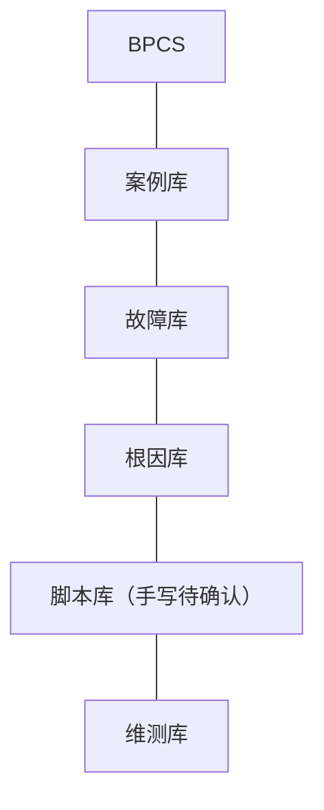
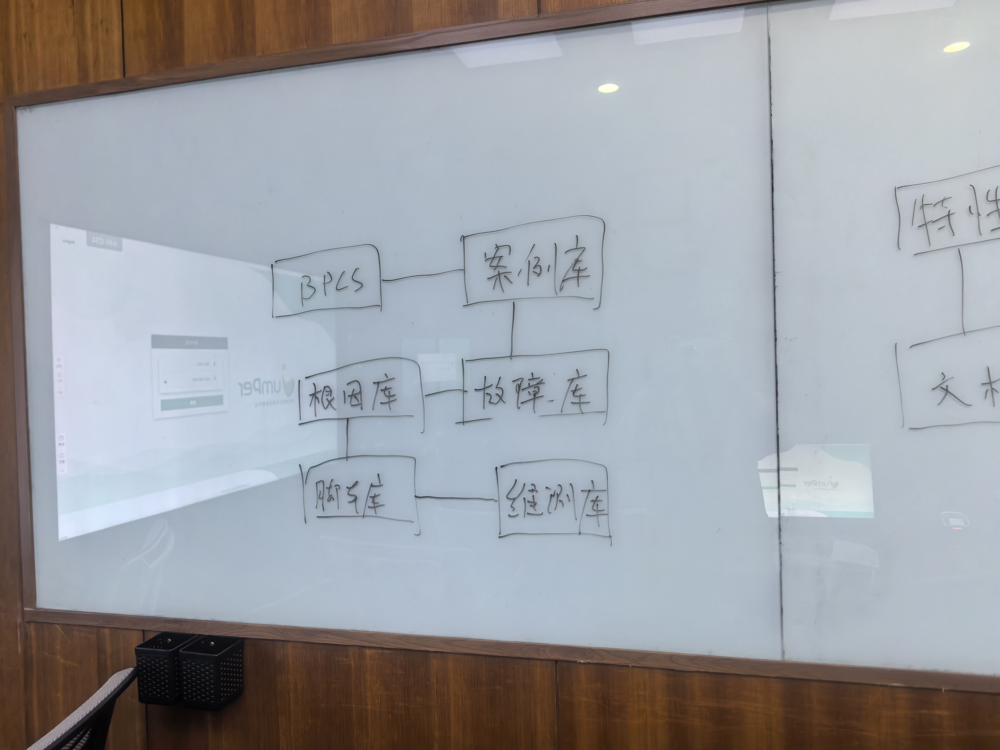

# 通信解决方案测试：测试分析知识全景图

> 历史识别记录。统一设计见[测试分析域](../../测试分析域.md)；此处保留当时的识别结果和待确认项。

## 来源与识别范围

- 领域：测试分析；依据用户指定的领域和图中“案例库、故障库、根因库”等内容归类，原图未单独书写领域标题。
- 来源：用户提供的第 1 张白板照片，原始文件名为 `codex-clipboard-90fe1053-071d-466d-9bde-a68ce1165bfb.jpg`。
- 识别结果：左侧完整图包含 6 个框选节点、5 条关联连线。
- 左下方节点暂识别为“脚本库”，手写字形待确认；图和节点清单均保留此标记。
- 连线未标注箭头或关系名称，统一保留为无向关联，不据此推定分析顺序、数据流向或因果方向。
- 照片右侧另露出“特性”“文档”等局部内容，与第 2 张照片中的图相对应；不纳入本图，也不增补两张图之间的连线。

## 知识全景图

## 节点清单

| 编号 | 识别文字 | 位置及识别说明 |
|---|---|---|
| A01 | BPCS | 左上方；保留原图缩写，不展开全称。 |
| A02 | 案例库 | 右上方，与“BPCS”“故障库”相连。 |
| A03 | 故障库 | 右侧中部，与“案例库”“根因库”相连。 |
| A04 | 根因库 | 左侧中部，与“故障库”和左下方节点相连。 |
| A05 | 脚本库（手写待确认） | 左下方；暂按“脚本库”记录，节点名称需核对手写原文。 |
| A06 | 维测库 | 右下方，与左下方节点相连。 |

## 连线清单

以下“端点一／端点二”仅用于枚举连线，不表示方向。即使 A05 的文字尚待确认，该框与相邻框之间的连线仍可识别。

| 编号 | 端点一 | 端点二 | 原图关系标注 |
|---|---|---|---|
| AR01 | BPCS | 案例库 | 无标签、无箭头。 |
| AR02 | 案例库 | 故障库 | 无标签、无箭头。 |
| AR03 | 故障库 | 根因库 | 无标签、无箭头。 |
| AR04 | 根因库 | 脚本库（手写待确认） | 无标签、无箭头。 |
| AR05 | 脚本库（手写待确认） | 维测库 | 无标签、无箭头。 |

## 待确认信息

- 左下方节点 A05 的准确名称：目前暂读为“脚本库”，需确认手写文字。
- `BPCS` 的完整名称及其与案例库的具体关系：原图未提供，不推定为导入、同步或生产关系。
- “案例库—故障库”“故障库—根因库”等连线的具体语义、方向和数量关系：原图未提供。
- 本图“维测库”没有写出下级分类；测试执行图中的 `NV / MSP / AT / MML` 不直接补入本图。
- 两个领域中的“案例库”“维测库”是否为同一份资产，以及“脚本”与暂识别的“脚本库”如何关联：原图未明确，不新增跨领域关系。

## 原图

## 相关领域

- [测试执行域：原始图、知识库与 UModel 集成](../../测试执行域.md)
