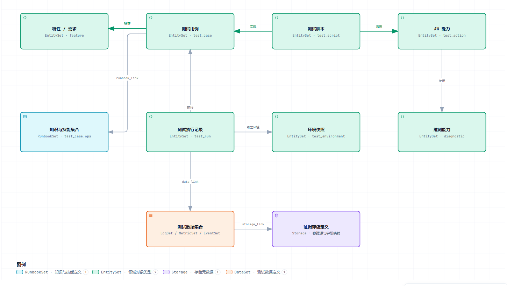
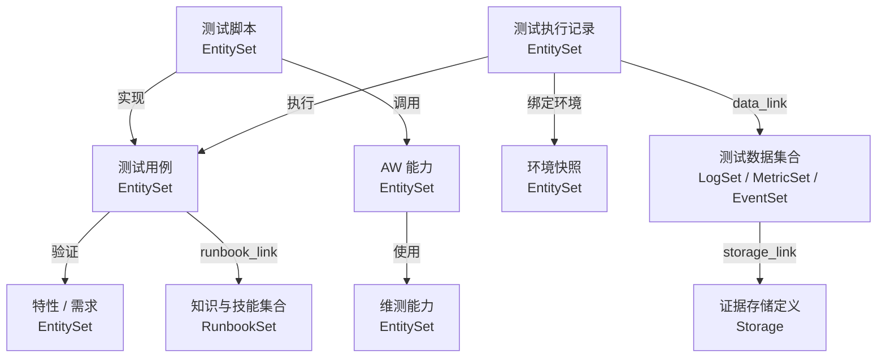

# 测试执行领域的 UModel 关系图

> 历史稿，仅供追溯。当前统一文档：[测试执行域](../../测试执行域.md)。

> 已由用户澄清：维测库是 NV、AT、MML、消息等知识库的合集。本页及其旧 HTML、截图将其解释为“维测能力”，该解释已失效；当前知识组织关系以[测试执行知识库关系图](测试执行-知识库关系图.md)为准。以下保留为历史提案。

状态：**拟建领域模型**。基于白板中的测试执行知识资产，补入执行记录、环境快照和证据数据；尚未导入 UModel，也未连接真实测试设备。

- [打开交互关系图](assets/测试执行-UModel关系图.html)：支持缩放、节点选择及三个主题视图。
- [图源 JSON](assets/测试执行-UModel关系图.architecture.json)
- [生成校验回执](assets/测试执行-UModel关系图.delivery.json)
- [多尺寸检查回执](assets/测试执行-UModel关系图.visual-check.json)

## 关系总览



箭头表示关系方向，不代表工作流顺序。业务关系名称属于设计建议，白板原图只提供了无向连线。以下 Mermaid 与交互图表达相同的主干关系。



## 三类关系的承载方式

| 类别 | 图中的关系 | UModel 承载方式 |
|---|---|---|
| 领域对象关系 | 用例验证特性、脚本实现用例、脚本调用 AW、AW 使用维测能力、执行关联用例与环境 | 用 `entity_set_link` 定义类型之间的语义关系；具体实例关系经 EntityStore 写入，通过 `.topo` 查询。 |
| 知识与工作方法关联 | 测试用例关联知识与技能集合 | 用 `runbook_link` 连接 EntitySet 和 RunbookSet；通过公开的发现方法获取适用 Knowledge / Skill。 |
| 数据查询映射 | 执行记录关联测试数据，测试数据关联存储 | 用 `data_link` 和 `storage_link` 描述数据集、存储和字段映射。它们不是数据复制或自动采集的动作。 |

## 白板资产的对应位置

| 白板资产 | 建议位置 |
|---|---|
| 特性 | `feature` 对象；记录规范与需求版本引用。 |
| 用例 | `test_case` 对象；记录适用条件、参数与断言定义引用。 |
| 脚本 | `test_script` 对象；记录脚本版本、步骤及实现位置。 |
| AW | `test_action` 对象；暂按可复用测试动作建模，全称仍待确认。 |
| 维测库 | 拆为 `diagnostic` 能力对象；记录命令定义与适配器引用，代码由外部执行器承载。 |
| 文档、案例库、AW 调用规则 | 作为可定位、可版本化的 Knowledge；工作方法作为 Skill；通过对象关联找到适用内容。 |

图中的英文对象名是拟建示例，不是仓库已有的通信领域模型。图按主干聚合展示：特性与需求可进一步拆开；环境快照应展开设备、测试床及资源绑定；LogSet / MetricSet / EventSet 应分别定义。

## 一次实际执行如何挂接

示例实例关系：

```text
RUN-102 ──executes──> TC-001@v3
RUN-102 ──uses──────> ENV-SNAPSHOT-008
```

- `RUN-102` 还应固定脚本版本、AW 实现版本和判定规则版本；总览未逐一展开这些版本引用。
- 环境快照记录本次设备型号、软件版本、测试床配置和资源绑定。
- 日志、指标、事件通过 `run_id` 等字段关联；抓包、截图、报告保存为外部证据及其引用。
- 后续可展开 `StepRun`、AW 调用记录、`AssertionResult` 与证据对象。运行记录由执行器产生，用例定义不因本次运行而被覆盖。

## Agent 与执行器的边界

1. Agent 经 Query Service 定位用例、对象关系以及适用 Knowledge / Skill。
2. Runtime 根据真实工具注册信息、权限和执行条件，选择可用的 AW 实现。
3. 外部测试执行器占用资源、驱动设备、执行步骤与断言，保存原始证据。
4. 执行摘要及实例关系经 EntityStore 写回；Agent 经 Query Service 查询结果并引用证据。

UModel 中的 Skill、工具或规则描述不自动形成可执行能力。当前 Query Service 负责返回定义或下游数据查询计划，不能据此宣称已完成设备调用或数据采集。

## 参考与检查

- [原始测试执行白板识别](通信解决方案测试-测试执行知识全景图.md)
- [Query Service 的实际边界](../../../docs/zh/guides/query-service.md)
- [RunbookSet schema](../../../schemas/core/dataset/runbook_set.schema.yaml)
- [Skill Runner 工作协议](../../../skills/umodel-skill-runner/SKILL.md)

交互图类型为 `architecture`，用于表达对象关系总览。最终通过 9/9 showcase 检查，0 个错误、0 个警告；在 1440×900、1600×1000、1920×1080、2048×1320 下通过页面容纳检查。已人工查看最小和最大尺寸的浅色、深色截图，无节点遮挡、连线交叉或页面裁切。视觉检查后的定向修订为 1 轮。

最终文件校验值：

```text
specification_sha256: 60df9161db2f588c16b97e5a3e5d83a490dab35dda154a2006666bcff80d4a45
artifact_sha256: e3aa8dbda8f5fb0f3ca83c0ad455ee15e383c5580404db8e941a5f73b01a8ce6
visual_review: passed
correction_rounds: 1
```
