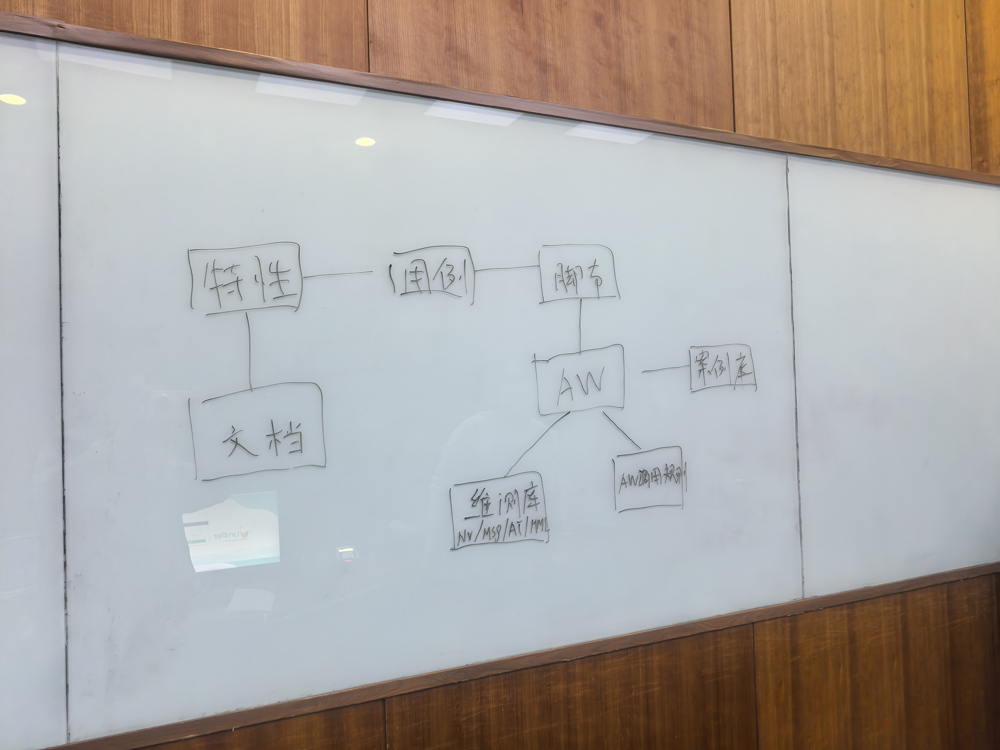
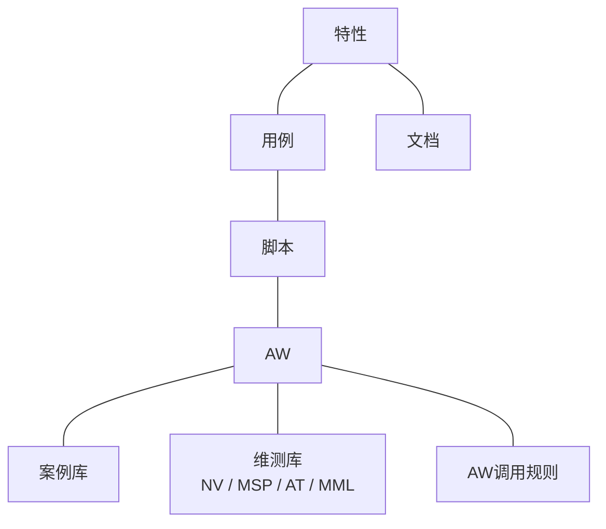
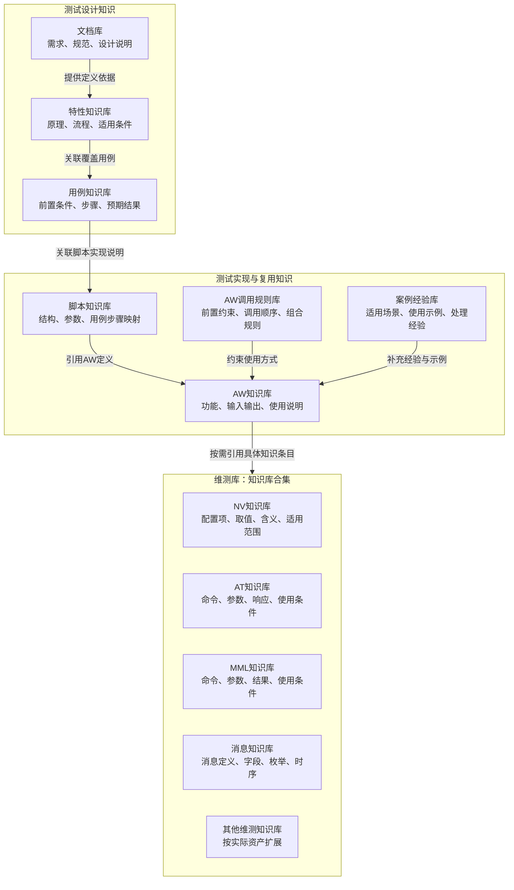
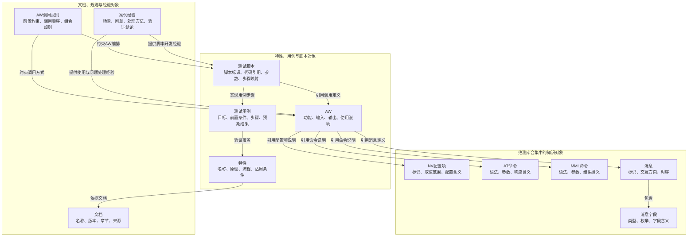
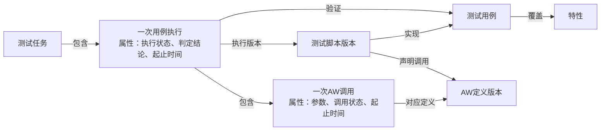
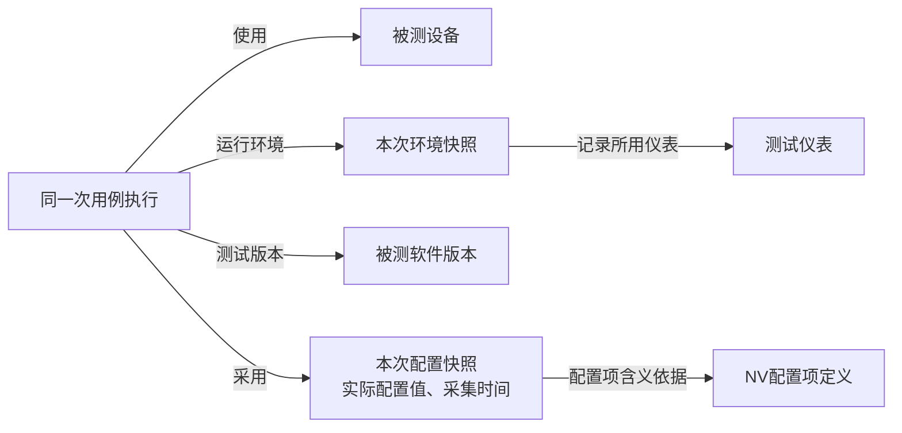
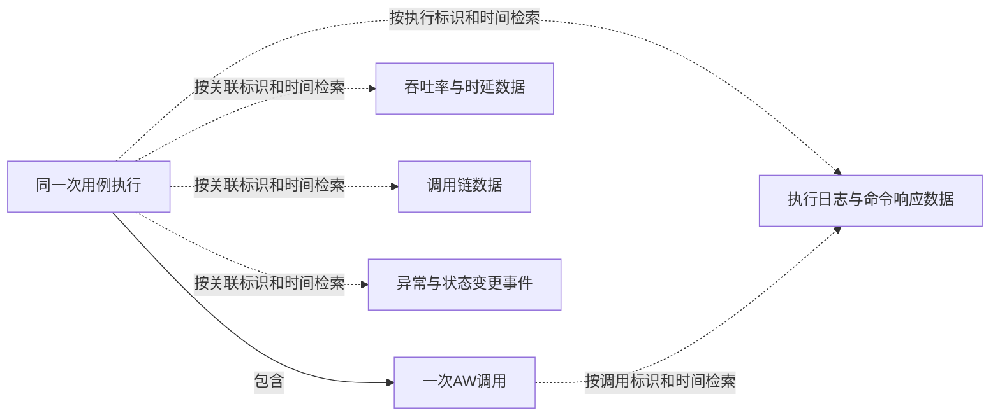
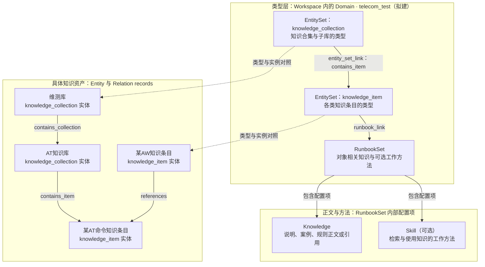

# 测试执行领域：知识库关系图

> 历史稿，仅供追溯。当前统一文档：[测试执行域](../../测试执行域.md)。

状态：包含原始知识全景、知识对象关系，以及扩展的测试业务全景建模建议。维测库已明确为 **NV、AT、MML、消息等知识库的合集**；它只占完整 UModel 建模范围的一部分。

后续设计：[测试执行域设计：参考 UModel 现有示例](测试执行域-UModel设计.md)。本文的原始图与知识关系继续保留；后面的执行对象分视图为早期候选，实际实体粒度以新设计为准，逐次 AW 调用、软件版本和配置快照不再默认独立实体化。

业务现状更正：用户已明确实际系统没有版本管理。当前设计使用“用例、脚本、AW”业务对象；本文后半部早期候选图中的版本、快照假设不作为当前要求，以新设计中的统一图和历史边界说明为准。

## 原始知识全景图

用户提供的测试执行白板原图：



以下 Mermaid 保留原图的 8 个节点、7 条无向连线，不增加关系方向或语义标签。维测库框内的 `NV / MSP / AT / MML` 沿用首次转录，其中 `MSP` 手写待确认；用户已明确维测库包含 NV、AT、MML、消息等知识库，整理后的模型见下一节。



## 整理后的知识库关系图



## 关系的含义

- 所有节点均表示知识资产；箭头表示定义依据、覆盖关联、实现映射、引用、约束或经验关联，不是执行流程。
- “维测库”是集合边界，内部包含 NV、AT、MML、消息等知识库，不再表示设备操作能力或适配器集合。
- AW 知识记录 AW 的定义与用法；脚本知识记录脚本的结构、参数和用例映射。实际代码可以通过来源引用关联，但代码执行不属于本图。
- AW 到维测库的连线是合集层的简写。落到条目时，应指向实际需要的 NV 项、AT 命令、MML 命令、消息或消息字段；不表示每个 AW 都依赖所有子库。
- 子库框内的小字是建议的知识组织内容；除用户确认的维测库组成外，关系命名与内容细分均为建模建议。
- 各类条目可以继续关联原始文档、版本和适用条件；总览只画主要关系，未绘制每条来源引用。

## 从库到条目的落地方式

| 层级 | 示例 | 主要保存什么 |
|---|---|---|
| 知识库合集 | 维测库 | 子库目录、分类、共同检索入口。 |
| 子知识库 | NV、AT、MML、消息知识库 | 本类知识的组织结构和条目索引。 |
| 具体知识条目 | 某 NV 配置项、某 AT 命令、某消息字段 | 定义、参数或取值、适用范围、来源与版本。 |
| 跨库关系 | 某 AW 引用某命令；某脚本引用某 AW | 条目之间可追溯的引用与使用约束。 |

案例经验库与 AW 调用规则库保持独立：案例经验保存具体场景、使用示例与处理经验，规则保存明确的使用约束，二者均可关联到具体 AW 条目。

## 具体知识对象关系图（屏蔽平台术语）

保留具体业务对象的类型、属性和关系，分别展开特性、用例、脚本、AW、NV 配置项、AT 命令、MML 命令、消息等对象。节点用业务名称，连线用“覆盖、实现、引用、约束、提供经验”等表达，不把这些对象收拢成一个“对象类别”或“知识条目”节点。



- 每个框分别表示一种业务知识对象，框内第二行是建议的属性或正文内容；具体特性、用例、AW、命令等按来源中的业务标识关联，不要求存在版本号。
- 图中的“文档”“AW 调用规则”“案例经验”分别对应前面文档库、规则库、案例经验库中的具体条目；NV、AT、MML、消息及消息字段对应维测库各子库中的条目。
- 关系表达知识定义、实现映射、引用和约束。脚本到 AW 的边记录调用定义，不表示正在执行；AW 按需关联具体维测条目，不要求同时引用所有类别。
- 案例经验明确关联脚本开发，也可关联 AW 的使用与问题处理。调用规则既说明 AW 的使用条件，也可以约束脚本中的 AW 组合与顺序。
- 各对象保留实际来源与适用条件；版本等信息仅在来源提供时记录。为避免总览连线过密，只画出“特性依据文档”这一条来源示例。
- 本图是逐类展开的业务对象视图。后文通用知识条目的存储方式仅是实现备选，不表示将这些业务类别合并，也不引入设备执行或资源调度。

## UModel 的完整建模范围：知识只是其中一部分

以一次通信测试失败为例：需要知道执行了哪个用例和脚本版本、在哪台设备和哪个环境运行、当时使用什么配置、产生了什么日志与指标，再结合命令说明、调用规则和案例经验解释失败。前面的知识图只覆盖最后一部分及相关静态定义，不能替代完整业务对象图。

以下六个方面是便于理解的归纳，不是官方规定的六种 Kind，也不是六个互斥的数据分区。

| 方面 | 要回答的问题 | 本场景的具体内容 | UModel 对应机制 |
|---|---|---|---|
| 对象与实例 | 有什么对象？当前是哪一个？ | 特性、用例、脚本、AW、设备、环境、软件版本、测试任务、一次执行、一次 AW 调用 | EntitySet 定义类型与字段，Entity records 保存具体对象；知识条目也可以作为对象。 |
| 关系与拓扑 | 对象之间如何关联？ | 用例覆盖特性、脚本调用 AW、执行使用设备、设备连接仪表、执行采用配置快照 | 类型关系定义与具体 Relation records；关系可带业务属性。 |
| 观测数据 | 发生了什么？表现如何？ | 执行日志、吞吐率与时延、调用链、异常事件、性能剖析 | 日志、指标、链路、事件、剖析数据集及对象到数据的字段映射。 |
| 知识与操作方法 | 如何理解、分析或处理？ | 文档、NV/AT/MML/消息定义、规则、案例经验、排查步骤、工具说明与技能 | 对象关联的知识、操作手册、技能等定义；表达方法不等于执行方法。 |
| 数据来源与映射 | 数据在哪里？如何精确找到？ | 设备台账、执行平台、日志平台、指标平台、文档库；执行标识和设备标识的字段对齐 | 来源链接、Storage、数据与存储链接、字段映射；实际访问能力取决于接入实现。 |
| 范围与组织 | 哪些模型和数据属于同一个上下文？ | 产品或项目工作空间，测试设计、测试执行、测试分析等语义域 | Workspace 隔离上下文，Domain 组织命名；不自动等同于完整权限或治理体系。 |

还要横向区分**模型定义与具体记录**：“测试执行”是一种对象类型，“执行 R001”是一条对象记录；“执行使用设备”是一种关系，“R001 使用设备 D001”是一条具体关系。指标定义也不同于某时刻采集的指标值。设备、任务、知识条目都可以有具体对象记录，不能把“实例”仅理解成运行日志。

### 节点与连线如何取舍

前版把执行、环境、数据和知识关系集中在一张图中，又把“判定结果”默认画成独立节点，阅读负担偏大。线条数量本身不是判断标准；每条线都应对应一个明确的业务问题、关系事实或数据定位规则。

本场景按以下原则收敛：

| 表达方式 | 选择条件 | 例子 |
|---|---|---|
| 独立对象节点 | 需要稳定标识，且需要单独查询、复用、追踪或关联其他对象 | 用例、脚本版本、设备、一次执行、一次 AW 调用。 |
| 对象属性 | 描述某个对象的一项状态、数值或简单结论，无需独立管理 | 执行状态、开始时间、通过/失败结论、耗时。 |
| 对象间关系 | 两个对象之间有明确业务语义，并能由来源记录或确定规则建立 | 执行采用脚本版本、执行使用设备、调用对应 AW 定义。 |
| 数据定位映射 | 原始数据保存在其他平台，按标识、时间等条件查找 | 用执行标识和时间范围查询日志、指标、事件；不逐条创建图实体边。 |
| 说明性文字 | 只是在解释用途，没有需要维护的具体对象关联 | “经验帮助分析日志”不默认生成每条经验到每份日志的关系。 |

多个视图中出现的“同一次执行”使用同一标识，不重复存储。视图隐藏某条线不等于删除底层事实；能够推导的关系也不能仅为少画线而删除，例如脚本可复用于多个用例时，一次执行实际选择的用例仍需明确记录。

### 测试场景分视图（屏蔽平台术语）

以下是建议扩展的业务模型，尚未导入或实现。每类对象仍分别展开，只按要回答的问题拆图，不收拢成一个抽象“对象”节点。图示用例、脚本和 AW 是可关联版本的定义资产；执行和调用是具体发生记录。

**视图一：这次执行测了什么，调用了什么？**

本图约定“一次用例执行”对应一个选定用例及一轮运行尝试；批量执行由测试任务包含多个用例执行。重试产生新的执行记录。



“脚本声明调用”描述代码设计，“本次 AW 调用”描述实际发生的调用。两者不能互相替代；条件分支未必执行，循环也可能产生多次调用。

**视图二：这次执行用了什么环境和配置？**



设备状态和环境会变化，历史执行需保留当时的版本与配置上下文。这里假设软件版本作为可复用、可独立追踪的发布资产建模；若只需要保存一个版本字符串，也可以先作为执行属性。配置中的每个实际值先作为快照字段，不为每个值另建节点。

**视图三：从哪里取得本次执行的观测证据？**



虚线表示数据定位映射，不表示必须保存一条条实体关系。日志、指标、链路和事件节点代表数据集合；原始数据可以留在原平台。若指标只有设备标识而没有执行标识，应结合本次使用的设备和时间窗口定位，并保留共享设备导致的归属不确定性。

**知识关系沿用前面的“具体知识对象关系图”。** 文档、规则、案例经验、NV、AT、MML、消息和字段继续分别展开。排查步骤与工具说明可按场景引用这些知识；只有确实引用了某条知识或证据时，才记录具体引用，不将“指导分析”泛化为到所有日志、指标的固定关系。

维测库始终是知识库合集。AT 命令说明、一次调用和实际响应分别属于知识定义、执行事实和观测数据，不混为同一个对象。工作空间、数据来源及字段映射仍按前面的维度表覆盖各视图。

### 判定结果默认是属性，判定记录按需独立

对一个执行只有一个最终通过/失败结论的情况，建议把结论作为执行属性，不额外创建“判定结果”节点。例如：

```yaml
执行标识: R001
执行状态: 已完成
判定结论: 不通过
判定时间: 2026-11-16T10:05:00+08:00
判定规则版本: latency-rule-v3
判定摘要: 时延超过阈值
```

以上为虚构示例。“执行已完成”描述运行过程，“判定不通过”描述测试结论，应分开保存。设备连接中断导致无法完成测试时，不应仅凭执行异常自动得出被测功能不通过。

出现以下需求时，再引入有独立标识的**判定记录**：

- 一次执行包含多个检查项，每项有独立结论、阈值和证据。
- 同一份执行数据需要由不同规则版本重新判定，且旧结论必须保留。
- 需要追踪自动判定、人工复核、改判以及各自的责任人与时间。
- 某次判定需要被问题单、报告或其他分析独立引用。

此时结构为“一次执行 → 多条判定记录”；每条记录保存检查项、结论、规则版本、判定时间及证据引用，按需求再关联独立管理的规则或证据对象。独立节点是一次具体判断，而不是抽象的“通过”或“失败”值。执行上的总判定可作为派生摘要，但需明确汇总规则和采用的判定版本。

图建模的通用参考：[Neo4j 的节点、关系与属性说明](https://neo4j.com/docs/getting-started/data-modeling/)、[中间节点建模示例](https://neo4j.com/docs/getting-started/data-modeling/modeling-designs/)。本节的拆图方式与判定建模选择是针对本测试场景的设计建议，不是 UModel 强制规则。

### Agent 如何使用这些维度

对“为什么执行 R001 失败”，建议的读取链路是：找到 R001 → 沿关系取得用例、脚本版本、设备、软件与配置快照 → 根据执行标识和时间范围定位日志、指标和事件 → 读取相关命令定义、规则和经验 → 给出带证据的判断。若需要操作设备，由外部执行平台或工具实施，并回写新的执行记录与证据。

当前仓库 Query Service 可读模型、对象与关系，并发现相关知识和技能；`get_logs` / `get_metrics` 返回下游查询计划，本身不执行外部存储查询。数据采集、设备控制、脚本运行和判定引擎需要相应外部系统接入。这张完整图描述建议的语义组织，不代表这些通信测试能力已经实现。

依据：[对象图语义层](../../../docs/zh/concepts/object-graph-semantic-layer.md)、[DataSet](../../../docs/zh/concepts/datasets.md)、[Entity 与 Relation](../../../docs/zh/concepts/entities-and-relations.md)、[Link 与字段映射](../../../docs/zh/concepts/links-and-field-mappings.md)、[Query Service](../../../docs/zh/guides/query-service.md)。

## 知识子图的 UModel 承载对照

以下仅对照前面的知识子图：知识库视角回答“知识如何分类、哪些内容互相引用”；承载视角回答“这些知识对象如何定义、标识、关联及查询”。完整 UModel 范围见上一节，不能从本表推断 UModel 仅覆盖知识。

下面按八个问题梳理 UModel 的承载维度。这是便于理解的归纳，既包含模型元素，也包含作用范围和访问机制，不表示八种互斥的内置 Kind。

| 维度 | UModel 对应概念 | 本场景如何理解 |
|---|---|---|
| 范围 | Workspace、Domain | Workspace 是隔离上下文；Domain 是语义命名空间。可在一个知识工作空间内使用 `telecom_test`，不要求每个知识库都成为独立 Domain。 |
| 对象类型 | EntitySet | 定义知识集合、知识条目的字段和标识规则。`knowledge_collection`、`knowledge_item` 是本场景拟建的 EntitySet 名称，不是内置 Kind。 |
| 具体对象 | Entity records | 维测库、AT 库、某个 AW、某条 AT 命令分别是可标识的知识资产记录。这里的实体记录也可以承载稳定知识资产，并不只表示设备状态或执行日志。 |
| 关系 | `entity_set_link`、Relation records | 前者定义类型之间的关系语义，后者保存具体对象之间的边，例如“维测库包含 AT 库”“某 AW 引用某 AT 条目”。 |
| 正文与方法 | RunbookSet、`runbook_link`、内部 Knowledge / Skill 项 | 将说明正文、经验、规则说明和可选的工作方法关联到对象类型及适用实体上下文。Knowledge / Skill 是 RunbookSet 内部配置项，不是同级独立 Kind。 |
| 数据与存储映射 | DataSet、`data_link`、`storage_link`、Storage | 描述对象相关数据及实际存储。RunbookSet 也属于 DataSet 类别；NV、AT 等“知识分类”不需要因此改成 LogSet 或 MetricSet。 |
| 底层持久化 | GraphStore provider | 保存模型定义、实体和关系。它与用于描述外部数据源的 Storage 模型职责不同。 |
| 查询与发现 | Query Service | `.umodel` 读模型定义，`.entity` 读具体资产，`.topo` 读实例关系；实体关联的 Knowledge / Skill 通过对应发现方法读取。 |

## 知识库视角与 UModel 视角对照

| 知识库视角 | 建议的 UModel 表达 | 保留的语义 |
|---|---|---|
| 维测库合集 | 一个 `knowledge_collection` 实体 | `collection_kind=collection_group`，包含多个子库。 |
| NV、AT、MML、消息等子库 | 各自一个 `knowledge_collection` 实体 | `collection_kind=library`，保存分类、名称与来源引用。 |
| 某个 NV 项、AT 命令、MML 命令、消息字段 | 各自一个 `knowledge_item` 实体 | `item_kind` 区分知识类别，保留条目标识、版本、适用范围和正文引用。 |
| 特性、用例、脚本、AW、案例、规则等条目 | 同样作为知识条目建模；需要明显不同的字段与校验时再拆分 EntitySet | 先表达知识定义与引用，不自动升级为设备操作或执行记录。 |
| 合集包含子库、子库包含条目 | `contains_collection`、`contains_item` 等关系定义与具体边 | 维测库—AT 库—AT 条目的组织结构。 |
| 脚本引用 AW、AW 引用某维测条目 | `references` 等关系定义与具体边 | 引用落到精确条目，而不仅是整库关联。 |
| 条目的说明正文、案例解释、规则说明 | RunbookSet 内的 Knowledge，或由受控读取器读取的外部正文引用 | 正文保留来源与版本；读取定义不等于已经获取外部内容。 |
| Agent 使用这些知识的工作方法 | 按需关联 RunbookSet 中的 Skill | 工作方法与参考知识分开；规则说明不自动成为执行门禁。 |

本表中的名称、字段与关系谓词均是建模建议，尚未创建或导入。“通用知识集合 + 通用知识条目”是一种存储备选，业务对象仍按前图逐类展开；若 NV、消息、用例等需要独立的结构化字段和校验，可拆成专用 EntitySet，并保留原有集合归属与引用关系。

## UModel 承载关系图（与知识库图对照）

以下区分类型层、具体资产层和正文层。虚线只用于对照“类型与实例”，不表示额外需要写入的业务关系。



为保持可读性，类型层省略了两个同类型关系定义：`knowledge_collection → knowledge_collection` 的 `contains_collection`，以及 `knowledge_item → knowledge_item` 的 `references`。具体资产层已展示对应边；AT 库与维测库属于同一集合类型，AT 条目与 AW 条目属于同一条目类型。

例如，“维测库包含 AT 库”和“某 AW 引用某 AT 命令”可以被独立检索；该 AT 命令的长篇说明则作为正文关联。这样既保留原来的知识库目录，也支持沿具体条目查找引用者、适用范围和来源。

## 对应现有能力与后续边界

- **现有机制**：Workspace / Domain、EntitySet、模型与实体关系、RunbookSet 及实体关联知识发现等，均有仓库文档或实现依据。
- **拟建内容**：`telecom_test`、知识集合与知识条目 EntitySet、完整图中的通信测试对象、关系谓词及业务字段。并未将其宣称为 UModel 已有的通信测试模型。
- **条目与正文要显式对齐**：`runbook_link` 连接对象类型和 RunbookSet；具体条目需要结合实体过滤、明确的正文引用和上下文选择规则取得适用内容。自定义的 `body_ref` 等字段不会自动解引用，也不能认为每个实体天然对应一篇 Knowledge。
- **版本要分清**：`schema.version` 表示模型 Schema 校验版本。协议版本、文档版本、知识修订号和适用产品版本，应另行记录为业务字段或引用。
- **访问边界**：当前 Query Service 读取模型、实体、关系，并返回关联知识定义或下游数据查询计划；不会因此自动下载正文、执行 Skill 或调用设备。本文补充执行事实的建模建议，没有实现执行平台。
- **契约待统一**：当前 RunbookSet schema 将 `knowledge` 字段标为 `deprecated`，而 Query Service 文档和实现仍提供 `list_knowledge`。正式导入前需统一内容承载契约；本文只做维度对照，不在此轮修改 Schema。

依据：

- [Workspace 与 Domain](../../../docs/zh/concepts/workspaces-and-domains.md)
- [模型元素与 Kind](../../../docs/zh/concepts/model-elements.md)
- [Link 与字段映射](../../../docs/zh/concepts/links-and-field-mappings.md)
- [Storage 与 GraphStore](../../../docs/zh/concepts/storage-and-graphstore.md)
- [Query Service](../../../docs/zh/guides/query-service.md)
- [RunbookSet schema](../../../schemas/core/dataset/runbook_set.schema.yaml)
- [实体关联查询实现](../../../internal/query/executor.go)

## 与此前图稿的关系

- [白板识别原稿](通信解决方案测试-测试执行知识全景图.md) 保留原图转录，便于追溯。
- [此前 UModel 执行模型提案](测试执行-UModel关系图.md) 将“维测库”解释为“维测能力”，该解释已被本次用户确认纠正；其旧 HTML、截图与 Mermaid 不作为当前知识库关系模型。
- 白板转录中的 `MSP` 是当时的手写待确认项，本次不将其擅自解释为“消息”，也不据此排除其他子库。
- 知识子图保留原来的知识组织边界；新增完整场景图补充执行记录、设备、环境和观测数据等建模建议，没有实现设备控制、资源调度或判定引擎。
