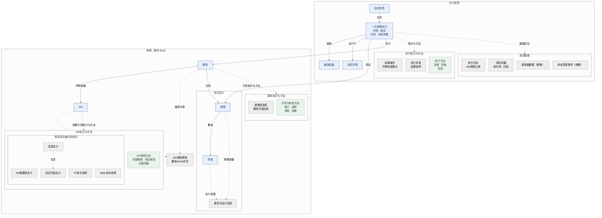

# 测试执行域设计：参考 UModel 现有示例

> 历史稿，仅供追溯。当前统一文档：[测试执行域](../../测试执行域.md)。

状态：2026-11-16 根据本地仓库现有示例重新设计。本文是领域设计提案，不代表已经创建 workspace、导入模型、接入设备或运行测试。业务图屏蔽平台方言，技术映射与模型片段单独列出。

设计结论：以**一次用例执行**作为运行上下文中心；测试执行域先保留**测试任务、用例执行、脚本、AW**四类对象。特性与用例从测试设计域引用，设备与测试环境从实验室域引用。执行结论作为属性，逐次 AW 调用先作为日志或调用链记录；知识、观测数据和物理存储分别关联。

业务现状约束：用户已确认没有版本管理。用例、脚本、AW 使用实际业务标识和当前属性，不引入版本对象；执行快照仅为可选增强。

## 1. 先看一个具体执行

以下标识与数值均为虚构的设计示例。

测试任务 T001 要执行“网络注册”用例 C001。第 1 次尝试 R001 使用脚本 S001 和设备 D001，在测试环境 E001 中运行。脚本声明调用 AW A001；本次实际调用了两次，第二次超时。C001、S001、A001 都是业务对象标识，没有附加版本号。

- **对象**：任务 T001、执行 R001、用例 C001、脚本 S001、AW A001、设备 D001、测试环境 E001。
- **执行属性**：运行状态、判定结论、起止时间、尝试次数，以及实际记录到的参数和环境信息；没有记录的字段不补造。
- **执行数据**：两次调用的参数与响应、调用时间、日志、测量值；通过执行标识和尝试次数定位。
- **参考知识**：用例前置条件、AW 调用规则、相关 AT 命令及消息定义、脚本开发案例经验。

这里的“超时”还不足以断定被测功能失败：需要区分设备无响应、测试工具异常、执行环境异常和用例预期不满足。运行状态与测试结论分开记录，依据保留在对应数据中。

## 2. 现有示例中实际采用了什么设计

| 已检查的示例文件 | 能直接看到的做法 | 本场景采用方式 |
|---|---|---|
| [devops.pipeline](../../../examples/quickstart-multidomain/umodel/devops/entity_set/devops.pipeline.yaml) | `status`、`last_run_result`、`source_branch` 是字段，没有为每个状态或结果值建立实体。 | 执行状态、判定结论作为属性；另外保留每次执行对象，避免只保存最后一次结果而丢失历史。 |
| [devops.deployment](../../../examples/quickstart-multidomain/umodel/devops/entity_set/devops.deployment.yaml) | 一次部署作为实体，`version`、`commit_sha`、`artifact` 作为字段。 | 借鉴“执行事实有独立身份、描述信息用字段承载”的做法；不照搬示例的版本、commit 或制品管理要求。 |
| [service-localization](../../../examples/service-localization/README.zh-CN.md) 与 [跨域读写关系](../../../examples/service-localization/cross-domain/link/entity_set_link/service.app_reads_writes_data.store.yaml) | 产品、服务、数据、基础设施按语义域分工，再通过有业务含义的关系连接。 | 执行、设计和实验室资产分清归属，复用对象身份，不在执行域复制一套设备和用例。 |
| [服务到日志映射](../../../examples/service-localization/service/link/data_link/service.app_related_to_service.app.logs.yaml)、[日志集](../../../examples/service-localization/service/log_set/service.app.logs.yaml)、[日志到存储映射](../../../examples/service-localization/service/link/storage_link/service.app.logs_to_elasticsearch.yaml) | 对象 `id` → 逻辑日志 `target_id` → 物理字段 `svc_id`，查询条件经过两层映射。 | 执行对象 → 执行日志/测量数据 → 实际数据源；不把每条日志建成图实体。 |
| [服务运维手册](../../../examples/incident-investigation/platform/runbook_set/platform.service.ops.yaml) 与 [手册关联](../../../examples/incident-investigation/platform/link/runbook_link/platform.service_to_platform.service.ops.yaml) | 对象关联观察方法、知识、技能与工具说明；正文与对象拓扑分别表达。 | 执行准备方法关联执行对象，脚本开发经验关联脚本，维测知识关联 AW，不把所有内容塞进执行实体。 |

这不是逐项复制示例：`pipeline.last_run_result` 不能代替测试执行历史；示例中的工具和自动化声明也不等于开源服务已具备执行器。以 [Query Service 实际接口](../../../docs/zh/guides/query-service.md) 与 [查询实现](../../../internal/query/executor.go) 为能力边界，避免把示例中的声明直接描述成运行能力。

## 3. 领域归属与范围

建议在同一个 workspace 中使用下面三个逻辑域，以便跨域关联。域表示语义归属，不要求部署三个系统，也不把域命名等同于权限控制。以下名称均为拟建名称。

| 逻辑域 | 负责对象 | 责任边界 |
|---|---|---|
| 测试执行 `test_execution` | 测试任务、用例执行、脚本、AW | 脚本实现与执行事实、执行数据关联、执行方法。 |
| 测试设计 `test_design` | 特性、用例 | 特性定义、测试目标、前置条件、步骤、预期与覆盖关系。 |
| 实验室 `test_lab` | 被测设备、测试环境 | 设备及环境身份、类型与当前可用状态；历史上下文以当时实际留存的执行记录为准。 |

知识库不强制一库一域。NV、AT、MML、消息库仍是维测库合集的成员，案例经验库与 AW 调用规则库各自独立；可继续由现有知识系统负责内容。

测试执行域负责把执行准备、执行事实、结果及证据组织起来。故障假设、根因判断、问题单生命周期属于后续测试分析设计；本次只保留可交付给分析域的证据，不设计整套分析域。

## 4. 哪些建立实体，哪些不建立

### 4.1 四类执行域核心对象

| 对象 | 建议类型名称 | 一条记录代表什么 | 主要字段与身份 |
|---|---|---|---|
| 测试任务 | `test_execution.task` | 一次提交的测试批次，可包含多个用例和尝试 | 来源系统、原始任务 ID、状态、触发方式、参数引用、提交时间；不与可复用计划模板混为一体。 |
| 用例执行 | `test_execution.run` | 一个用例、一个参数组合的一轮运行尝试 | 原始运行 ID、尝试次数、状态、结论、起止时间，以及实际采集的参数和证据；重试创建新执行记录，不是创建用例的新版本。 |
| 脚本 | `test_execution.script` | 业务系统中的一条脚本记录 | 原始脚本 ID、名称、实际提供的路径或代码引用、入口、参数约定、依赖 AW 标识；不要求仓库、commit 或内容 hash。 |
| AW | `test_execution.aw` | 业务系统中的一个可复用 AW | 原始 AW 标识、名称、输入输出约定、实际提供的实现引用、适用范围。AW 全称仍按原图保留，不猜测扩写。 |

脚本和 AW 可被多个用例执行复用，且需要查找依赖与适用知识，因此保留为实体；每次调用的时间与响应则先保留为数据记录。业务系统修改同一条用例、脚本或 AW 时，更新同一对象的当前属性，不创建虚构的修订对象或版本链。

### 4.2 引用的四类外域对象

| 对象 | 建议类型名称 | 使用方式 |
|---|---|---|
| 特性 | `test_design.feature` | 通过用例覆盖关系访问，不为每次执行重复建立“执行 → 特性”关系。 |
| 用例 | `test_design.test_case` | 执行通过业务标识指向选定用例；脚本可能支持多个用例，不能仅从脚本反推本次选择。 |
| 被测设备 | `test_lab.device` | 沿用设备台账的稳定身份，执行与设备的关系可记录主被测/辅助等角色。 |
| 测试环境 | `test_lab.environment` | 表示本次测试使用的资源与配置上下文，可包含仪表、网络连接、工具及配置；具体内容按业务系统实际记录描述，不假设已有快照能力。 |

这八类是初期选择，不是 UModel 内置的通信对象，也不是为了凑固定数量。若实际没有可独立标识的测试环境记录，可先保留执行中已有的环境字段，不制造无业务身份的环境对象。

### 4.3 不默认实体化的内容

| 内容 | 初期承载 | 何时升级为实体 |
|---|---|---|
| 通过、失败等结论 | 执行属性 `verdict`，与运行状态 `status` 分开 | 需要独立复判、审计或跨报告引用时，建立“判定记录”，不是为“通过/失败”值建立节点。 |
| 多个检查项结果 | 执行数据中的检查记录，包含检查项、阈值、实测值、结论和证据 | 需要独立生命周期、复核和跨对象引用时；仅有多条记录不必升级。 |
| 一次 AW 调用 | 日志记录或 span；按实际采集保留 `invocation_id`、`aw_id`、时间、参数、响应及状态 | 需要独立调度、恢复、审批或独立关联问题时，再定义调用实体。 |
| 被测软件标识 | 源系统如有 build/软件标识，可作为可选执行属性；无则不填写 | 以后确有独立软件发布管理需求时再设计，不作为当前模型前提。 |
| 环境与配置记录 | 当前系统实际留存的参数、日志或附件；执行时复制一份内容是可选后续增强 | 确有独立管理需求且能采集时再设计；不要求先建设快照或版本管理。 |
| 测试仪表 | 测试环境信息或本次执行记录中实际提供的仪表身份、型号与设置 | 需要独立占用、校准、健康检查、故障关联时，在实验室域建立仪表实体。 |
| NV 实际取值 | 本次执行实际记录的配置值 | 不为每个值建立实体；配置项定义另属知识。 |
| 日志、指标采样、消息实例 | 有执行上下文的数据集记录 | 通常继续保留在数据平台；只有业务需要独立追踪的记录才另建实体。 |

### 4.4 无版本管理时的身份与历史边界

本设计不要求新增版本号、revision 对象、commit、内容 hash 或版本锁定清单。

- **身份按业务对象确定**：通常用“来源系统 + 原始对象 ID”确定同一对象；若没有独立 ID，再确认来源中的稳定唯一键，不能仅凭相同展示名合并。
- **修改更新当前对象**：C001、S001、A001 的内容修改后仍是原对象，同步其当前属性；不因为修改而自动创建新对象。
- **执行记录保留发生事实**：R001、R002 是两轮执行，分别记录时间、结果、实际参数和当时已采集的响应；执行次数不等于定义版本。
- **历史内容不能反推**：R001 指向 S001 只能说明当时选择了这条业务脚本；若 S001 后来被覆盖且当时未留存原文，就不能从当前 S001 恢复 R001 使用的确切脚本。知识说明及当前依赖关系同样不能自动代表过去。
- **快照是可选增强**：以后如需更强追溯，可在执行时附存当时内容和采集时间；这不是要求现有系统具备版本管理，也不能补回过去没有采集的内容。

## 5. 一张统一语义关系图

在同一个 workspace 内，对象、对象关系、相关数据、知识与方法共同组织成一张统一语义图。测试设计、测试执行、实验室是图内的语义域，不是三张互不相通的图。前版拆成多个阅读视图，却遗漏了脚本和 AW 的方法挂接，不能完整表达这个设计；以下统一图替代前版四幅局部图。

需要区别模型定义与具体实例：UModel 同时包含模型图和运行时对象/关系记录；统一语义图不等于所有内容都是同一种运行时节点。下图是业务语义总览，展开对象类型、数据类别及知识/方法内容；落实到某次执行时，通过业务对象身份、字段映射和实际适用条件选择对应内容。参见 [对象图语义层](../../../docs/zh/concepts/object-graph-semantic-layer.md) 与 [模型/运行时关系](../../../docs/zh/concepts/entities-and-relations.md)。

- **实线**：业务对象之间的关系。
- **虚线**：对象相关的数据、知识、方法绑定，或知识内容组成；连到分组边框时，是该对象到组内条目的绑定汇总，具体含义见下表，不表示新增一个合集实体。
- **分组框**：按“测试定义、执行现场、脚本开发、AW 使用”组织阅读。具体知识仍逐类展开，观测数据和配套内容就近分组；分组不是独立图或存储库。
- **阅读顺序**：先看任务、执行、脚本、AW 的主关系，再看旁边的配套分组。同一来源的多条内容绑定只画一条到组边框的线；AW 调用规则保留两条明确引用，表示脚本与 AW 共享它。



[查看已渲染的分组总图](assets/测试执行域-分组总图.png)。Markdown 中的 Mermaid 是可编辑源图；图片是本次排布检查的静态预览，不同 Mermaid 渲染器的具体排布可能略有差异。

分组连线展开后的挂接语义如下。图中省略重复线条，具体内容类别和绑定对象没有合并：

| 对象 | 知识挂接 | 方法挂接 |
|---|---|---|
| 用例执行 | 前置条件与环境检查要点、执行异常处理说明 | 执行准备、证据采集、复跑方法。 |
| 脚本 | AW 调用规则、案例经验库中的脚本开发经验 | 接口与编排检查、参数准备、依赖核对方法。 |
| AW | AW 调用规则、适用的 NV/AT/MML/消息及字段说明 | 参数解释、响应解读、证据采集方法。 |

规则节点由脚本和 AW 共享，前置条件引用所选用例，文档节点由特性和用例引用；这些共享内容不因挂到多个对象而复制多份。内容按业务标识、适用产品和上下文选取，不要求版本字段；图中的类型级连线不表示每个 AW 都引用全部维测条目。

脚本声明依赖来自脚本清单或可追溯解析结果；实际调用来自观测记录。实际调用的 AW 标识按采集能力写入调用记录，不能仅凭静态依赖图认定被执行。执行不重复连接所有静态 AW 依赖，Agent 可以沿脚本关系查找定义，再用调用记录确认事实。

知识类别分别可识别、可引用，但不因此全部需要 EntitySet。初期可采用带稳定业务标识、适用范围和来源的正文条目或外部条目引用；更新时间仅在来源提供时记录，不自行生成版本号。总图中的知识内容节点可对应对象相关内容集合中的条目，不保证在原生实例拓扑中各占一个节点；如需在实例图中逐条遍历或反向查询“哪些 AW 引用了这条 AT 命令”，则将相关条目提升为独立对象，并显式维护引用边。知识文本中提到某命令，不自动生成可查询关系。

## 6. 关系清单与维护依据

初期对象拓扑只有下面八类关系；观测数据和知识绑定另计，不混入实体拓扑数量。

| 来源 → 目标 | 关系建议 | 数量语义 | 来源与用途 |
|---|---|---|---|
| 任务 → 执行 | `contains` | 一个已运行任务包含多次执行，每次执行属于一个来源任务 | 执行平台任务记录。 |
| 执行 → 用例 | `validates` | 每次执行选定一个用例 | 执行请求中的用例业务标识。 |
| 执行 → 脚本 | `executes` | 自动化场景选定一个入口脚本 | 执行请求或调度记录中的脚本标识；手工测试可缺省，不构造假脚本。 |
| 执行 → 设备 | `uses` | 可有多台设备，关系记录角色 | 实际资源分配与执行清单；未分配的排队任务可以暂缺。 |
| 执行 → 测试环境 | `runs_in` | 每次执行关联实际选定的测试环境 | 执行请求和实际资源配置；无历史环境记录时标注缺失，不用环境当前状态替代历史。 |
| 用例 → 特性 | `covers` | 一个用例可覆盖多个特性 | 用例设计覆盖表。 |
| 脚本 → 用例 | `implements` | 可多对多 | 脚本与用例映射清单。 |
| 脚本 → AW | `depends_on` | 脚本可声明多个 AW 依赖 | 现有依赖配置或可追溯解析结果；未知动态依赖不得凭模型补造。 |

类型关系由模型定义，具体关系由来源系统同步；仅声明类型链接或保存一个 `task_id` 属性，不会自动生成所有实例边。若同时保存来源外键与关系记录，应由同一写入逻辑同步，避免两份事实不一致。

## 7. 观测数据、映射与物理存储

| 数据类别 | 建议模型 | 初期字段/用途 | 接入边界 |
|---|---|---|---|
| 执行日志与 AW 调用记录 | `test_execution.run.logs`：LogSet | 来源系统、原始运行 ID、尝试次数、时间、级别、步骤/调用 ID、AW 标识、消息、响应或附件引用 | 第一优先；调用记录保留参数与响应，但敏感值按来源策略处理。 |
| 测试测量 | `test_execution.run.metrics`：MetricSet，或先保留结构化测量记录 | 吞吐率、时延等，明确单位、聚合口径和执行归属 | 有可用时序数据源时再配置 MetricSet；不要把大量短命运行 ID 无条件塞进生产监控标签。 |
| 调用链 | `test_execution.run.traces`：TraceSet | 调用 ID、父调用 ID、AW 标识、开始/结束时间、状态 | 按需；没有 span 采集链路时不承诺存在。 |
| 状态变更 | `test_execution.run.events`：EventSet | 排队、资源就绪、启动、终止等事件 | 按需；模型可描述不等于已有对应数据查询适配器。 |

采用 service-localization 的两层映射方式。例如：

| 执行实体字段 | 逻辑日志字段 | 物理字段示例 |
|---|---|---|
| `source_system` | `source_system` | `producer` |
| `source_run_id` | `run_id` | `execution_id` |
| `attempt_no` | `attempt_no` | `attempt` |

物理字段是示意，必须按实际源契约确认。三个条件一起确定一轮执行，避免不同系统或重试间混查。起止时间另外作为时间范围，不把 `started_at` 映射成日志时间的等值条件。若源数据缺失尝试标识，先由采集端补齐，或明确隔离查询的不确定性。

日志正文、采样、pcap、截图等仍可保存在原平台。保存来源、实际附件地址及所属执行；若地址内容会被覆盖，需标明它不能保证还原历史。执行时留存副本或计算摘要属于可选增强，摘要本身也不能恢复原内容。最终 Storage 类型按实际系统选用；不因为示例用了 Elasticsearch/Prometheus 就要求替换现有平台。

## 8. 知识与操作方法如何承载

| 挂接对象 | 参考内容 | 工作方法 |
|---|---|---|
| 用例执行 | 用例前置条件、环境检查要点、执行异常处理说明 | 检查前置条件 → 获取执行参数和资源 → 调用执行平台 → 采集并关联证据。 |
| 脚本 | AW 调用规则、案例经验库中的脚本开发经验 | 检查接口与顺序、参数准备、依赖 AW 核对。 |
| AW | 对应 NV/AT/MML/消息/字段说明、实际适用范围与使用约束 | 参数解释、响应解读、所需证据采集。 |
| 特性/用例 | 规范、设计文档、测试预期依据 | 定位当前定义与适用条件；不将当前内容视为历史执行时的原文。 |

技术上可参照 incident-investigation 的 RunbookSet 及对象挂接方式，但以下边界必须保持：

- **内容挂到具体上下文**：不得把全量维测库正文复制到每次执行。按脚本/AW 的业务标识及适用条件选择条目，内容可保留在原知识系统。
- **沿图显式查找**：执行关联脚本，脚本关联 AW，不代表 `list_knowledge` 会自动递归收集全部下游知识。当前发现依赖直接可见的挂接；Agent 需要先找对应对象，再查询其关联内容。
- **说明与执行分开**：规则说明不自动成为强制门禁，技能定义不自动运行脚本，工具说明不等于已接通设备。前置校验、授权、幂等提交、占用与释放由执行平台/Agent Runtime 实现。
- **契约现状**：现有示例和查询实现使用 `knowledge`，而当前 [RunbookSet schema](../../../schemas/core/dataset/runbook_set.schema.yaml) 将该字段标为 deprecated。设计保留知识语义；批量生成正式知识包前需决定兼容策略，不在此文修改 Schema。

## 9. 最小模型片段

以下五个模型元素演示任务、执行、包含关系、日志集和数据绑定，格式参照仓库 YAML。它们不是完整的八对象模型包：未定义其余外域对象、Storage/StorageLink、知识挂接或实际实体记录，也未接入任何真实数据源。`schema.version` 是 Schema 校验版本，不是脚本、AW 或产品版本。

### 9.1 测试任务

```yaml
kind: entity_set
schema: {url: umodel.aliyun.com, version: v1.0.0}
metadata:
  name: test_execution.task
  domain: test_execution
  display_name: {zh_cn: 测试任务, en_us: Test task}
spec:
  fields:
    - {name: id, type: string}
    - {name: display_name, type: string}
    - {name: source_system, type: string}
    - {name: source_task_id, type: string}
    - {name: status, type: string}
  primary_key_fields: [id]
  id_generator: id
  name_fields: [display_name]
```

### 9.2 一次用例执行

```yaml
kind: entity_set
schema: {url: umodel.aliyun.com, version: v1.0.0}
metadata:
  name: test_execution.run
  domain: test_execution
  display_name: {zh_cn: 用例执行, en_us: Test case run}
spec:
  fields:
    - {name: id, type: string}
    - {name: display_name, type: string}
    - {name: source_system, type: string}
    - {name: source_run_id, type: string}
    - {name: attempt_no, type: integer}
    - {name: status, type: string}
    - {name: verdict, type: string}
    - {name: started_at, type: time}
    - {name: ended_at, type: time}
  primary_key_fields: [id]
  id_generator: id
  name_fields: [display_name]
  ordered_fields: [display_name, status, verdict, source_run_id, attempt_no]
```

### 9.3 任务包含执行

```yaml
kind: entity_set_link
schema: {url: umodel.aliyun.com, version: v1.0.0}
metadata:
  name: test_execution.task_contains_run
  domain: test_execution
spec:
  src: {domain: test_execution, kind: entity_set, name: test_execution.task}
  dest: {domain: test_execution, kind: entity_set, name: test_execution.run}
  entity_link_type: contains
```

### 9.4 日志集

```yaml
kind: log_set
schema: {url: umodel.aliyun.com, version: v1.0.0}
metadata:
  name: test_execution.run.logs
  domain: test_execution
spec:
  fields:
    - {name: timestamp, type: time}
    - {name: source_system, type: string}
    - {name: run_id, type: string}
    - {name: attempt_no, type: integer}
    - {name: level, type: string}
    - {name: invocation_id, type: string}
    - {name: aw_id, type: string}
    - {name: message, type: string}
  time_field: timestamp
  name_fields: [message]
  tag_fields: [source_system, run_id, attempt_no, level]
  ordered_fields: [timestamp, run_id, attempt_no, level, message]
  default_order: desc
```

### 9.5 执行到日志的映射

```yaml
kind: data_link
schema: {url: umodel.aliyun.com, version: v1.0.0}
metadata:
  name: test_execution.run_related_to_logs
  domain: test_execution
spec:
  src: {domain: test_execution, kind: entity_set, name: test_execution.run}
  dest: {domain: test_execution, kind: log_set, name: test_execution.run.logs}
  data_link_type: related_to
  fields_mapping:
    source_system: source_system
    source_run_id: run_id
    attempt_no: attempt_no
```

写入端需把稳定源键规范化为 UModel 接受的实体 ID，并保留可回溯的原始 ID；`R001` 是业务标识示例，不是可直接套用到任意拓扑调用中的实体 ID。类型定义不会自动抓取执行平台记录或生成所有关系。已结束运行需有明确保留策略，不照抄示例中的心跳/保活时间来删除历史执行证据。

## 10. Agent 的使用路径

### 执行前

1. 根据用例业务标识找到合适脚本及关联的 AW，读取系统当前可用的参数契约。
2. 根据脚本和 AW 的适用上下文读取规则、案例经验及需要的维测条目。
3. 通过外部平台确认资源、前置条件与参数；记录用例、脚本、AW、设备等实际业务标识及本次实际参数。有能力时可留存当时内容，不以建设版本管理为前提。
4. 外部平台创建任务/执行，返回身份；同步器写入实体和具体关系。调用可重入时使用平台幂等键，避免重复提交。

### 执行中及结束后

1. 执行平台提供状态与事件；采集器为日志、调用、测量附上来源、执行标识和尝试次数。
2. 更新执行状态与判定摘要，保留证据来源和判定依据；执行异常不自动变成被测功能失败。
3. Agent 从执行对象查看关联设备/资产及可用数据集；生成查询计划后，由外部读取器获取数据。
4. 需要解释调用时，沿调用记录中的 AW 标识找到适用说明；说明若是当前内容，应与当时的响应证据区分，不宣称它就是当时定义。
5. 复跑建立新的尝试记录，继续关联同一业务用例、脚本和 AW。只比较两轮实际记录到的参数、配置和证据差异，不能推断未留存的内容差异。

以下为模型导入并写入数据后的查询模板，本轮没有执行。`ids` 中的占位符必须换成上一条返回的 `__entity_id__`。

```text
.entity with(domain='test_execution', name='test_execution.run')
| where source_system = 'lab_runner' and source_run_id = 'R001' and attempt_no = 1
| project __entity_id__, display_name, status, verdict, source_run_id, attempt_no

.entity_set with(domain='test_execution', name='test_execution.run', ids=['<执行实体ID>'])
| entity-call list_data_set(['log_set', 'metric_set'], true)

.entity_set with(domain='test_execution', name='test_execution.run', ids=['<执行实体ID>'])
| entity-call get_logs('test_execution', 'test_execution.run.logs')
```

最后一条还需要完整 Storage 和 StorageLink 才能获得实际存储计划。当前 `get_logs` / `get_metrics` 返回计划，不直接查询外部平台；查询时间范围需由调用者设置并核对。TraceSet/EventSet 可作为模型描述，但不能据此假设存在 `get_traces` / `get_events` 方法。知识正文下载、Skill 执行与设备操作也由外部 Runtime 承担。

## 11. 验证与落地顺序

设计评审先回答：能否唯一找到某一轮执行及其关联业务对象；能否取到该轮实际留存的证据；能否区分当前定义与历史事实；能否区分执行异常与功能失败；重试是否不会覆盖前一轮。未保存历史内容时，完整复现不作为已具备能力。

落地时先做一个用例、一台设备、一份脚本、一个 AW 的闭环；再补跨任务复用、并行设备和可独立管理的仪表，不为尚不存在的来源系统造数据。

- 本轮只新增设计文档及旧图稿的导航说明，原始白板和知识分类保持原样。
- 已将五段模型 YAML 提取到临时目录，使用仓库 `ConfigValidator` 和当前 `expanded_schemas` 校验：5/5 通过，错误和警告均为 0；另检查片段间端点引用与字段映射一致性。
- 统一图保留 25 个具体节点，使用分组边框汇总重复绑定，可见连线由 27 条减为 17 条（8 条业务对象关系、9 条数据/知识/方法汇总或内容组成连线）。执行、脚本、AW 均明确连接各自配套分组，共享规则只保留一个节点。已检查端点与分组归属，并实际渲染及查看分组总图，预览保存在 `assets/测试执行域-分组总图.png`。
- `git diff --check` 通过，并补查未跟踪文档的尾随空白及乱码。未运行服务测试：本轮只修改设计文档，没有改动代码或正式示例包；静态通过不等于真实导入、数据查询或设备运行成功。
- 未接入执行平台、外部日志/指标源或知识正文读取器；未执行运行时查询模板。

## 12. 与已有图稿的关系

- [原始测试执行知识全景图](通信解决方案测试-测试执行知识全景图.md)：保留原图文字及无向关系，作为来源证据。
- [测试执行知识库关系图](测试执行-知识库关系图.md)：知识部分继续有效；其中早期运行视图是候选展开，实体粒度以本文为准。
- [早期 UModel 关系图](测试执行-UModel关系图.md)：曾将维测库解释成执行能力，已经标记为历史稿，不作为本设计依据。

本次相对上一轮的关键收敛：用例、脚本和 AW 按现有业务对象建模，不要求版本管理；逐次 AW 调用不默认建立实体；判定结论作为属性；软件标识、环境记录和知识元数据只按实际来源提供，不补造。知识条目逐类保留，是否进入实体图取决于独立查询和关系维护需要。
