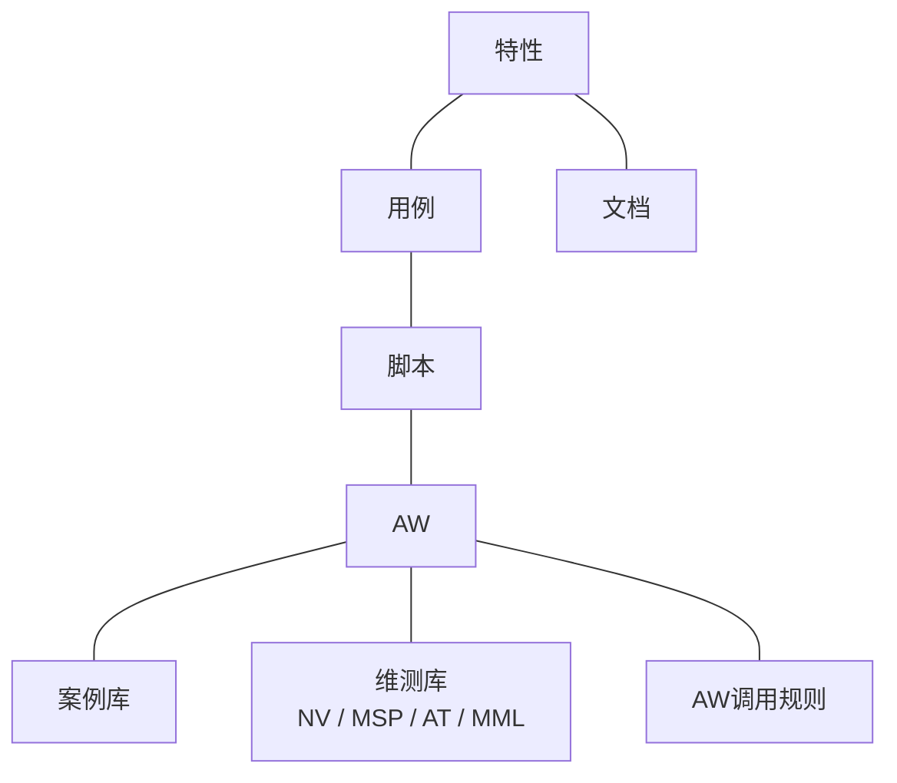
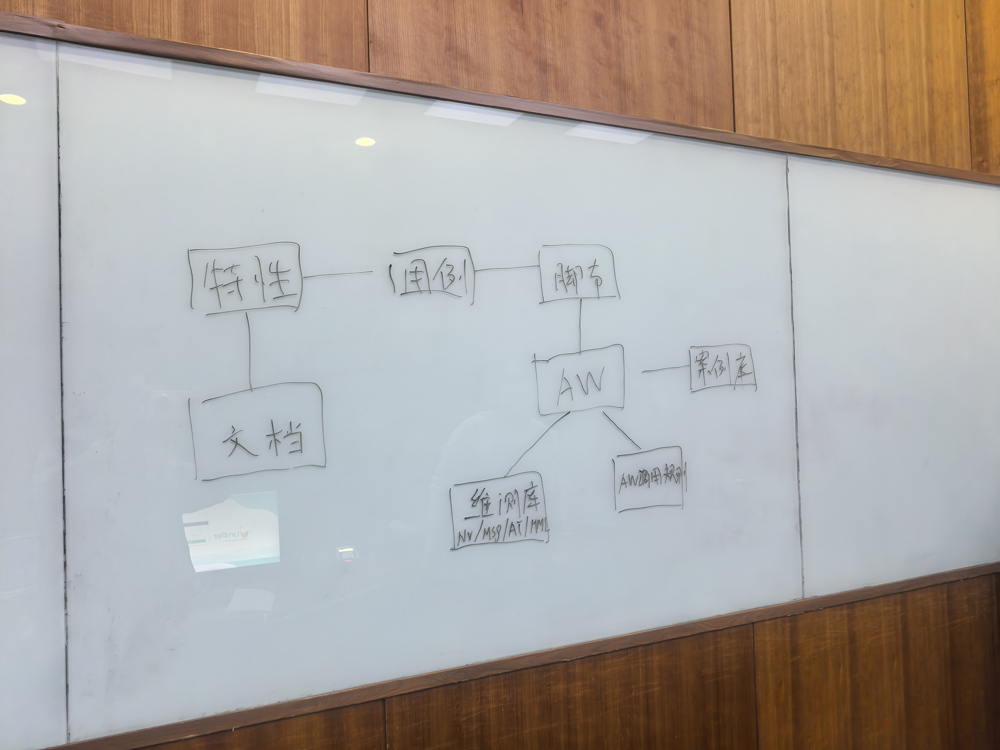

# 通信解决方案测试：测试执行知识全景图

> 历史稿，仅供追溯。当前统一文档：[测试执行域](../../测试执行域.md)。

## 来源与识别范围

- 领域：测试执行；依据用户指定的领域和图中“特性、用例、脚本、AW”等内容归类，原图未单独书写领域标题。
- 来源：用户提供的第 2 张白板照片，原始文件名为 `codex-clipboard-2960fac7-80f3-4a7d-8a8f-3d60836dbcf9.jpg`。
- 识别结果：8 个框选节点、7 条关联连线；`NV / MSP / AT / MML` 是“维测库”框内的附注，不另算节点。
- 连线未标注箭头或关系名称，统一保留为无向关联，不据此推定执行顺序、调用方向或数据流向。
- 缩写按原图保留，不补写未经确认的全称或业务定义。

## 知识全景图

## 节点清单

| 编号 | 原图文字 | 位置及附注 |
|---|---|---|
| E01 | 特性 | 左上方，与“用例”“文档”相连。 |
| E02 | 用例 | 上方中间，与“特性”“脚本”相连。 |
| E03 | 脚本 | 上方偏右，与“用例”“AW”相连。 |
| E04 | 文档 | “特性”下方。 |
| E05 | AW | “脚本”下方，是下半部分多个节点的关联中心。 |
| E06 | 案例库 | “AW”右侧。 |
| E07 | 维测库 | “AW”左下方；框内另写有 `NV / MSP / AT / MML`。 |
| E08 | AW调用规则 | “AW”右下方。 |

## 连线清单

以下“端点一／端点二”仅用于枚举连线，不表示方向。

| 编号 | 端点一 | 端点二 | 原图关系标注 |
|---|---|---|---|
| ER01 | 特性 | 用例 | 无标签、无箭头。 |
| ER02 | 特性 | 文档 | 无标签、无箭头。 |
| ER03 | 用例 | 脚本 | 无标签、无箭头。 |
| ER04 | 脚本 | AW | 无标签、无箭头。 |
| ER05 | AW | 案例库 | 无标签、无箭头。 |
| ER06 | AW | 维测库 | 无标签、无箭头。 |
| ER07 | AW | AW调用规则 | 无标签、无箭头。 |

## 待确认信息

- `AW` 的完整名称及业务定义：原图未提供。
- `NV / MSP / AT / MML` 的完整名称及各自在维测库中的分类含义：原图未提供；其中第二项手写暂识别为 `MSP`，待确认。
- 各条连线的具体语义：例如覆盖、实现、调用、约束或参考，原图没有标注，暂不指定。
- 本图的“案例库”“维测库”与测试分析图中的同名节点是否指向同一份知识资产：原图未明确。

## 原图

## 相关领域

- [测试分析域：原始图、知识库与 UModel 集成](../../测试分析域.md)
