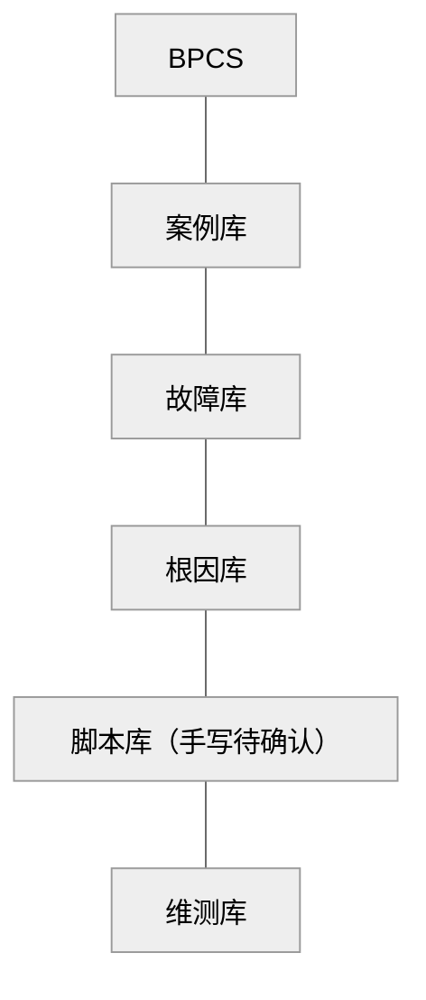
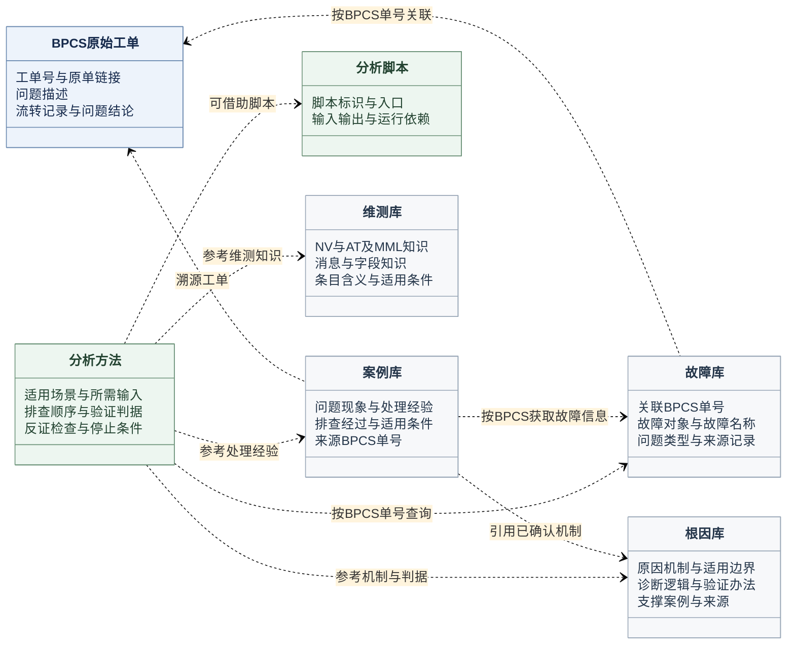
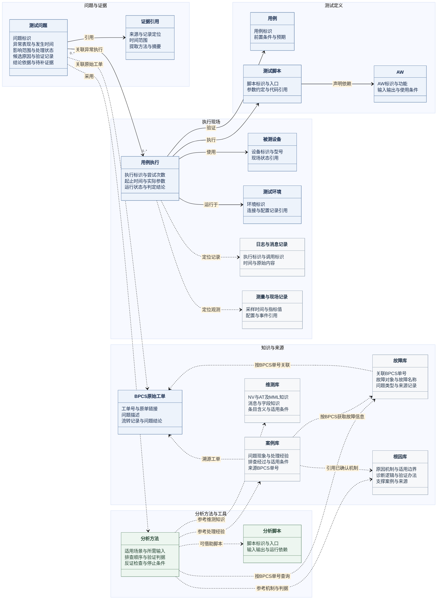

# 测试分析域：知识全景与 UModel 集成

测试分析从一次异常或一组异常执行出发，结合现场数据、历史经验和分析方法，解释发生了什么、有哪些可能原因、还缺什么证据，以及如何验证。执行域提供用例、脚本、AW、设备和测试环境；分析域组织问题与证据，使用案例库、根因库、故障库和维测库开展分析，保留知识与 BPCS 工单的来源联系。

例如，“用例执行超时”只是现象。分析需要区分设备未响应、测试环境异常、脚本参数不当、响应解析失败等可能原因，最后用本次证据形成结论。检索到相似案例，可以帮助提出假设，但不能直接证明本次根因。

## 原始图

依据原始白板重绘，保留 6 个节点和 5 条无向连线。原图未标关系名称和箭头，不将这些连线解释成分析流程或因果链。

“脚本库”的手写识别仍待确认；后续暂按分析脚本理解。原图中的 BPCS 已确认为 BPCS 原始工单，主要保存问题描述、流转记录、问题结论等单据信息。下文统一使用“案例库”和“根因库”作为知识集合名称。故障库按 BPCS 查询故障对象、故障名称、问题类型等信息。维测库包含 NV、AT、MML、消息及字段知识，在领域图中合并为一个节点；后续有向关系属于设计补充。

## 知识库视角

这一视角保留知识库、原始来源以及知识的使用关系。BPCS 原始工单是必要的来源节点，保存工单号、问题描述、流转记录和问题结论；案例库、根因库、故障库与维测库围绕这些资料提供可复用知识。分析方法和脚本沿用已有关系，用于说明如何使用知识。

当前由 LLM Wiki 将工单整理成案例与根因内容，分别承载在案例库、根因库中。图中只省略 LLM Wiki 加工节点，保留工单信息和来源关系；页面载体用“案例库、根因库”的业务名称表达。

蓝色表示原始工单，灰色表示知识库，绿色表示分析方法与辅助脚本。不同角色在图中明确区分。

| 关系 | 含义 |
|---|---|
| 案例库溯源 BPCS 原始工单 | 保留来源单号和原单链接，能够回查问题描述、流转记录及原始结论。 |
| 故障库按 BPCS 单号关联原始工单 | 查询对应的故障对象、故障名称和问题类型，补充上下文与检索条件。 |
| 案例库从故障库获取工单故障信息 | 按案例来源的 BPCS 单号获取故障对象、故障名称、问题类型等信息，补充案例内容与检索属性。 |
| 案例库引用根因库 | 已确认的机制解释可被案例引用，根因知识保留支撑案例与证据边界。 |
| 分析方法参考知识库 | 使用案例经验、根因机制、故障信息及维测定义，组织排查和验证。 |
| 分析方法可借助脚本 | 脚本辅助提取、解析或比较数据，运行行为由外部环境完成。 |

库级连线表示具体条目之间可建立的关系，不表示库内全部内容都相互依赖，也不表示处理顺序。一份工单可以补充已有知识，不要求固定生成两份新内容；相同故障分类不代表同一根因。

分析方法是供 Agent 采用的步骤与判据，脚本是辅助实现。两张视图沿用同名的工单、知识库、方法和脚本节点；集成视图再补充测试问题、执行现场与证据。原工单结论、可复用知识与本次分析结论分别保留。

## UModel 集成视角

在与执行域相同的工作空间内，以“测试问题”为分析入口，直接关联原始工单、异常执行、证据、知识和方法。“待分析”是问题状态；定位、复测和关闭后仍是同一个问题对象。用例执行、设备、测试环境、脚本和 AW 复用执行域对象。

总图从“测试问题”展开两条阅读路径：一条关联执行现场与证据，另一条采用分析方法、读取知识。BPCS 原始工单、四类知识库、分析方法与脚本沿用知识库视图的命名和职责。分析过程默认保留在问题属性中，需要独立留存多轮排查时再增加从属于问题的“分析记录”。

| 图形 | 读法 |
|---|---|
| 蓝色节点 | 业务对象，包括 BPCS 原始工单和按需独立建模的证据引用；执行域节点复用原对象。 |
| 绿色节点 | 分析方法与辅助脚本。方法定义排查和验证步骤，本身不代表已经执行。 |
| 灰色节点 | 知识库或观测数据类别；库内的具体条目和记录通过标识定位，不要求逐条建成实体。 |
| 实线箭头 | 对象关联；按“主语—关系—宾语”阅读，不是排查时序。 |
| 虚线箭头 | 参考、方法依赖或数据定位；不表示已调用工具或完成根因确认。 |
| 分组边框 | 阅读分类，不是关系端点，也不是新增实体。 |
| `0..*` | 零到多个；未标数量的关系暂不约束数量。 |

问题与执行允许多对多，尚未定位执行时可暂不关联。这是本方案建议，不是原图或现有业务系统已确认的强制规则。

“分析方法”是供 Agent 采用的排查步骤与判断规则，包括所需输入、检查顺序、验证判据、反证检查和停止条件；分析脚本是可选的辅助实现。方法可以引用根因库中的诊断逻辑，无需重复维护一份内容。

“测试问题”直接关联原始工单、异常执行和证据，并采用适用的分析方法。Agent 按方法检索案例库、根因库、故障库与维测库，读取适用条目，再用现场证据验证。图中的“方法—参考—知识”是内容使用依赖，不代表方法自动执行，也不表示所有资料都已被取回。

主图省略的次要关系保留如下，避免重复铺设跨区连线：

| 起点 | 关系 | 终点或限定 |
|---|---|---|
| 根因库 | 参考定义与判据 | 维测库；按机制解释或诊断所需的具体条目关联。 |
| 根因库中的知识条目 | 溯源 | 支撑案例及其 BPCS 来源，保留各自适用条件与证据边界。 |
| 测试脚本 | 实现 | 用例；复用执行域已有关系。 |
| 证据引用 | 对应 | 用例执行，并定位具体日志、消息、测量或现场记录。 |
| 证据引用或分析脚本 | 参考解释依据 | 按内容选择具体 NV、AT、MML、消息或字段条目，图上统一为维测库。 |

故障对象、故障名称和问题类型用于检索及上下文补充，候选根因来自知识与证据的综合分析。每个候选在当前问题中记录“待验证、已排除、已确认”及依据，不另建“判断结果”节点。原工单结论、Wiki 提炼出的可复用知识、本次分析结论分别保留，不能互相替代。

### 在项目中的承载

下列名称和映射是本场景的设计建议，尚未创建模型包或导入运行数据。业务图保持中文，项目类型只在承载说明中出现。LLM Wiki 负责外部知识加工，UModel 保留知识库入口、具体条目引用与来源关系；加工工具和页面载体不作为领域关系节点。

| 内容 | UModel 中的承载 | 本场景的安排 |
|---|---|---|
| 业务范围 | 同一 Workspace 下的 Domain | 新增 `test_analysis`；复用执行域方案中的 `test_execution`、`test_design`、`test_lab`，不新建孤立的分析工作空间。 |
| 测试问题与分析信息 | EntitySet + 实体记录 | 建议 `test_analysis.issue`；采用来源业务标识，保存问题描述、处理状态、候选原因、验证记录、当前结论、依据和待补证据。 |
| 分析记录（可选） | 问题下的记录清单；需要独立管理时再建 EntitySet | 多轮排查或独立复核需要分别留存时，可使用 `test_analysis.analysis_record`，记录时间、输入范围、验证动作、证据及当轮结论。它从属于问题，不作为主入口。 |
| BPCS 原始工单 | 原工单及其分析扩展，或独立问题对象的外部来源 | 若业务上问题就是一张工单，直接用工单号识别问题，在同一实体上扩展分析属性。需要跨工单聚合时，再独立设置问题对象，并按需以 `test_analysis.bpcs_ticket` 关联原单；不重复创建业务工单。 |
| 证据引用 | 问题分析属性中的引用清单；需要独立复用时再建 EntitySet | `test_analysis.evidence` 只保存定位、摘要和提取方法。日志行、消息字段值不逐条变成图实体。 |
| 对象关系 | 关系类型定义 + 具体关系记录 | 问题关联工单与执行、问题引用证据、证据对应执行。按需扩展问题到分析记录的关系，不要求每次 Agent 调用都新增分析实体。 |
| 案例库与根因库 | RunbookSet 内容及外部知识引用；需独立拓扑查询时增加条目 EntitySet | 图中表达库级知识范围，实际读取时定位到具体条目标识与地址，保留 BPCS 来源、支撑案例和适用条件。将知识入口与方法一起挂接到测试问题；若需在 `.topo` 中查询条目关系，再建立条目实体和边，正文沿用现有存储。 |
| 故障库 | 外部查询入口及返回字段；按需保存属性或记录引用 | 按 BPCS 单号读取故障对象、故障名称、问题类型等信息。记录字段来源与对应单号，不预设故障模式实体，也不把这些字段当作根因确认或自动聚合键。 |
| 分析方法与脚本 | RunbookSet 中的方法、Skill 声明及外部脚本引用 | 将同一份分析方法直接挂接测试问题，写清知识检索入口、所需输入、排查与验证步骤。脚本登记入口与输入输出；需独立管理时使用 `test_analysis.analysis_script`，与执行域的测试脚本区分。 |
| 现场数据 | DataSet + 对象到数据的绑定 | 日志和消息记录优先按执行标识、调用标识、时间窗口定位；测量、配置和事件按实际数据源接入。图中数据分组不意味着混装为一个物理数据集。 |
| 数据与知识来源 | Storage、数据映射、外部内容地址 | 日志与指标使用数据集到存储的映射；Wiki 页面、故障查询结果和 BPCS 工单保留出处。具体接口、字段映射与同步方式按实际系统确定，不预设现成连接器。 |
| Agent 读取 | Query Service / MCP | 从问题或工单标识进入，用 `.entity` 找问题与相关执行，`.topo` 读关系，`.umodel` 查定义；按对象发现知识和方法，获取日志、指标查询计划后交给外部读取器。 |

图中的节点表达业务对象、知识集合、方法或观测数据，不要求全部建成独立 EntitySet。测试问题与 BPCS 原始工单的分离关联适用于独立问题对象；若工单直接承载问题，则合并承载，不建立重复实体。分析方法和所需知识入口直接挂接到问题，方法正文也可引用页面与查询入口；无需为了表达“使用知识”再创建独立的方法实体。Agent 按适用条件主动检索、读取内容，不能假定系统会沿图自动收集上下文或自动展开方法依赖。

### Agent 如何使用

以“执行 R001 报告命令响应超时”为例，下面只演示分析路径，不代表真实故障或已经验证的结果。

1. **定位问题及工单。** 从问题 P001 进入，关联 R001 和已有的 BPCS 工单；若工单就是问题，则复用工单号。读取原始描述、处理记录及执行时留下的参数、设备和环境信息。
2. **补充故障信息。** 按该 BPCS 单号查询故障库，取得故障对象、故障名称、问题类型及出处，作为检索条件。问题尚无 BPCS 单号时，先用已有现象检索；查询历史案例时，其故障信息仍归属于对应历史工单。
3. **采用方法、读取知识。** 选择适用的超时分析方法，检索案例库与根因库中的适用条目，核对场景与适用边界，再读取维测库中的命令、消息定义。“未收到响应”和“收到响应但未被解析识别”可列为候选原因，不能因为命中相似案例就直接确认。
4. **按方法取证和验证。** 根据执行标识与时间窗口取得日志查询计划，由外部读取器获取记录；必要时运行辅助脚本。比对发送、原始响应、关联标识和解析日志，记录支持、排除或仍缺失的证据。根因库中的诊断逻辑用来指导核验，不能代替当前证据。
5. **记录本次结论。** 将判断、依据、待补证据与验证结果保存在问题中。复跑产生新的执行记录并关联同一问题；需要核对 AW 语义时，继续读取执行域中该 AW 已挂接的知识与方法。
6. **增量更新知识。** 已核验的新事实和实际处理记录可作为 LLM Wiki 的补充来源，用于补充案例库、根因库中的知识及关联；没有新增知识时不必新增条目。本次尚未验证的假设不直接写成通用根因。

### 建模边界

- **来源、分类、知识与结论分开。** BPCS 保存原始记录，故障库提供对应分类信息，案例库与根因库沉淀经验与机制；本次结论由当前问题的证据支持。相同故障分类不代表相同根因。
- **问题作为稳定入口。** “待分析”是状态，不是永久对象类别。以问题为中心保存当前分析信息；已有工单能承载问题时沿用原业务标识，不重复建单。
- **按需保留过程记录。** 独立保存多轮排查、复核或审批时，再增加从属于问题的分析记录；它不是每次分析的前置条件，也不等同于每次 Agent 调用。证据需要复用、追溯时独立建节点，普通引用可保留在问题属性中。
- **保留来源与既有关系。** 知识库视图保留 BPCS 原始工单、知识库、分析方法及脚本，区分各自角色；集成视图补充问题、现场与证据。省略加工工具不意味着删除原始资料或使用关系，执行域对象延续已有的知识和方法绑定。
- **不增加业务版本管理。** 用例、脚本、AW 沿用现有标识。分析时能够还原哪些历史内容，取决于执行时实际留存的数据；当前配置不能当作当时配置。必要的证据摘录或快照是可选留存措施。
- **模型组织上下文，外部平台负责动作。** Query Service 提供模型、实体、关系读取及日志、指标查询计划；知识发现返回内容定义或引用，不自动下载正文、执行分析脚本、操作设备或发布案例。

设计参考了本仓库[故障排查示例](../examples/incident-investigation/README.zh-CN.md)的“对象关系 + 观测数据 + 方法引导”，以及[服务定位示例](../examples/service-localization/README.zh-CN.md)的逐层取数方式。实际接口边界以 [Query Service](../docs/zh/guides/query-service.md) 和 [MCP 参考](../docs/zh/reference/mcp.md)为准。与[测试执行域](测试执行域.md)共享对象和已确认的知识分类；原始识别记录保留在[历史资料](archive/测试分析/通信解决方案测试-测试分析知识全景图.md)中。

## 画法选择与参考

本场景采用“领域类图式总图 + 知识关系视角”：同一个模型按阅读目的投影，原始图用于溯源，知识图解释内容联系，集成图解释如何从测试问题找到现场、知识与方法。

| 画法 | 擅长表达 | 本次采用方式 |
|---|---|---|
| UML 类图 | 对象类型、属性、关联及数量约束。 | 采用原生名称栏、属性栏和关系标签；不引入没有业务依据的继承、组合或操作方法。 |
| ER 图 | 实体、属性及关系基数，也可用于概念和逻辑模型。 | 借鉴数量约束表达；暂不画成表结构，不增加主外键或必填数量规则。 |
| 属性图模型图 | 节点类型、关系类型及双方属性，区分模型与具体实例。 | 关系命名采用业务动词；关系必须有具体端点，检索相似度与验证状态属于本次分析上下文。 |
| C4 的标注原则 | 清楚标出范围、元素类型、关系含义和图例。 | 借鉴图例与标签规范；此处仍是领域关系图，不套用系统、容器、组件层级。 |

依据：Mermaid 官方 [Class diagrams](https://mermaid.js.org/syntax/classDiagram.html) 与 [Entity Relationship Diagrams](https://mermaid.js.org/syntax/entityRelationshipDiagram.html)、Neo4j 官方 [Graph data modeling](https://neo4j.com/docs/getting-started/data-modeling/guide-data-modeling/)、C4 官方 [Notation](https://c4model.com/diagrams/notation)。前两项用于核对语法与关系表达，后两项用于参考建模和标注原则；具体节点、关系和布局是本场景的设计选择。
