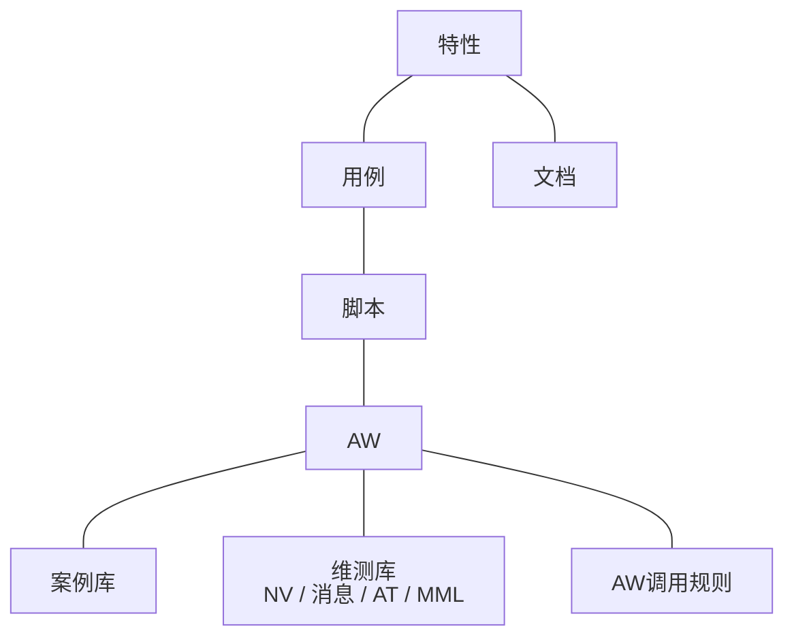
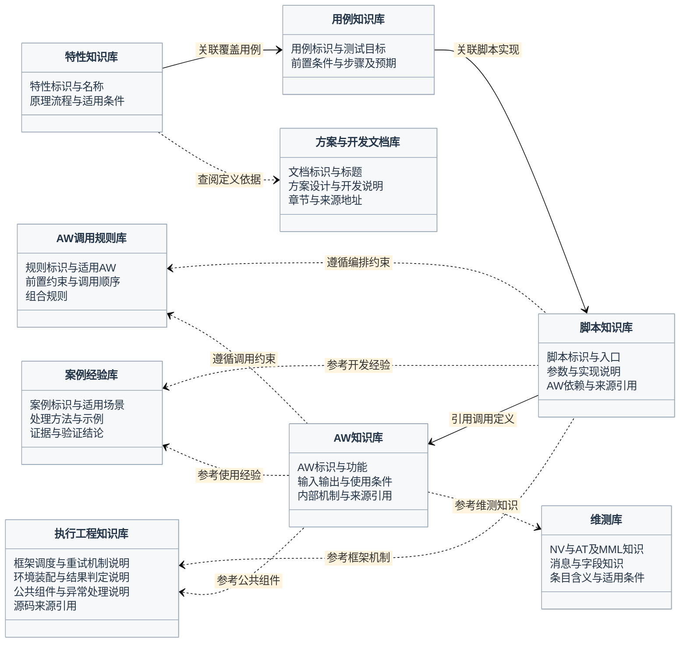
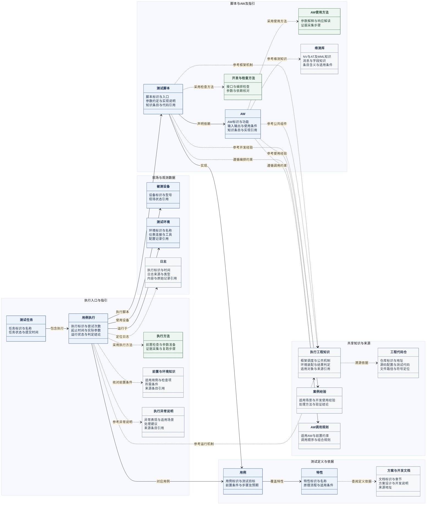

# 测试执行域：知识全景与 UModel 集成

测试执行围绕“特性—用例—脚本—AW”组织知识，并把一次实际执行与设备、测试环境、观测数据和操作方法关联起来。脚本与 AW 的实现知识按对象归位，执行框架与公共组件知识共享引用，工程代码仓提供可追溯的实现依据。用例、脚本、AW 沿用业务系统的标识，不引入版本管理。

## 原始图

按原始图重绘，保留 8 个节点和 7 条无向连线，不补充原图没有的属性或关系方向。

维测库中的手写项已按确认结果标为“消息”。后续将“案例库”统一称为“案例经验库”。AW 保留原缩写。

## 知识库视角

知识库视图展示知识集合，源码通过来源属性定位。特性、用例、脚本和 AW 描述设计与实现知识，执行工程知识解释框架与公共组件，方案与开发文档提供设计和实现依据，案例经验与调用规则支撑使用。名称与内容摘要使用原生类图分栏，箭头表示知识引用关系，不表示处理顺序。

NV、AT、MML、消息及字段统一收进“维测库”节点，AW 通过一条“参考维测知识”连线挂接。属性按来源实际提供的内容整理，不要求新增版本字段。

维测库保存定义与说明，不表示设备操作能力。脚本开发经验与 AW 使用经验放在同一案例经验库，明确的调用约束放在共享规则库。图中连线落到具体节点；实际检索仍按适用条件定位具体条目，不表示每个脚本或 AW 都依赖全部知识。脚本、AW 和执行工程知识通过来源引用溯源到源码；集成视角保留工程代码仓这一源码定位入口。

### 工程知识的归位与溯源

脚本知识库保留具体脚本的参数、编排与实现说明，AW 知识库保留具体 AW 的封装、响应解析和内部机制。执行工程知识库承载从源码整理或逆向得到的执行框架、任务调度、环境装配、公共重试和结果收集机制说明，例如 OpenWiki 生成的相关文档。原始源码、配置和测试代码保存在工程代码仓中，由知识条目的来源引用定位。

OpenWiki 等工具生成的工程说明按上述主题归位，工具名称留在承载说明中。同一份内容可以被多个对象引用，不要求为每个知识库、脚本或执行复制一份。工程知识解释“如何实现”，执行方法、开发与检查方法、AW 使用方法说明“如何操作或核查”，方法可以引用相应知识及源码依据。

来源引用至少明确适用对象、知识条目标识或地址、仓库标识、文件路径及可用的符号定位，并保留核验时间。能够取得时，再记录源码提交号或内容指纹，用于说明知识依据哪份内容，不新增用例版本或 AW 版本节点。无法确认某次执行使用的源码时保留未知，不能用当前源码或生成说明代替那次执行的日志证据。

## UModel 集成视角

在同一个工作空间内，以“用例执行”为入口，直接关联用例、测试脚本、被测设备、测试环境和观测数据。测试任务是批量入口，通过任务找到具体执行；用例执行保留实际参数、起止时间、运行状态和判定结论。

用例执行是实际运行记录，保留独立节点。同一用例复跑可以产生新的执行记录；复跑记录与原始记录分别留存，不新增一层泛化“执行过程”对象。

阅读时先找到“测试任务—用例执行—测试脚本—AW”这条对象主线：任务包含执行，执行运行脚本，脚本声明 AW 依赖。再从执行和脚本找到用例，查看测试目标、覆盖特性和方案依据。这是一条查找上下文的路径，不表示任务、用例、脚本、AW 是依次发生的流程步骤。

总图按使用关系组织成五组，将专属指引放在对象附近，共享知识保留一个入口。分组中的每个对象和知识仍独立展开，属性以业务系统实际记录为准。

| 分组 | 回答的问题 | 阅读重点 |
|---|---|---|
| 执行入口与指引 | 哪一次执行，如何检查和复跑？ | 任务与执行放在一起，前置知识、异常说明、执行方法直接挂到执行。 |
| 脚本与 AW 及指引 | 执行什么实现，如何核查和使用？ | 脚本与 AW 相邻，各自挂接方法；AW 直接引用维测知识。 |
| 测试定义与依据 | 测试目标和设计依据是什么？ | 执行对应用例，脚本实现用例，用例覆盖特性，特性引用方案与开发文档。 |
| 现场与观测数据 | 在哪里运行，实际发生了什么？ | 从本次执行定位设备、环境和日志；设备与环境是现场对象，日志是运行证据入口。 |
| 共享知识与来源 | 哪些经验、约束和实现机制可以参考？ | 案例经验与调用规则由脚本和 AW 共享；执行工程知识同时供执行、脚本、AW 引用，并溯源到工程代码仓。 |

图上的“执行工程知识”是知识库中适用的机制说明，工程代码仓是原始源码入口。脚本和 AW 自身的实现知识保留在各自的知识引用中。共享不意味着所有对象读取同一份内容，具体条目仍需按适用对象筛选。

| 图形 | 读法 |
|---|---|
| 蓝色节点 | 任务、执行、用例、脚本、AW、设备和测试环境等业务对象。 |
| 绿色节点 | 执行方法、开发与检查方法、AW 使用方法；表示可引用的方法内容。 |
| 灰色节点 | 参考知识、规则、文档、源码来源和观测数据类别；不要求一律建成实体。 |
| 实线箭头 | 对象关联；按箭头读成“主语—关系—宾语”，不表示执行先后。 |
| 虚线箭头 | 内容引用、方法挂接或数据定位；不表示已经调用工具或操作设备。 |
| 分组边框 | 阅读分类，不是关系端点，也不是新增实体。 |

关系数量暂不增加统一约束，按实际任务、设备和环境模型确定。

执行直接关联前置与环境知识、异常说明和执行方法；脚本关联自身实现知识、开发经验、编排约束和检查方法；AW 关联自身实现知识、使用经验、调用约束、维测库和使用方法。执行、脚本和 AW 分别引用适用的工程知识条目；案例经验、AW 调用规则及工程知识共享保留，不复制到每个对象中。

“日志”是本次执行的统一日志入口，可按来源区分框架、脚本、设备和 AW 调用日志。图中一个节点不意味着只有一个日志文件、一个存储或一个数据集。按执行标识及必要的尝试次数、时间窗口定位记录；AW 标识、调用标识和原始响应引用仅在来源实际提供时保留，不要求每条日志都有。测试测量不在当前主图展开；独立的指标序列与调用链仍按各自数据类型处理，不改名为日志。

前置与环境知识、执行异常说明及执行工程知识都是供执行参考的内容类别，不要求新增独立存储。按实际已有内容建立来源引用：

| 内容类别 | 可引用的来源 | 使用边界 |
|---|---|---|
| 前置与环境知识 | 用例知识库中的前置条件，以及方案与开发文档库中已有的环境与配置说明。 | 描述执行所需条件；本次实际环境状态与配置仍从关联的测试环境和执行记录获取。 |
| 执行异常说明 | 案例经验库中已验证且适用于执行场景的经验，以及已有操作文档中的异常说明。 | 仅引用来源实际具备的内容；处理建议需核对适用条件，不能代替本次异常证据。 |
| 执行工程知识 | 工程代码仓、配置、测试代码及有明确来源的工程说明。 | 解释框架和公共组件的实现机制；判断本次是否触发某种机制，还需核对实际参数、配置和日志。 |

引用保留来源条目标识、地址或章节及适用条件，不把来源内容复制到每次执行中。上述来源是集成时的对齐依据，不表示已完成数据接入。

为减少主图长线，以下已有关系和可选数据在此补充，不表示从模型中删除。

| 起点或内容 | 关系或用途 | 终点或关键字段 |
|---|---|---|
| 用例 | 查阅预期依据 | 方案与开发文档中的具体章节。 |
| 测试脚本 | 溯源实现 | 工程代码仓中的脚本入口、文件路径和符号；由代码引用定位。 |
| AW | 溯源实现 | 工程代码仓中的 AW 实现、文件路径和符号；由实现引用定位。 |
| 执行方法、开发与检查方法、AW 使用方法 | 按需引用工程依据 | 适用的脚本、AW 或执行工程知识条目及源码定位。 |
| 用例执行 | 按需定位调用链 | 调用标识、父调用标识、AW 标识、耗时、状态。 |
| 用例执行 | 按需定位事件 | 执行标识、发生时间、事件类型、变更内容。 |

维测库是知识库合集的统一引用入口，子库与条目标识保留在知识内容和检索结果中，不在领域图中继续展开。字段和方法说明是参考内容；挂接到图上不等于已经执行脚本或操作设备。

### 在项目中的承载

业务图使用中文名称，实际集成时对应以下项目结构。类型名称是本场景的设计建议，尚未导入。

| 内容 | UModel 中的承载 | 本场景的划分 |
|---|---|---|
| 业务范围 | 同一 Workspace 内的 Domain | `test_execution` 管理任务、执行、脚本、AW；`test_design` 管理特性、用例；`test_lab` 管理设备、测试环境。 |
| 对象与属性 | EntitySet + 实体记录 | 如 `test_execution.run`、`test_execution.script`、`test_execution.aw`、`test_design.test_case`、`test_lab.environment`；沿用业务标识。用例执行是入口，任务提供批量组织，不为每次 Agent 调用新增执行实体。 |
| 对象关系 | 类型关系定义 + 具体关系记录 | 包含、对应、执行、实现、依赖、使用、运行于、覆盖。声明类型关系不会自动生成具体边。 |
| 日志 | LogSet（日志类 DataSet）+ 对象到数据的绑定 | 统一定位框架、脚本、设备和 AW 调用日志；实际可对应多个日志集。按来源、执行标识、尝试次数和时间定位数据，调用关联字段按来源保留。 |
| 知识与方法 | RunbookSet 及对象挂接，或受控的外部内容引用 | 分别关联用例执行、测试脚本、AW；脚本与 AW 的实现知识按对象定位，案例经验、调用规则和执行工程知识共享引用。维测条目仍保留来源和业务标识。 |
| 工程知识正文 | 知识内容或外部内容地址 | OpenWiki 等生成说明按主题纳入脚本、AW 或执行工程知识。先按已确认的对象与组件映射筛选适用条目，再读取正文；名称相似不自动建立绑定。 |
| 源码与溯源 | 对象或知识条目的外部来源引用 | 工程代码仓先作为来源入口，保留仓库、路径、符号和核验信息；图中出现来源节点不要求新增 EntitySet。需查询仓库或组件的影响范围时，再按实际身份建模。 |
| 数据来源 | Storage + 数据集到存储的映射 | 接入实际日志平台或已纳入数据源的日志文件，映射物理字段。原始数据可以留在原系统。 |
| Agent 读取 | Query Service / MCP | 从执行标识进入；只有任务标识时先找到任务下的执行。发现直接挂接的知识、方法与数据集；外部正文和源码由读取工具获取，观测数据由外部读取器按查询计划取数。 |

现有知识详情可返回 `content` 和 `content_url`；内容发现不等于下载外部正文。源码引用、知识条目与业务对象的映射需要实际建立，项目不会自动解析代码仓并生成这些关系。

### Agent 如何使用

以任务 T001 下的一次用例执行 R001 为例，以下是使用路径，不代表已完成模型接入或真实执行。

1. **定位执行。** 从 R001 进入；只有 T001 时，先找到任务下的执行。读取用例 C001、测试脚本 S001、设备 D001 和环境 E001，确认实际参数及运行状态。
2. **核对知识与方法。** 读取 R001 适用的前置与环境知识、异常说明、执行工程知识及执行方法，核对适用条件与本次实际环境；再按需读取脚本和 AW 自身的实现知识，以及直接挂接的共享知识、规则和方法。
3. **定位日志。** 按执行标识、必要的尝试次数和时间窗口取得日志查询计划，由外部读取器取数；再按日志来源、类型及已有调用标识缩小范围。
4. **按需核查实现。** 根据工程知识和源码引用，读取相关文件、函数、配置或测试代码。确认知识依据及其与本次执行的适用关系；源码中的分支或静态依赖本身不证明已经执行。
5. **解释结果并保留出处。** 日志包含 AW 标识或明确调用引用时，定位对应 AW 并读取具体命令或消息说明，与实现机制和本次证据交叉核对；缺少关联依据时保留未知。保留知识条目、源码定位及原始日志；需要执行脚本、操作设备或复跑时，交由执行平台完成。复跑留存新的执行记录。

例如，假设脚本只有一次 AW 调用，日志却有三次命令发送：先检查脚本编排，再查看 AW 内部重试和框架重跑机制，最后用调用标识、参数与时间顺序核对实际触发路径。工程说明帮助找到检查位置，具体原因由本次证据支持。

知识发现不自动沿图递归收集全部内容，Agent 需逐个读取相关对象的直接知识与方法绑定。测试分析从问题进入，并关联这里的执行记录；两个领域共享同一用例执行，不各建一份。

### 日志建模的业界参考

| 参考 | 已有做法 | 本场景借鉴 |
|---|---|---|
| [OpenTelemetry 日志数据模型](https://opentelemetry.io/docs/specs/otel/logs/data-model/) | 用统一模型表达应用日志、系统日志等来源，包含时间、正文、来源与附加属性；TraceId、SpanId 为可选字段。 | 日志保留一个概念入口，通过来源和属性区分内容。AW 标识、执行标识等是本领域扩展字段，不是该标准规定的测试字段。 |
| [Allure 测试结果模型](https://allurereport.org/docs/how-it-works-test-result-file/) | 测试结果保留状态、起止时间、步骤及附件引用；附件以名称、来源文件和媒体类型描述。 | 用例执行保留运行状态与判定，日志作为可定位的证据。附件机制是关系设计的参考，不意味着 Allure 把所有附件都视为日志。 |
| [OpenTelemetry 信号分类](https://opentelemetry.io/docs/concepts/signals/) | 日志、指标与调用链分别表达事件记录、运行时测量和请求路径。 | 删除当前图中的测量节点是展示范围收敛，不是把指标或调用链转换成日志。 |

本项目的 [LogSet 定义](../schemas/core/dataset/log_set.schema.yaml)同样把日志建模为具有共同属性的记录集合。因此，业务图保留一个“日志”节点，集成时按真实来源绑定一个或多个日志集即可，不必为每类日志或每次 AW 调用新增业务实体。

### 建模边界

- **以实际执行为入口。** 用例是测试定义，测试任务组织一批执行，用例执行记录具体运行。保留实际业务标识和执行记录，不因 Agent 读取、检查或解释结果而新建一轮执行。
- **状态与结论分开。** “已完成”是运行状态，“不通过”是判定结论，默认都放在执行属性中。需要独立复判、审核或引用时，再增加判定记录。
- **定义与调用分开。** AW 是可复用业务对象；一次调用先保留为日志或 span，不为每条响应建立实体。脚本声明依赖不代表每个 AW 都实际执行。
- **当前内容与历史事实分开。** 同一用例、脚本或 AW 修改后仍是原业务对象。执行时未留存的原内容，不能从当前定义恢复；源码提交号、指纹或快照仅作为可取得的溯源信息，不要求业务版本管理。
- **知识与方法分别挂接。** 用例执行关联执行知识与方法；脚本和 AW 各自保留实现知识及方法；共享工程知识、案例经验和调用规则按适用对象引用，条目保留同一标识。
- **来源与知识分清。** 工程代码仓承载源码、配置和测试代码，工程知识保留解释及来源，方法引用知识指导操作。生成说明不能代替源码核查，源码也不能代替本次运行证据。
- **工程对象按查询需要展开。** 需要查询执行器、公共组件或仓库的影响范围时，再按实际身份补充对象。文件和函数细节先由源码定位或代码索引承载，不全部放入领域总图。
- **图负责组织上下文。** 设备操作、脚本运行和资源调度仍由执行平台承担。当前项目的日志、指标接口返回下游查询计划；知识发现也不自动递归遍历全部关联对象或下载正文。

设计借鉴了 [Quickstart](../examples/quickstart-multidomain/README.zh-CN.md) 的对象与属性划分、[服务定位](../examples/service-localization/README.zh-CN.md) 的数据映射，以及[故障排查](../examples/incident-investigation/README.zh-CN.md)的知识和方法挂接。实际查询边界以 [Query Service](../docs/zh/guides/query-service.md) 为准；现有知识发现接口仍使用 `knowledge`，但其 Schema 已标为 deprecated，正式接入时需确认兼容方式。

图形约定与[测试分析域](测试分析域.md)保持一致：原始图用于溯源，知识库视图采用紧凑布局，集成总图保留具体对象及其知识、方法挂接；只在承载说明中使用项目类型名称。原始识别记录保留在[历史资料](archive/测试执行/通信解决方案测试-测试执行知识全景图.md)中。
