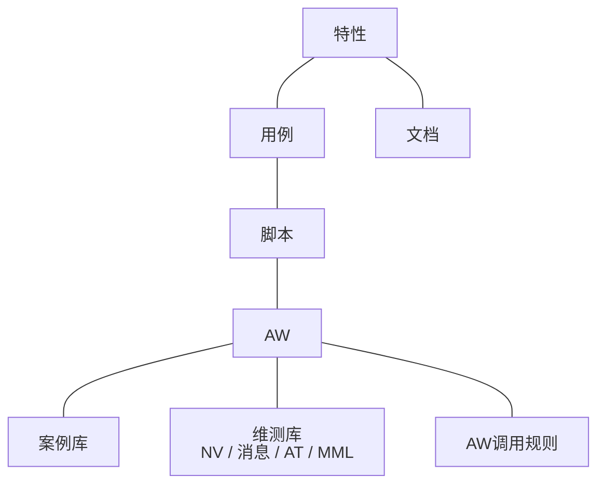
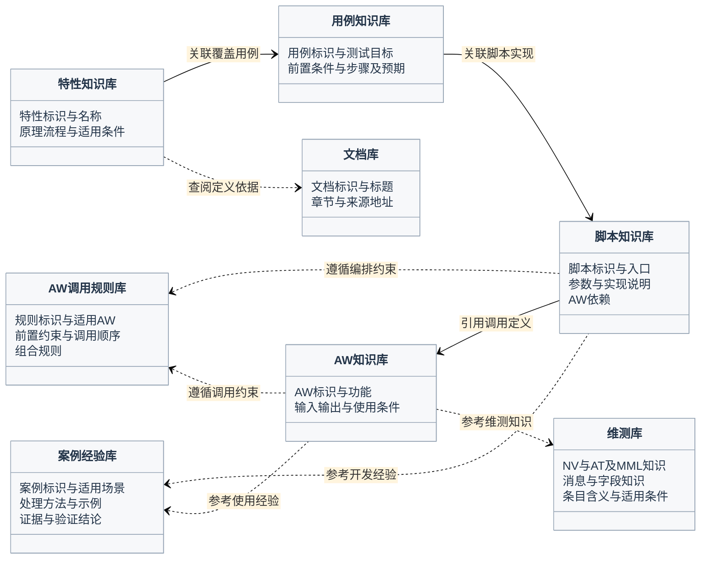
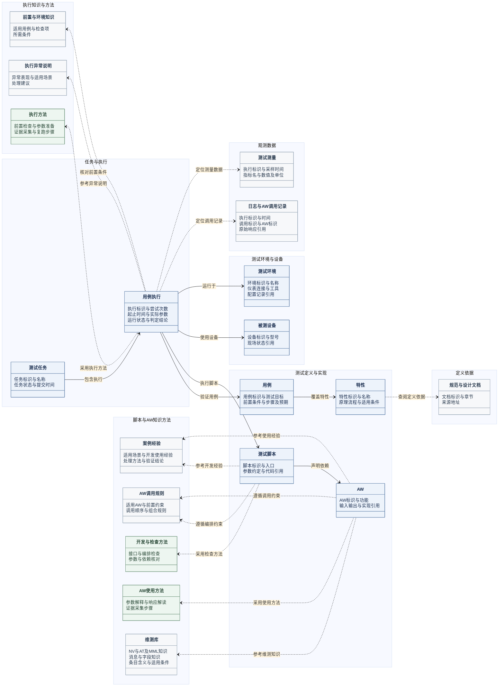

# 测试执行域：知识全景与 UModel 集成

测试执行围绕“特性—用例—脚本—AW”组织知识，并把一次实际执行与设备、测试环境、观测数据和操作方法关联起来。用例、脚本、AW 沿用业务系统的标识，不引入版本管理。

## 原始图

按原始图重绘，保留 8 个节点和 7 条无向连线，不补充原图没有的属性或关系方向。

维测库中的手写项已按确认结果标为“消息”。后续将“案例库”统一称为“案例经验库”。AW 保留原缩写。

## 知识库视角

知识库视图保留 8 个节点，采用紧凑的横向多层布局，名称与属性使用原生类图分栏。特性、用例、脚本和 AW 描述设计与实现知识，文档提供依据，案例经验与调用规则支撑使用。箭头表示引用关系，不表示处理顺序。

NV、AT、MML、消息及字段统一收进“维测库”节点，AW 通过一条“参考维测知识”连线挂接。属性按来源实际提供的内容整理，不要求新增版本字段。

维测库保存定义与说明，不表示设备操作能力。脚本开发经验与 AW 使用经验放在同一案例经验库，明确的调用约束放在共享规则库。图中连线落到具体节点；实际检索仍按适用条件定位具体条目，不表示每个脚本或 AW 都依赖全部知识。

## UModel 集成视角

在同一个工作空间内，以“用例执行”为入口，直接关联用例、测试脚本、被测设备、测试环境和观测数据。测试任务是批量入口，通过任务找到具体执行；用例执行保留实际参数、起止时间、运行状态和判定结论。

用例执行是实际运行记录，保留独立节点。同一用例复跑可以产生新的执行记录；复跑记录与原始记录分别留存，不新增一层泛化“执行过程”对象。

总图仍是一张统一关系图，采用原生类图的名称栏与属性栏。执行、脚本和 AW 分别直接挂接适用知识与方法，维测子库合并为一个节点。图上属性是关键字段摘要，以业务系统实际记录为准。

| 图形 | 读法 |
|---|---|
| 蓝色节点 | 任务、执行、用例、脚本、AW、设备和测试环境等业务对象。 |
| 绿色节点 | 执行方法、开发与检查方法、AW 使用方法；表示可引用的方法内容。 |
| 灰色节点 | 参考知识、规则、文档和观测数据类别；不要求一律建成实体。 |
| 实线箭头 | 对象关联；按箭头读成“主语—关系—宾语”，不表示执行先后。 |
| 虚线箭头 | 内容引用、方法挂接或数据定位；不表示已经调用工具或操作设备。 |
| 分组边框 | 阅读分类，不是关系端点，也不是新增实体。 |

关系数量暂不增加统一约束，按实际任务、设备和环境模型确定。

执行直接关联前置与环境知识、异常说明和执行方法；脚本关联开发经验、编排约束和检查方法；AW 关联使用经验、调用约束、维测库和使用方法。案例经验与 AW 调用规则分别由脚本和 AW 共享，不复制成两份知识。

为减少主图长线，以下已有关系和可选数据在此补充，不表示从模型中删除。

| 起点或内容 | 关系或用途 | 终点或关键字段 |
|---|---|---|
| 测试脚本 | 实现 | 用例；用例定义与脚本实现保持区分。 |
| 用例 | 查阅预期依据 | 规范与设计文档中的具体章节。 |
| 用例执行 | 按需定位调用链 | 调用标识、父调用标识、AW 标识、耗时、状态。 |
| 用例执行 | 按需定位事件 | 执行标识、发生时间、事件类型、变更内容。 |

维测库是知识库合集的统一引用入口，子库与条目标识保留在知识内容和检索结果中，不在领域图中继续展开。字段和方法说明是参考内容；挂接到图上不等于已经执行脚本或操作设备。

### 在项目中的承载

业务图使用中文名称，实际集成时对应以下项目结构。类型名称是本场景的设计建议，尚未导入。

| 内容 | UModel 中的承载 | 本场景的划分 |
|---|---|---|
| 业务范围 | 同一 Workspace 内的 Domain | `test_execution` 管理任务、执行、脚本、AW；`test_design` 管理特性、用例；`test_lab` 管理设备、测试环境。 |
| 对象与属性 | EntitySet + 实体记录 | 如 `test_execution.run`、`test_execution.script`、`test_execution.aw`、`test_design.test_case`、`test_lab.environment`；沿用业务标识。用例执行是入口，任务提供批量组织，不为每次 Agent 调用新增执行实体。 |
| 对象关系 | 类型关系定义 + 具体关系记录 | 包含、验证、执行、实现、依赖、使用、运行于、覆盖。声明类型关系不会自动生成具体边。 |
| 观测数据 | DataSet + 对象到数据的绑定 | 日志与调用记录优先；测量按实际数据源接入，调用链和事件按需增加。按来源、执行标识、尝试次数和时间定位数据。 |
| 知识与方法 | RunbookSet 及对象挂接，或受控的外部内容引用 | 分别关联用例执行、测试脚本、AW；共享案例经验和调用规则。维测库在图上合并，实际 NV、AT、MML、消息条目仍保留来源和业务标识，不复制到每次执行中。 |
| 数据来源 | Storage + 数据集到存储的映射 | 接入实际日志、指标等平台，映射物理字段。原始数据可以留在原系统。 |
| Agent 读取 | Query Service / MCP | 从执行标识进入；只有任务标识时先找到任务下的执行。再读取关联对象，发现适用知识、方法与数据集；取得查询计划后，由外部读取器取数。 |

### Agent 如何使用

以任务 T001 下的一次用例执行 R001 为例，以下是使用路径，不代表已完成模型接入或真实执行。

1. **定位执行。** 从 R001 进入；只有 T001 时，先找到任务下的执行。读取用例 C001、测试脚本 S001、设备 D001 和环境 E001，确认实际参数及运行状态。
2. **核对知识与方法。** 读取 R001 的前置与环境知识、异常说明及执行方法；需要检查脚本或 AW 时，再分别读取其直接挂接的经验、规则和使用方法。
3. **定位现场数据。** 按执行标识、调用标识和时间窗口取得日志、测量查询计划，由外部读取器取数；调用链和事件按实际数据源选择接入。
4. **解释结果并保留出处。** 根据调用记录中的 AW 标识，读取具体命令或消息说明。保留原始结果与证据定位；需要执行脚本、操作设备或复跑时，交由执行平台完成。复跑留存新的执行记录。

知识发现不自动沿图递归收集全部内容，Agent 需逐个读取相关对象的直接知识与方法绑定。测试分析从问题进入，并关联这里的执行记录；两个领域共享同一用例执行，不各建一份。

### 建模边界

- **以实际执行为入口。** 用例是测试定义，测试任务组织一批执行，用例执行记录具体运行。保留实际业务标识和执行记录，不因 Agent 读取、检查或解释结果而新建一轮执行。
- **状态与结论分开。** “已完成”是运行状态，“不通过”是判定结论，默认都放在执行属性中。需要独立复判、审核或引用时，再增加判定记录。
- **定义与调用分开。** AW 是可复用业务对象；一次调用先保留为日志或 span，不为每条响应建立实体。脚本声明依赖不代表每个 AW 都实际执行。
- **当前内容与历史事实分开。** 同一用例、脚本或 AW 修改后仍是原业务对象。执行时未留存的原内容，不能从当前定义恢复；快照是可选增强，不是版本管理前提。
- **知识与方法分别挂接。** 用例执行关联执行知识与方法；脚本关联开发经验、编排规则与检查方法；AW 关联使用经验、调用规则、维测知识与使用方法。共享条目保留同一标识。
- **图负责组织上下文。** 设备操作、脚本运行和资源调度仍由执行平台承担。当前项目的日志、指标接口返回下游查询计划；知识发现也不自动递归遍历全部关联对象或下载正文。

设计借鉴了 [Quickstart](../examples/quickstart-multidomain/README.zh-CN.md) 的对象与属性划分、[服务定位](../examples/service-localization/README.zh-CN.md) 的数据映射，以及[故障排查](../examples/incident-investigation/README.zh-CN.md)的知识和方法挂接。实际查询边界以 [Query Service](../docs/zh/guides/query-service.md) 为准；现有知识发现接口仍使用 `knowledge`，但其 Schema 已标为 deprecated，正式接入时需确认兼容方式。

图形约定与[测试分析域](测试分析域.md)保持一致：原始图用于溯源，知识库视图采用紧凑布局，集成总图保留具体对象及其知识、方法挂接；只在承载说明中使用项目类型名称。原始识别记录保留在[历史资料](archive/测试执行/通信解决方案测试-测试执行知识全景图.md)中。
