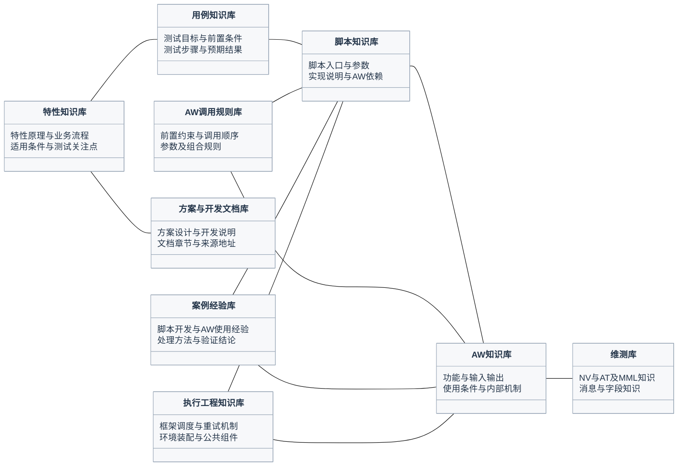
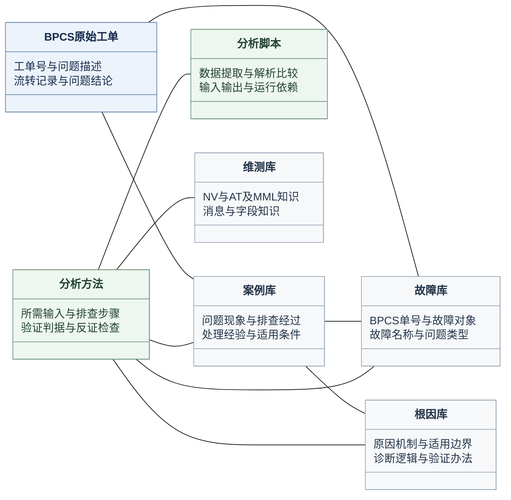

# 测试知识全景

**覆盖范围**

- 测试执行：测试目标、实现机制与使用规范。
- 测试分析：问题定位、原因分析与验证。

**图示说明**

- 节点：知识资产及内容摘要。
- 连线：内容关联，不表示流程或因果。

**资产说明**

- 内容：包含哪些知识、解决什么问题。
- 来源：知识依据的资料。
- 载体：存储形式与访问入口，未明确项标为建议。

## 一、测试执行知识

测试执行知识以特性、用例、脚本和 AW 为主线。特性与用例描述测试目标和预期，脚本与 AW 描述实现和使用方式；方案与开发文档提供依据，执行工程知识解释框架与公共组件，案例经验、调用规则和维测知识支持开发、调用与核查。

### 知识库视图

### 知识资产说明

| 名称 | 主要内容与用途 | 来源 | 载体 |
|---|---|---|---|
| 特性知识库 | 特性标识、原理、流程、适用条件及测试关注点，帮助理解测试对象和覆盖范围。 | 特性定义、方案设计及相关规范；具体依据随条目保留。 | 建议：特性知识条目或 Wiki 文档，附原始资料的章节引用。 |
| 用例知识库 | 用例标识、测试目标、前置条件、步骤和预期结果，提供执行准备与结果核对依据。 | 业务系统中的用例定义及其设计依据。 | 建议：用例管理记录与关联知识文档；沿用原用例标识。 |
| 脚本知识库 | 脚本入口、参数、AW 编排及实现说明，支持脚本开发、检查和理解。 | 脚本源码、配置、测试代码及开发说明。 | 建议：脚本说明或 Wiki 条目，保留源码文件与符号定位；可包含经核验的源码逆向说明。 |
| AW知识库 | AW 功能、输入输出、使用条件、封装逻辑、响应解析及内部机制，支持正确调用和结果解读。 | AW 实现源码、接口定义、开发说明及验证材料。 | 建议：AW 知识条目或接口说明，关联实现代码与示例。 |
| 执行工程知识库 | 执行框架、任务调度、环境装配、公共重试、结果收集与判定、公共组件及异常处理机制，解释运行行为。 | 工程代码仓中的源码、配置、测试代码及已有工程设计说明。 | 建议：按机制组织的工程说明或 Wiki 文档，例如经核验的 OpenWiki 生成内容；保留源码引用。 |
| 方案与开发文档库 | 方案设计、模块职责、实现约定及开发说明，为特性、脚本和工程知识提供依据。 | 已有方案文档与开发文档。 | 建议：现有文档平台或原始文档文件，通过标题、章节和地址定位。 |
| 案例经验库 | 脚本开发和 AW 使用中的典型场景、问题处理、实践示例与验证结论，帮助复用已有经验。 | 开发调试记录、已验证的处理记录及实际使用经验。 | 建议：按场景组织的案例条目或 Wiki 文档，附适用条件和验证依据。 |
| AW调用规则库 | 前置约束、参数约束、调用顺序和组合规则，帮助检查脚本编排及 AW 使用是否合理。 | 明确的接口约定、设计约束与已验证的调用规则。 | 建议：结构化规则条目或规则文档，保留适用 AW 与规则依据。 |
| 维测库 | NV、AT、MML、消息及字段的含义、使用条件与解释，支持配置、命令和响应的理解。 | 现有维测子库及相关定义资料。 | 沿用现有子库的记录或文档，提供统一知识入口；子库与条目标识仍保留。 |

执行工程知识库保存源码整理或逆向得到的机制说明，工程代码仓保存原始源码，两者通过引用联系。OpenWiki 是内容整理方式，不单独作为知识库节点；脚本和 AW 的专属说明分别归入各自知识库，共用框架机制归入执行工程知识库。

## 二、测试分析知识

测试分析以历史问题资料和可复用的分析知识为基础。BPCS 原始工单保留问题描述、流转记录和问题结论；案例库沉淀具体问题的处理经验，根因库组织原因机制与验证逻辑，故障库补充工单对应的故障对象、故障名称和问题类型，维测库解释配置、命令与消息。分析方法结合这些知识开展排查，分析脚本辅助提取、解析和比较数据。

### 知识库视图

蓝色为原始来源，灰色为知识库，绿色为方法与辅助脚本。保留这些角色是为了说明知识从哪里来、如何使用。

### 知识资产说明

| 名称 | 主要内容与用途 | 来源 | 载体 |
|---|---|---|---|
| BPCS原始工单 | 工单号、问题描述、流转记录、处理经过与问题结论，是案例和根因知识的原始依据。 | BPCS 中对应工单的原始业务记录。 | BPCS 工单记录及原单链接；引用时保留工单号与具体记录出处。 |
| 故障库 | 按 BPCS 单号查询故障对象、故障名称、问题类型等，补充案例信息与检索条件。 | 故障库中与 BPCS 工单对应的故障信息记录。 | 现有故障库记录及查询入口；具体接口和字段映射待接入时确认。 |
| 案例库 | 具体问题的现象、背景、排查经过、处理办法、验证结果与适用条件，回答类似问题如何处理过。 | BPCS 原始工单及其已有证据；按来源单号从故障库补充对应故障信息。 | LLM Wiki 整理形成的案例 Wiki 内容，保留来源单号、原单链接和证据引用。 |
| 根因库 | 原因机制、触发条件、适用边界、诊断逻辑和验证办法，回答某类问题为什么发生、如何核验。 | 工单与案例中有证据支持的机制和结论，保留支撑案例及原始出处。 | LLM Wiki 整理形成的根因聚合 Wiki 内容，按机制组织并关联支撑案例。 |
| 维测库 | 解释 NV、AT、MML、消息及字段含义，支持读取和核对分析证据。 | 与测试执行共用的维测定义资料。 | 复用同一维测知识入口及原有子库，不另建一份分析专用副本。 |
| 分析方法 | 适用场景、所需输入、知识检索要点、排查步骤、验证判据与停止条件，指导人或 Agent 使用知识分析问题。 | 已验证的排查实践、专家经验，以及案例与根因知识中的诊断办法。 | 建议：方法文档或结构化步骤条目，关联所需知识和辅助脚本入口。 |
| 分析脚本 | 数据提取、解析、过滤、对比等辅助实现，减少重复操作。 | 已有分析工具和脚本实现；具体清单需按实际资产核对。 | 建议：脚本源码、使用说明及运行入口，保留输入输出和运行依赖。 |

LLM Wiki 是工单整理为知识的加工方式，不在全景图中单列。案例库从故障库获取的是对应工单的故障信息，故障库不等同于根因库，也不预设为可推断原因的“故障模式库”。相同故障分类或相似案例只能帮助缩小检索范围，本次结论仍需现场证据支持。

## 三、跨领域复用

| 资产 | 复用方式 |
|---|---|
| 维测库 | 两个领域共用定义与条目标识。执行侧关注如何使用，分析侧关注如何解释配置、命令、消息和响应。 |
| 特性、用例、脚本、AW 与执行工程知识 | 分析问题涉及测试目标、实现或框架行为时，直接查阅执行领域已有知识及其来源。 |
| 案例经验库与案例库 | 前者侧重脚本开发和 AW 使用经验，后者侧重问题排查案例；内容重合时保留一份来源并建立引用，不因名称相近就合并全部内容。 |
| 脚本知识库与分析脚本 | 脚本知识库解释测试脚本的设计和实现；分析脚本用于辅助分析，两者按用途区分，保留各自入口。 |

## 四、知识条目的基础信息

各知识库可沿用现有载体，优先补齐可检索、可判断适用性、可回查来源的信息。以下为整理建议，具体字段按已有系统提供的内容保留。

| 信息 | 建议记录的内容 |
|---|---|
| 身份与名称 | 原有条目标识、名称、所属知识库或内容类别。 |
| 适用范围 | 适用特性、用例、脚本、AW、故障类型、场景及限制条件。 |
| 内容摘要 | 核心知识、规则、经验或方法要点，便于先判断是否相关。 |
| 来源依据 | BPCS 单号、文档章节、故障记录、代码路径或支撑案例，区分原始事实与整理结论。 |
| 载体与位置 | 所在系统或仓库、文档或记录形式、可读取地址及具体定位。 |
| 维护与核验 | 已知的维护方、最近核验时间、验证依据及待确认项；未取得的信息保留未知。 |

来源定位用于追溯知识依据，不要求新增用例、脚本或 AW 的业务版本管理。某次执行的日志和现场记录是分析证据；形成可复用知识后，再按主题归入相应资产。

整理依据：[测试执行域](测试执行域.md)、[测试分析域](测试分析域.md)。
