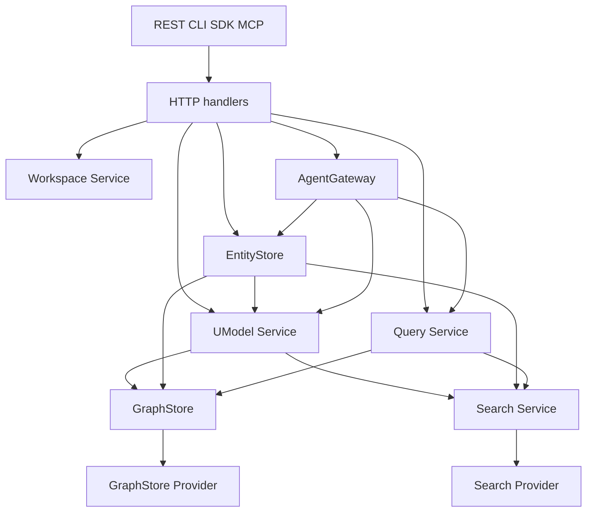

# Runtime Architecture and Ownership Boundaries

UModel 本地服务是一个 **workspace-scoped semantic runtime**：模型定义、运行时实体、关系、搜索索引和查询计划都由调用方显式带入 workspace，上层客户端通过统一的 REST、CLI、SDK 或 MCP/AgentGateway 表面访问它。服务本身不是把每个存储对象暴露成独立 API 的薄代理，而是由 application services 负责校验、编排和语义转换，再通过 `GraphStore` 抽象访问具体持久化实现。

## 组件职责

| 组件 | 所有权与职责 | 不应承担的职责 |
|---|---|---|
| `bootstrap.App` | 创建并持有各服务实例、选择 provider、注册 HTTP 路由和 UI handler；是组合根（composition root）。 | 不承载模型校验、实体合并或查询规划业务。 |
| `Workspace Service` | 管理 workspace metadata、状态、标签、配置、资源路径和 resource version。 | 不保存 UModel、实体或关系数据；workspace CRUD 是 metadata-only。 |
| `UModel Service` | 校验并写入模型元素，维护用于 schema resolution 的内存索引，驱动 UModel 搜索索引，并支持重建索引。 | 不直接实现 GraphStore provider；不负责运行时实体写入。 |
| `EntityStore` | 校验 CMS 2.0 entity/relation payload，执行写入、过期、部分成功和幂等结果缓存，并更新实体搜索索引。 | 不提供公共领域读取 API；读取必须走 `Query Service`。 |
| `Query Service` | 解析 SPL、生成 plan、读取模型/实体/拓扑，并按查询条件把搜索请求路由到 `Search Service`；返回 explain 信息。 | 不接受任意查询模式去执行远端真实存储；当前运行时只支持 `mode=plan` 协议。 |
| `Search Service` | 将 Provider 与 Embedder 组合成 keyword、vector、hybrid 检索，并在 hybrid 中做 RRF 融合。 | 不取代 Query Service 成为公共查询入口。 |
| `GraphStore` | 以 `pkg/contract.GraphStore` 提供 workspace、schema、UModel、实体、关系的读写及 capability/health；隐藏 memory、file.memory、Ladybug 等 provider 细节。 | 不决定上层 API 语义或 Agent 工具策略。 |
| `AgentGateway` | 面向 agent 提供 discovery、只读 metadata resources、SPL execute/explain/examples，以及受显式开关保护的写工具。 | 不绕过 Query、UModel 或 EntityStore 直接操作 GraphStore。 |

这些边界也体现在公开 contracts：`WorkspaceManager`、`GraphStore`、`UModelService`、`EntityWriteService`、`QueryService`、`SearchService` 和 `AgentGateway` 都在 `pkg/contract/contracts.go` 中以接口表达。接口是替换实现和编写 focused test 的边界，而不是要求调用方依赖 `internal` 的具体类型。

## 组合根与调用方向

`bootstrap.NewAppWithGraphStore` 按依赖方向组装运行时：先创建 workspace metadata service 和 GraphStore provider，再创建 Search provider/service；随后把 `GraphStore` 注入 `UModel` 和 `EntityStore`，把 UModel 作为 EntityStore 的 schema resolver，把 Search 注入两个写服务，并将 GraphStore 和 Search 注入 Query，最后把 Query 以及写服务注入 AgentGateway。由此形成以下单向关系：

*该图展示组合根下的运行时依赖和请求入口方向；箭头表示调用或注入，不表示数据复制。*

`App` 暴露的 handler 只做路径/方法解析、JSON 解码和错误/响应封装。例如 workspace 请求调用 `a.Workspace`，模型请求调用 `a.UModel`，实体关系写请求调用 `a.EntityStore`，查询调用 `a.Query`，Agent 请求调用 `a.AgentGateway`。因此新增公共 handler 时应遵守：**handler 不得绕过 domain service，也不得直接调用 provider 或在 handler 中重复领域规则**。架构 guard 会检查领域读取不能新增为 `/api/v1/entities`、`/api/v1/relations` 等旁路，并限制业务模块直接导入 provider implementation。

## Workspace 隔离与生命周期

Workspace Service 的状态以合法 workspace ID 为键，维护 `WorkspaceMetadata`：名称、描述、labels、配置、固定的 `data/instances/{workspace}` 与临时目录、状态和 `ResourceVersion`。创建时校验 ID、labels 和配置；更新可以用 `IfMatchVersion` 做乐观并发控制；删除不是物理清除，而是写入 deleted tombstone。被 tombstone 的 workspace 不能重新创建，普通 `GetWorkspace` 不返回 deleted 或 conflicted workspace，列表则可用显式选项查看它们。

`file.memory` 和 `local.ladybug` 使用持久化 workspace metadata；默认 metadata 文件是 `data/workspaces.json`。启动时还会从 provider-specific 目录恢复缺失的 workspace metadata，但不会用目录重新唤醒已删除的 tombstone。GraphStore 数据由 provider 自己拥有：`file.memory` 将每个 workspace 的 UModel、entities 和 relations 写在 `data/graphstore/file-memory/workspaces/{workspace}/` 下。两套状态故意分离：metadata 的创建并不等同于模型或实体数据已经写入。

启动流程由 `cmd/umodel-server` 控制：`--addr`、`--data`、`--graphstore` 和可选的 `--import-root` 决定运行配置；`--quickstart` 在服务监听前通过 Workspace Service 创建或取得 workspace，再经 `Samples` 调用 UModel/EntityStore 导入样例。provider 由 registry 按类型创建；内置类型包括 `memory`、`file.memory` 和 `local.ladybug`，provider 不可用或创建失败会阻止应用启动。`memory` 适合临时测试，进程退出即丢失数据；`file.memory` 适合本地持久化。

## 写入路径：模型、实体和关系

### UModel

模型导入或元素写入先经过 `UModel Service` 的基础字段和 schema validator 校验，再调用 GraphStore 的 `PutUModelElements`。成功写入后，服务合并 workspace 内的 schema index，用于 `ResolveEntitySet`、`ResolveRelationType` 和 EntityStore payload 校验；如果配置了 Search，还会建立模型文档索引。删除按 GraphStore 已接受的 item 更新本地 index，并删除对应搜索文档；搜索删除失败不会撤销 GraphStore 写入，而是作为 `WriteResult.Warnings` 返回。`RebuildIndex` 从 GraphStore snapshot 重建内存 schema index，适合恢复或诊断索引不同步的情况。

公共 API 的 `import` 还受 `--import-root` / `WithImportRoot` 限制：默认限制在 server 当前工作目录下，设为 `/` 才允许任意路径；内置可信 sample 使用 trusted import 路径，不受该限制。这样文件导入的安全策略属于 UModel service，而不是 HTTP handler。

### EntityStore

EntityStore 是运行时写入的唯一 application boundary。它通过 UModel 的 resolver 检查 CMS 2.0 必填字段、128-bit lowercase hex entity ID、relation 两端字段及 `Create`、`Update`、`Expire`、`Delete` 方法。非 partial batch 遇到校验失败即返回错误；`PartialSuccess` 则保留逐项失败结果并继续写入有效项。带 `IdempotencyKey` 的实体和关系结果按 `workspace + key` 缓存，重复请求返回缓存结果；未带 key 的请求不获得这一语义。

EntityStore 把有效 batch 交给 GraphStore。实体写入/过期还会维护搜索文档；索引或删除失败只产生 warning，不把已经接受的图数据伪装成失败。过期对象从当前查询隐藏，但带时间范围的历史查询仍可观察到过期记录，这是 GraphStore 时间语义与 Query 读取语义共同保证的行为。关系写入同样只经过 EntityStore 和 GraphStore，不能由公共读 handler 直接拼装存储操作。

## 读取路径：Query 与 Search

Query Service 是模型、实体、拓扑的统一公共读取面。`Execute` 先规范化 mode 和 format，调用 planner 取得 plan、provider capabilities 和 health，再按 provider timeout 设置 context deadline。普通 plan 由 executor 读取 GraphStore；带搜索 mode 的 `.entity` 或 `.runbook_set` 查询则路由到 Search Service，并把 search provider、embed model、search mode 写入 explain。keyword、vector、hybrid 的选择由查询 plan 决定：Search Service 负责 embedding、provider 检索和 hybrid 的 RRF，Query Service 负责 SPL 语义和结果投影。

当前 `unified-model` 只接受空 mode（归一化为 `plan`）或 `plan`；其他 mode 返回机器可操作的 `CodeNotImplemented` 及迁移信息。provider deadline 超时映射为 `CodeTimeout`，而客户端主动取消不会误报为 provider timeout。因而 public read API、CLI 和 Agent 都应把查询交给 Query Service，而不是把 GraphStore 当作读 API 使用；更完整的 SPL 规划与执行说明见 [查询规划与执行](../concepts/query-planning-and-execution.md)。

## AgentGateway 与扩展边界

AgentGateway 是 agent-facing adapter，不是第二个领域 service。Discovery 返回 workspace、工具清单、资源目录和 next actions；resource 只暴露 overview、schema index、query templates、tool metadata 等元数据和模板，运行时 rows 必须通过 Query API 获取。`query_spl_execute`、`query_spl_explain` 和 `query_spl_examples` 默认启用；`umodel_import`、`entity_write`、`entity_expire` 需要 `WithWriteToolsEnabled(true)` 且必须注入对应写服务，默认关闭。未知工具、禁用工具和未配置 provider 都返回稳定错误码。

这一层是 MCP 和其他 agent 客户端的安全扩展点：可以增加工具 schema、资源模板或 adapter，但工具实现应继续调用 Query、UModel、EntityStore 的接口。不能让 MCP/REST adapter直接触碰 GraphStore，也不能把 runtime rows 塞进只读 resource。workspace-and-object-graph 的语义背景见 [Workspace 与对象图](../concepts/workspace-and-object-graph.md)，公共集成面见 [Public Surfaces](../integrations/public-surfaces.md)。

## 变更与测试检查表

涉及边界的改动至少应关注：

- `internal/bootstrap` 的构造顺序、路由委派、quickstart 和 workspace persistence 测试；
- `internal/workspace/service_test.go` 的 tombstone、resource version、重启持久化及 provider 目录恢复测试；
- `internal/umodel` 的 import confinement、schema validation、delete 和 rebuild-index 测试；
- `internal/entitystore/service_test.go` 的 CMS 2.0 校验、partial success、幂等、CRUD/TTL 历史可见性测试；
- `internal/query` 的 planner、search routing、mode/format、timeout 和 agent envelope 测试；
- `internal/search/service_test.go` 的 workspace 索引、keyword/vector/hybrid、top-k、RRF capability 与 health 测试；
- `internal/agentgateway/service_test.go` 的默认禁写、资源不泄露 runtime rows、Query 委派和显式启写测试；
- 修改依赖方向或 provider 选择时运行 `make guard`，并根据存储实现运行 `make test-service` / `make verify`。

安全修改的原则是先更新 `pkg/contract` 和对应 domain service，再更新 adapter、SDK、MCP schema、测试与文档；不要以 handler 级快捷路径破坏上述 ownership boundary。
