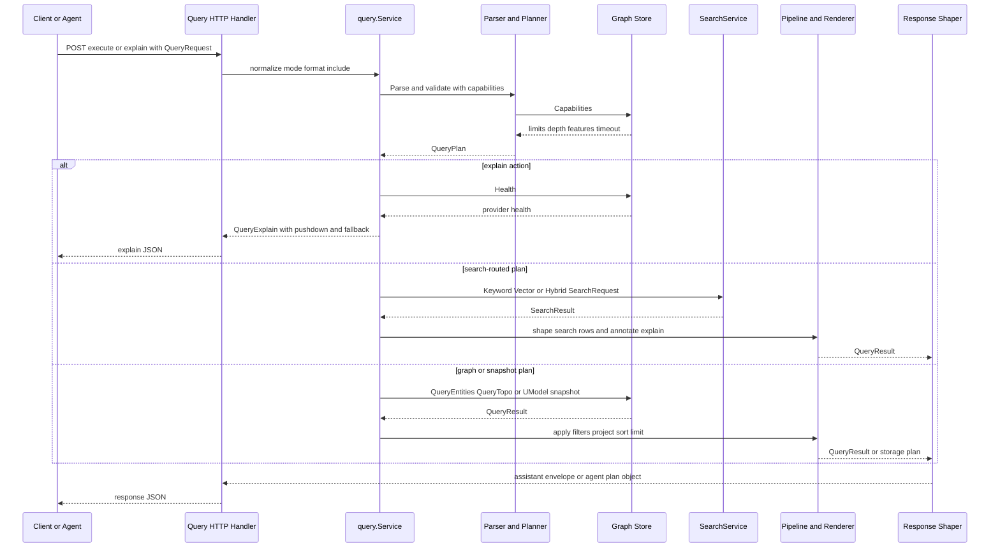

# SPL 查询规划与执行

## 概览

SPL 查询服务的入口是 `POST /api/v1/query/{workspace}/execute` 和 `POST /api/v1/query/{workspace}/explain`。服务先把请求规范化为计划，再根据计划选择图存储或 SearchService；执行结果始终附带 `explain`（`explain` 动作本身只返回解释）。这里的“执行”应理解为执行本地查询、图操作或搜索提供方调用，以及生成数据源查询计划；`mode=plan` 是本服务唯一支持的协议模式，本服务不会把生成的计划再针对真实外部存储执行。需要真实存储数据的后续动作由调用方或 `umodel-assistant` 完成。

服务支持的 SPL 顶层来源如下：

| 来源 | 主要用途 | 规划/执行边界 |
| --- | --- | --- |
| `.umodel` | 查询 workspace 的 UModel snapshot（模型元素） | 读取图存储 snapshot，在服务内做过滤与管道处理 |
| `.entity` | 查询实体 | 无搜索模式时走图存储；`mode=keyword\|vector\|hyper` 时走 SearchService |
| `.entity_set` | 以 EntitySet 为上下文发现数据集、技能、知识，或生成日志/指标计划 | 必须带 `with(domain=..., name=...)` 和 `entity-call`；不执行外部日志/指标存储查询 |
| `.topo` | 查询拓扑关系、邻居、直接关系或受控 Cypher | 图存储负责拓扑查询；图调用只允许出现在此来源 |
| `.runbook_set` | 搜索 runbook、knowledge 或 observations | 总是路由到 SearchService |

`.entity_set` 的内置实体调用包括 `__list_method__`、`list_data_set`、`list_skills`、`list_knowledge`、`get_logs` 和 `get_metrics`。`get_logs` 与 `get_metrics` 会从 UModel snapshot 解析 DataLink、StorageLink 和 storage，并生成下游查询；其中 storage 的 `storage_domain`、`storage_name`、`storage_kind` 会回显到计划，但不会被开源 planner 消费。

## 请求规范化与计划生命周期

服务层先规范化两个协议字段：空 `mode` 默认成 `plan`，显式 `plan` 原样接受；任何其他模式（包括 `data`）返回 `CodeNotImplemented`，并在结构化 `Details` 中提供 `requested_mode`、`supported_modes`、`migration_service=umodel-assistant`、`migration_action=switch_endpoint_to_umodel_assistant` 和迁移文档 URL。`format` 只接受空字符串（assistant envelope）或 `agent`；其他值返回 `CodeInvalidArgument`，并回显请求格式。

随后 `Planner.Plan` 依次调用解析器和计划校验器：

1. `ParseAST` 去除首尾空白，检测来源，并在顶层 `|` 上拆分管道；括号、引号和反引号中的内容不会被错误拆开。
2. `with(...)` 解析为 filters；`where` 支持比较和 `contains(...)`；`project`、`sort`、`limit`、`entity-call`、`graph-call` 与 `graph-match` 分别形成结构化管道算子。
3. `$name` 形式的参数会从 `QueryRequest.Params`/`parameters` 解析并注入 filters、谓词及调用参数；`EntityData`、`entityData`、`filterByEntities` 按优先级取第一个非空值。
4. 计划的 limit 优先级为 `QueryRequest.Limit`、SPL `limit`、`topk`、默认值 100；深度来自图调用（否则来自 AST）。计划同时携带 workspace、time range、原始 query、算子、谓词、排序、调用、format 和 `include_spec`。
5. 规划器以图存储声明的 capability 校验 limit、topk、depth 和操作支持，成功后服务再取得 provider health，填入解释信息。

该图展示从请求规范化到计划、搜索或图执行、管道、解释和响应整形的实际调用边界。

## 能力检查、limit/depth 与失败语义

`GraphStoreCapabilities` 是 provider 的可执行能力契约，包含 `EntitySearch`、`GraphMatch`、`GraphCallNeighbors`、`ControlledCypher`、`TimeVisibility`、`ServerSideFilter`、`MaxDepth`、`MaxLimit` 和 provider timeout。`MaxLimit <= 0` 时 planner 采用 1000；`MaxDepth <= 0` 时采用 1。超出 limit/topk/depth 返回 `CodeValidationFailed`，并带实际值与 `max_limit`/`max_depth`；不会静默截断请求。

操作与来源也在计划阶段拒绝：`graph-match` 需要 `GraphMatch`；`graph-call` 只能用于 `.topo`，且只允许 `getNeighborNodes`、`getDirectRelations`、`cypher`；邻居/直接关系需要 `GraphCallNeighbors`，`cypher` 需要 `ControlledCypher`；`entity-call` 只能用于 `.entity_set`。图节点选择器必须含带引号的 label 和合法的 128-bit lowercase hex `__entity_id__`。受控 Cypher 还必须以 `MATCH`、`OPTIONAL MATCH`、`WITH` 或 `UNWIND` 开始，并拒绝 `CALL`、`CREATE`、`DELETE`、`DROP`、`LOAD`、`MERGE`、`REMOVE`、`SET` 等写入或高风险关键字。

provider timeout 由 capability 的 duration 字符串声明。非空、可解析且为正值时，Service 用 `context.WithTimeout` 包住搜索或图执行；空、非法或非正值不建立 provider deadline。只有 `context.DeadlineExceeded` 或已过 provider deadline 的上下文会映射为稳定的 `CodeTimeout`。客户端断开或父上下文取消产生的 `context.Canceled` 原样透传，不能伪装成可重试的 provider timeout。

## 管道语义与 fetch 策略

对图查询，provider 先返回候选行，executor 再按 SPL 顺序应用 `with`、`where`、`project`、`sort`、`limit`，最后执行计划级 limit。`.umodel` 读取 snapshot 元素后在服务内应用 filters；`.entity_set` 的返回是 assistant 兼容的表格行，通常只做最终 limit，因为实体调用本身已完成关联和计划生成。

为了避免“先取 100 行、再过滤”导致结果丢失，executor 对 `.entity` 和 `.topo` 使用两种互补策略：

- 已知字段上的等值谓词会下推到 provider 的 filters，再由 provider 在 limit 前匹配。拓扑已知字段包括 `__relation_type__`/`relation`、`src`、`dest`；实体已知字段包括 `__domain__` 和 `__entity_type__`（映射为 provider 的 `domain`/`name`）。显式 `with` 已占用的同名或别名 filter 不会被自动覆盖。
- 未知字段、非等值/`contains`/比较谓词，以及任何 `sort`，都需要完整候选集，因此把 provider fetch limit 设为 `-1`；管道在服务内过滤或排序完整集合，然后再应用用户的最终 limit。provider 自身仍会实施其物理上限，所以这不是无限制的资源承诺。

`ServerSideFilter=false` 时，explain 的 `fallback` 会标记 `application_filter`；`where`、`project`、`sort` 分别会留下应用层过滤、投影、排序的 fallback 线索。时间范围会被带入计划；解释通过 `time_range_applied` 表示请求是否给出了 from/to，但是否能由 provider 真正做时间可见性仍取决于 `TimeVisibility`。

## 搜索路由与结果

`.runbook_set` 无条件进入 SearchService；其他来源只有在 `with(mode='keyword'|'vector'|'hyper')` 时进入搜索。空或未识别的搜索 mode 在 Explain 中按 keyword 展示，dispatch 也按 keyword 调用；未配置搜索服务时返回 `CodeProviderUnsupported`。`buildSearchRequest` 将 domain、name(s)、kind(s)、query、origin、embedding_model、topk 和 hybrid_k 映射到公开 `SearchRequest`，其余未知 filter 放到 `Filters` 供 provider 使用。

keyword、vector、hyper 分别调用 `SearchService.Keyword`、`Vector`、`Hybrid`。搜索行转换为 `QueryResult` 时保留 score；`.entity` 会把 `SearchRow.Spec` 展平为实体属性，并补齐实体基础列；runbook 等其他来源使用 `__type__`、`__domain__`、`kind`、`name`、`metadata`、`spec`、`__score__` 等列。解释会额外记录 `search_provider`、`embed_model` 和 `search_mode`。

## entity-call 与 graph-call 边界

### entity-call

`.entity_set` 必须包含 domain、name 和一个合法的实体调用。planner 将别名规范化为 canonical 方法名，并按签名检查参数数量、未知命名参数、重复提供、类型和 required 参数；缺省值写入 `Parameters`，原始参数同时保留在计划中。调用读取当前 workspace 的 UModel snapshot，并通过 data/runbook link 与 entity filter 数据寻找相关资源：

- `__list_method__` 返回当前 EntitySet 可用方法及参数/返回值描述。
- `list_data_set` 列出 MetricSet、LogSet、TraceSet、EventSet 等关联数据集，并可用 `detail` 展开细节。
- `list_skills`、`list_knowledge` 从关联 RunbookSet 返回技能或知识，可按 ID 过滤。
- `get_logs`、`get_metrics` 不访问日志/指标外部存储，而是解析 link、storage、字段映射、实体 ID、SPL 过滤条件、time range 等，生成下游 Elasticsearch Query DSL 或 PromQL 查询计划。

`get_logs` 使用 `document-search` renderer；`get_metrics` 使用 `label-timeseries` renderer。内置 storage kind（如 `elasticsearch`、`prometheus`、`aliyun_prometheus`）可映射到 renderer family；同 family 的新 backend 可以通过配置 `spec.family` 复用 renderer，而无需新增 Go 路由代码。

### graph-call 与受控 Cypher

`.topo | graph-call getNeighborNodes(type, depth, nodeList)` 支持 `sequence`、`sequence_in`、`sequence_out`、`full` 四类遍历；`getDirectRelations(nodeList)` 固定深度为 1。节点 selector 的 seed ID 会进入 `GraphCallPlan`。`graph-call cypher(`...`)` 只接受一个 backtick 查询字符串。

Ladybug provider 的受控 Cypher边界是：先从存储构造受限的内存图快照，再由 `internal/cypher` 的只读执行器执行；它不会把任意 Cypher 直接交给外部数据库。执行器支持 MATCH/OPTIONAL MATCH、WHERE、WITH/RETURN、UNWIND、ORDER BY、SKIP、LIMIT 和 UNION 等读路径，并以计划 limit 截断输出。Explain 在 capability 允许时标记 `graph_call:cypher`、`controlled_cypher`，以及 `cypher_dialect=ladybug`、`cypher_engine=go`。

## explain 输出

`POST .../explain` 与 execute 共用规范化和 `Planner.Plan`，所以会同样拒绝非法 mode、format、来源、调用和 capability。其 JSON 重点字段为：

- `source`、`provider`、`storage_provider`：来源和图存储健康信息；
- `operators`、`depth`、`limit`、`timeout_ms`、`time_range_applied`：有效计划边界；
- `entity_call`：规范化后的调用签名与参数；
- `pushdown`：例如 `entity_search`、`graph_match`、`graph_call:cypher`；
- `fallback`：例如 `snapshot_filter`、`entity_call_plan`、`application_filter`、`application_project`、`application_sort`；
- 搜索场景的 `search_provider`、`embed_model`、`search_mode`；受控 Cypher 的 dialect/engine。

解释描述的是“将由谁做什么”，不是保证每个 provider 都已执行了所有语义；尤其 `fallback` 是应用层补偿的可观测提示，`TimeVisibility` 等 capability 仍决定实际 provider 行为。

## 响应格式与 plan-only 合同

默认 `format=""` 使用兼容旧 assistant 的 `QueryExecuteResponse`：HTTP 层把 `QueryResult` 转为 `{code, data, message, success}`，其中 `data.header` 是列名、`data.data` 是矩阵，响应状态为 `Success/None/Info`。这会把 `.entity_set` 的 query plan 放在 `query` 列中（responseType=1），保持旧客户端行为。

`format="agent"` 使用 agent-native plan schema v1.1。executor 以唯一列 `__agent_plan__` 标记计划结果；HTTP 层检测该 sentinel 后直接把 plan map 写成顶层 JSON，而不是再包 assistant envelope。`include_spec=true`（或 HTTP `?include=spec`）才展开 `data_source.storage.config`、`data_link.spec`、`storage_link.spec` 等折叠字段；未开启时使用紧凑的 `{ref, kind}` 结构。计划包含 `mode: "plan"`、`version: "v1.1"`、`operation`、`description`、`next_action: "execute_query"`、`source_query`、`params_echo`、`data_source` 和生成的 `query`。

因此调用方应区分三层行为：

1. 本服务解析并验证 SPL，读取 UModel/图元数据，并可调用已配置的搜索或图 provider；
2. `get_logs`/`get_metrics` 产出真实下游查询文本和数据源引用，但不会执行这些外部日志/指标查询；
3. 需要 `mode=data` 的真实存储执行必须迁移到 `umodel-assistant`（或由调用方按 `next_action` 执行 inner `query`）。不支持的 mode 返回结构化迁移详情，而不是返回一个看似成功的空数据结果。

## 配置、扩展与测试重点

provider 通过 `Capabilities`、`Health` 和 graph store 接口接入查询服务；新增 provider 应明确能力、最大深度/行数、超时和过滤语义，而不是只实现接口后依赖默认值。搜索扩展实现 `SearchService` 的三种模式、健康和能力接口。存储查询 renderer 通过 registry 按 family 扩展；同类协议优先用 `spec.family` 配置复用已有 renderer。

修改查询语义时，优先运行并补充以下聚焦测试：`internal/query/parser_test.go` 覆盖来源、参数和管道解析；`internal/query/planner_test.go` 覆盖 limit/depth、能力拒绝和 explain pushdown/fallback；`internal/query/service_test.go` 的 fetch-limit 场景验证已知字段下推、未知字段全量 fetch 与 sort 全量可见；`internal/query/search_routing_test.go` 验证 runbook/entity 的 keyword/vector/hyper 路由和搜索结果；`internal/query/mode_test.go`、`format_test.go` 与 `agent_envelope_test.go` 锁定 plan-only、迁移详情和 v1/v1.1 envelope；`internal/query/timeout_test.go` 区分 deadline 与 cancellation；`internal/cypher/engine_test.go`、`conformance_test.go` 和 `engine_depth_test.go` 锁定只读 Cypher、图遍历和深度行为。
