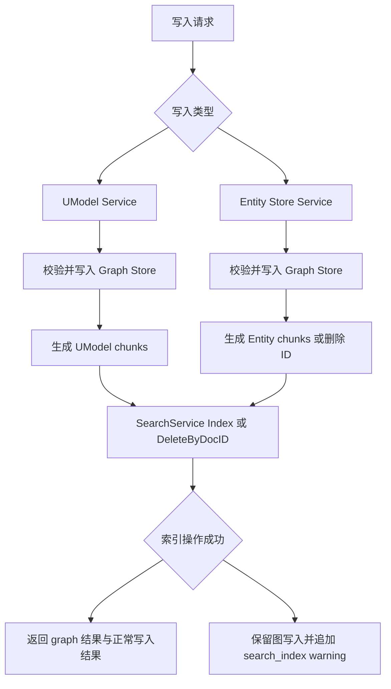

# Runtime Search and Index Consistency

本文描述运行时搜索路径，而不是图存储的查询语法本身。查询计划决定请求是否走 `SearchService`；搜索服务负责构造内部 `Query`、调用 Provider，并把命中转换为公开的 `SearchResult`。图写入先提交，索引更新随后尝试执行，因此图与搜索索引之间是“图写入成功、索引可能带 warning”的最终一致性关系。

相关主题：

- [Query Planning and Execution](./query-planning-and-execution.md)：查询解析、计划和图查询执行。
- [UModel Schema Validation](./umodel-schema-validation.md)：UModel 写入的 schema 校验边界。
- [Providers and Persistence](../operations/providers-and-persistence.md)：应用启动时的 Provider 装配与持久化背景。
- [Import and Mutate Data](../workflows/import-and-mutate-data.md)：导入和实体/UModel 变更工作流。

## 1. 运行时组成

搜索由三层职责组成：

1. `internal/search/contract` 定义稳定的内部边界。
   - `Chunk` 是索引单元，包含 `DocID`、来源、kind、domain、name、可检索的 `Text`、可选 `Vector`、属性 `Attrs`、展示用 `Metadata` 和返回给查询层的 `Spec`。
   - `Provider` 负责 workspace 生命周期、批量写入、按文档 ID 删除、keyword/vector 查找、能力与健康状态。
   - `Embedder` 只负责把查询文本转换成向量，并报告维度与模型名。
2. `internal/search.Service` 是编排层。它把公开的 `SearchRequest` 投影为内部 `Query`，调用 Provider，并统一实现 hybrid 检索和 RRF；Provider 不需要实现 hybrid。
3. `internal/query` 是查询语言边界。`.runbook_set` 总是路由到搜索；`.umodel` 与 `.entity` 只有在过滤器显式选择 `mode=keyword`、`mode=vector` 或 `mode=hyper` 时才路由到搜索。没有 mode 的普通 `.entity` 查询仍走图存储。这里对外的 hybrid 模式字符串是 `hyper`，内部最终调用 `Hybrid`。

*图：UModel 与实体变更先持久化图，再尝试更新搜索索引；索引失败不会伪装成图写入失败。*

### 当前 bootstrap 配置

`internal/bootstrap/app.go` 的 `NewAppWithGraphStore` 当前固定创建 `search.ProviderTypeMemory`，再以 `nil` embedder 调用 `search.NewService`。`NewService` 将 nil 替换为 `embed.Noop{}`，所以默认应用组合是 **memory Provider + noop Embedder**；这不是持久化 ANN 或真实语义模型。实现方可以在自己的 construction 中传入注册过的其他 Provider 和 Embedder，但仅修改配置数据不会自动替换 bootstrap 中这段固定装配。

memory Provider 是进程内实现：按 workspace 保存 `map[DocID]Chunk`，`OpenWorkspace` 只是确保 bucket 存在。它的 keyword 是对 `Chunk.Text` 的大小写不敏感子串匹配；vector 路径在 memory 实现中并不计算余弦距离，而是使用查询词在文本中的 token-overlap 分数。noop embedder 对每个输入返回一维零向量，因此它验证的是端到端 wiring，不代表真实向量质量。memory Provider 的健康状态为 `ok`，Provider 名为 `memory`。

Provider 可通过 `RegisterProvider` 注册工厂；`NewProvider` 使用 `ProviderConfig.Type` 查找工厂，空类型回退到 `DefaultProviderType`（`memory`），未知类型返回错误。替换 Provider 时必须实现索引、删除、keyword/vector 检索、能力、健康和关闭等完整接口；搜索服务仍会在自身内部提供 hybrid/RRF。

## 2. 三种检索模式

### Keyword

`Service.Keyword` 不生成向量，直接把文本与过滤条件放入 `Query` 并调用 `Provider.Keyword`。默认 `TopK` 为 10；结果行保留命中类型、domain、kind、name、metadata、spec 和分数，并标注 Provider 与 Embedder 模型名。Provider 可以利用 `Source`、`Domain`、`Names`、`Kinds`、`Type` 和 predicate 做过滤下推；当前 memory Provider 实现了这些字段中的来源、domain、name、kind、type 与 predicate 过滤。

### Vector

`Service.Vector` 先调用 Embedder；空查询不生成向量，非空查询取 Embedder 返回的第一个向量，然后调用 `Provider.Vector`。Embedder 错误会直接成为搜索错误；Provider 错误会被包装为 `search vector`。这使真实 Provider 可以使用 `Query.Vector`，而默认 memory Provider 仍以 token-overlap 作为确定性的替代实现。

### Hybrid 与 RRF

`Service.Hybrid` 对同一个 `Query` 分别执行 keyword 和 vector 检索；任一轴失败都会使本次搜索失败。随后用 Reciprocal Rank Fusion 合并两个有序命中列表：每个文档在每个轴贡献 `weight / (k + rank)`，rank 从 1 开始；默认 `HybridK` 为 60，keyword/vector 权重默认都为 1，也可由 `Weights` 中的 `keyword` 与 `vector` 覆盖。以 `DocID` 去重，分数相同按 DocID 升序稳定排序，最后按 `TopK` 截断。服务能力会强制声明 `HybridSearch=true` 与 `RRF=true`，因为融合发生在 Service 而非 Provider。

`TopK`、domain、name(s)、kind(s)、query、origin、embedding_model 与 `hybrid_k` 由查询计划显式投影；未知过滤器仍放入 `SearchRequest.Filters`，其中 `type` 会被 Service 转成内部 `Query.Type`。`.entity` 的搜索结果在 query 层会把 `Spec` 展平成实体行，并补齐 `__domain__`、`__entity_type__` 与默认 `__deleted__=false`；其他搜索源则返回通用搜索行。

## 3. workspace、chunk 与文档 ID

workspace 是索引隔离的第一边界：Service 每次检索把 workspace 放进 `Query`，Provider 的写入和删除也显式接收 workspace。memory Provider 为每个 workspace 维护独立 bucket，所以相同 `DocID` 在两个 workspace 中不会互相覆盖；调用者不能依赖仅凭 DocID 跨 workspace 定位文档。

一个 UModel 元素可以产生一个主 chunk，也可以产生多个知识分块。当前文档命名规则如下：

| 内容 | `Source` | `DocID` | 生成内容 |
| --- | --- | --- | --- |
| 普通 UModel 元素 | `.umodel` | `umodel/` + `model.UModelElementKey(element)` | kind、domain、name、version 和完整 `Spec` |
| `runbook_set` 的 section | `.runbook_set` | `runbook_set/` + 元素 key + `/` + section | `knowledge`、`observations`、`actions`、`automations`、`skills` 中存在且非 nil 的 section |
| 实体 | `.entity` | `entity/` + `model.EntityStableKey(payload)` | domain、entity type、entity ID、method 和完整实体 payload |

实体 chunk 将实体 ID 与 method 同时放入 `Attrs`/`Metadata`，完整 payload 放入 `Spec`；UModel 主 chunk 的 `Spec` 是元素 spec，runbook section chunk 的 `Attrs.type` 与 `Metadata.type` 是 section 名。这些字段决定过滤和结果投影，不只是展示信息。

DocID 前缀是语义命名空间，不是 workspace 前缀；workspace 已由 Provider 的外层参数隔离。更新使用同一个 DocID 写回 chunk，因此 memory Provider 的 map assignment 是覆盖；换言之，实体或 UModel 更新不会留下同一逻辑对象的旧版本 chunk。真实 Provider 必须保持这种按 DocID upsert 语义，或在替换实现时明确提供等价的版本/覆盖行为。

## 4. 变更后的索引生命周期

### UModel Put、Delete 与 runbook 分块

`umodel.Service.PutElements` 先验证并调用 `graph.PutUModelElements`，成功后更新 schema 内存索引，再调用 `search.Index`。一个 UModel 写入失败时不会调用索引；索引失败只向 `WriteResult.Warnings` 追加 `Field: "search_index"`。`DeleteElements` 先调用 graph delete，只针对 graph 返回中成功接受的 item 处理索引删除，然后删除主 `umodel/` 文档；如果被删除元素是 `runbook_set`，还会根据已缓存元素的 section 删除对应的 `runbook_set/.../section` 文档。删除请求不是写入一个“已删除”搜索 chunk，而是对这些 DocID 调用 `DeleteByDocID`。

`RebuildIndex` 当前从 graph 读取 snapshot 并重建 UModel 的内存 schema index；它本身没有调用 `search.Index`，因此不能被误解为搜索 Provider 的物理重建命令。若搜索 backend 丢失，需要由具体 Provider 或应用层提供相应重建流程；UModel Service 的该方法只维护 schema 侧状态。

### Entity Create、Update、Expire 与 Delete

`entitystore.Service.WriteEntities` 先逐条 schema 校验，再把有效批次写入 graph。graph 成功后，`indexEntities` 将普通 Create/Update/其他非删除 method 变成 `entity/<stable-key>` chunk，并 upsert 到搜索。`__method__` 为大小写不敏感的 `expire` 或 `delete` 时，不生成 chunk，而是把 stable key 转换为 `entity/<stable-key>` 后调用 `DeleteByDocID`。

`ExpireEntities` 通过稳定键生成 Expire payload，graph 写成功后同样删除搜索文档；格式不正确的稳定键是单项失败。实体删除是“物理移除搜索文档”而非让搜索结果带 `__deleted__=true` 的 tombstone；历史可见性和 `__deleted__` 语义由 graph store 的时间模型维护，搜索删除会使这类实体不再由当前搜索 Provider 返回。关系写入目前只写 graph，不生成或删除搜索 chunks；不要把关系的 graph 生命周期推断为搜索文档生命周期。

### 失败语义与重试

UModel 和 entity 写路径都遵循相同顺序：graph 操作返回错误时，整个写调用返回错误且不会继续索引；graph 已成功而 `Index` 或 `DeleteByDocID` 报错时，写结果仍返回 graph 的接受/失败项目，并在 `Warnings` 增加 `search_index`。因此搜索失败被明确暴露为写入 warning，不会静默地当作 graph-write failure，也不会回滚已经提交的 graph mutation。调用方应监控 warning，并按稳定 DocID 重试或执行 Provider 特定的重建/补偿；带 idempotency key 的实体写结果会缓存整个写结果，重放同一 key 可能直接返回缓存结果，不应把它当成自动索引重试机制。

## 5. 安全修改与扩展检查清单

- 新 Provider 必须把 workspace 作为真正的隔离键，并支持按 DocID 删除；不能仅用全局 DocID map。
- 保持 `umodel/`、`runbook_set/`、`entity/` 前缀与生成规则，否则删除路径无法清理旧文档，会造成幽灵命中。
- 修改 chunk 文本或 `Spec` 投影时，同时检查 query 层对 `.entity` 与 `.runbook_set` 的列映射，以及 `type`/domain/name/kind 过滤。
- 为真实向量 Provider 配套真实 Embedder，并检查维度、模型标识和失败传播；noop 只适合默认 wiring 与测试。
- 不要让索引错误改变 graph 写入的成功语义；应继续写 `search_index` warning，并在运维侧处理最终一致性。
- 若改变删除为后端 tombstone，要保持当前对调用者可见的删除约定：删除 API 是按 workspace 和 DocID 执行，当前 memory Provider 的行为是从 bucket 中移除，而不是返回删除命中。

## 6. 关注的测试

`internal/search/service_test.go` 覆盖 memory Provider 上 keyword 的 domain 隔离、vector wiring、hybrid 融合、TopK 截断、能力声明和健康检查；这是替换 Provider 或 Embedder 后应保持的基础契约。`internal/query/search_routing_test.go` 覆盖 `.runbook_set` 强制搜索、`.entity` 的 vector/keyword 路由、无 mode 时留在 graph，以及搜索结果展平和 explain 标记。`internal/umodel/delete_test.go` 验证删除一个 runbook_set 同时清理主 UModel 文档和每个存在的 section 文档。实体 CRUD 查询测试则验证 Update 的当前可见性、Expire 的当前隐藏与历史 graph 可见性；它也提醒维护者，搜索删除与 graph 的历史删除语义是两个不同边界。
