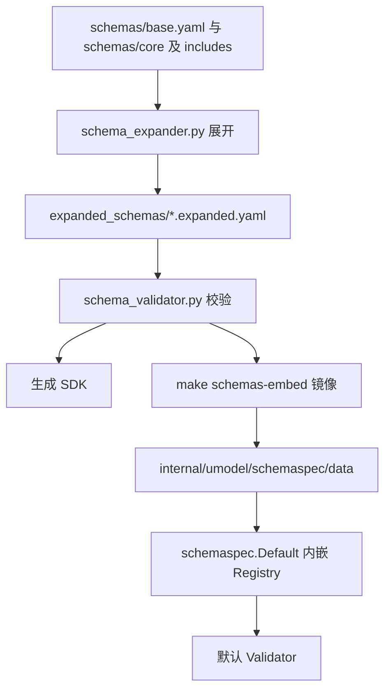

# UModel Packs、Schema Registry 与 Validation

UModel 元数据是对象图的“词汇表”：它用 `kind` 表示模型类别，用 `domain` 和 `name` 标识域内对象，用 `spec` 描述该类别的结构，用可选的 `version` 表示模型 envelope 版本。元素的稳定键是 `domain/name/kind`；因此同一 workspace 中重复导入同一键会覆盖同一对象，而不是产生第二个语义对象（`pkg/model/types.go`、`internal/umodel/index.go`）。

仓库把模型定义组织成三层：`schemas/base.yaml` 规定 Schema 元数据语法，`schemas/includes/` 放可复用组件，`schemas/core/` 放数据集、link 与 storage 等具体模型。`expanded_schemas/*.expanded.yaml` 是展开后的运行时输入；仓库的验证报告记录了 25 个展开文件均通过工具校验。多域 quickstart 则是可信的完整 pack 示例，包含 `devops`、`k8s`、`automaker`、`game`、`supplier` 以及跨域 link，可用 `.umodel` 查询模型。

## 从 Schema 源到运行时注册表

Schema 的维护链路不是让服务在请求时读取任意 Schema 文件，而是先生成并校验展开文件，再把同一批文件镜像到 Go 的 embed 目录：



该图表示生成、校验、镜像和运行时加载之间的关系。

`make expand` 依次运行展开、展开文件校验、Go/Python/Java SDK 生成，最后执行 `schemas-embed`；`make schemas-embed-check` 会比较 `expanded_schemas/` 与 `internal/umodel/schemaspec/data/`（忽略 Markdown），防止服务携带过期副本。Go 侧通过 `//go:embed data/*.expanded.yaml` 编译进二进制，`schemaspec.Default()` 使用 `sync.Once` 延迟初始化，目录中任一文件读取或解析失败都会使默认注册表初始化 panic，而不是静默使用不完整词汇表。

注册表逐个解析展开 YAML，要求有 `name`、至少一个 `versions` 项、首个版本的 `spec` 以及其下的 `properties.spec`；同名 Schema 会拒绝。当前运行时解析每个 Schema 的首个版本，并把其 `name` 作为 `kind` 查找键、其版本名作为可接受 envelope 版本的一部分。注册表还固定接受清单级 `v0.1.0`，而当前内嵌模型版本为 `v1.0.0`；未知版本（例如 `v9.9.9`）不接受。这里的“接受版本”是 envelope 兼容性门槛，不表示服务会在导入时动态下载或自动迁移任意历史版本。

默认注册表覆盖 `entity_set`、`entity_source`、`metric_set`、`log_set`、`event_set`、`trace_set`、`profile_set`、`runbook_set`、`explorer`、各类 storage，以及 `entity_set_link`、`entity_source_link`、`data_link`、`storage_link`、`runbook_link`、`explorer_link` 等模型类别。增加或改变类别的扩展点在源 Schema、展开/校验生成链和内嵌镜像，而不是仅修改一个请求样例。

## Import 的输入格式与安全边界

API 入口是 `Service.Import(ctx, workspace, UModelImportRequest)`，请求包含 `path` 和可选 `common_schema_packs`。它支持单个 `.yaml`、`.yml` 或 `.json` 文件，也支持目录递归导入；目录中的这些扩展名按排序后的路径顺序读取，其他文件计入 `Skipped`。隐藏目录以及 `node_modules`、`vendor`、`target`、`dist`、`build`、`sample-data`、`deploy` 会跳过。YAML 的 `map[any]any` 会递归规范化成 `map[string]any`，然后转换为元素。

转换时，`kind` 来自顶层；`name`、`domain` 优先来自 `metadata`，也兼容顶层字段；`version` 优先来自 `schema.version`，也兼容顶层 `version`。缺少 `kind`、`domain` 或 `name` 会在解析阶段失败；若 `domain` 缺失，会尝试从名称第一个点号前的部分推断。最终写入的模型只保留上述 envelope 字段和 `spec`，所以导入文件中的其他顶层字段不会自动成为 UModel 属性。`schema.url` 属于 pack 描述，但当前元素转换不把它带入 `UModelElement`。

**API-originated import 不等于服务器的任意文件读取。** `Service.Import` 会把路径解析为绝对路径、清理并解析符号链接，然后要求它位于 `WithImportRoot` 配置的根目录内；默认根目录是服务当前工作目录。根目录和候选路径都按真实路径比较，目录扫描得到的每个文件还会再次检查，因此嵌套的 YAML 符号链接也不能逃出根目录。路径不存在、不可访问、扩展名不支持或越界会返回 `INVALID_ARGUMENT`；这里不能把 `WithImportRoot("/")` 当作默认安全策略，它事实上允许全局路径。

可信的 bundled sample 是单独的边界：`internal/sampledata/service.go` 通过 `repoPath` 从仓库解析 quickstart 路径后调用 `ImportTrusted`。该入口跳过 import-root confinement，设计前提是调用者已经证明路径来自仓库/内置样例，代码注释也明确要求它不能触达用户输入。不要把 `ImportTrusted` 暴露给 API 参数；普通 API 和 SDK 应使用 `Import`。

`common_schema_packs` 是预留的导入钩子，不是当前已实现的通用 pack 下载器。若请求包含它而没有安装 `CommonSchemaLoader`，导入会返回 `NOT_IMPLEMENTED`；安装 loader 后由该 hook 产生额外元素，再与文件元素一起写入。

## Validation envelope 与字段语义

服务默认使用 `schemaspec.DefaultValidator`。`PutElements` 先检查 workspace，再逐元素检查 `kind`、`domain`、`name`；随后 Validator 按 `kind` 从内嵌 Registry 查找 Schema，并针对 `spec` 递归 walk。Schema 支持 `string`、`integer`、`float`、`boolean`、`time`、`object`、`array`、`map`、`semantic_string` 等类型，以及必填、正则、长度、数组/Map 大小和枚举约束。数组元素和 Map value 会继续按子属性验证；未定义的 object 字段不是硬失败，而是 warning。

`entity_set` 的典型约束要求 `fields` 数组项为 object 且至少有 `name` 和 `type`；`entity_set_link` 的 link 端点使用 `src`/`dest`，各自需要 `domain`、`kind`、`name`，并要求 `entity_link_type`。这也是为什么把旧式 `source`、`destination`、`relation_type` 写入 link spec 会得到未知字段 warning，同时因缺少 `entity_link_type` 得到 validation error。

错误与警告的处理有明确区别：

- **错误**包括 envelope 版本不支持、未知 `kind`、类型/枚举/正则/必填约束失败，以及 import 文件解析失败。`Validate` 返回 `Valid: false`；`PutElements` 以 `VALIDATION_FAILED` 拒绝整个 batch，不调用 graph store，也不会更新内存索引或搜索索引。
- **警告**包括 Schema 中未定义的字段、`experimental` 或 `deprecated` 字段，以及之后的搜索索引失败。warning 不会使 `Valid` 变为 false；成功的 graph 写入仍会返回 warning。字段问题聚合为带 `elements[i].spec...` 路径的 `ErrorDetail`，但写入错误详情目前只把首个 validation error 放入主错误，并用 `additional_errors` 记录其余数量。
- Validator 本身对未知 kind 返回 Go error；Service 将它归入带元素索引的 validation error。`NewNoopValidator()` 只适合明确需要绕过 Schema 的测试，不应作为生产语义校验配置。

当前 TODO 是 Validator 尚未直接校验完整的 kind/schema/metadata envelope；导入解析和 Service 的最低 `kind`、`domain`、`name` 检查承担这部分边界。因此修改 envelope 或支持新的 envelope 字段时，应同时审查 `elementFromPayload`、Service 检查和 Registry 版本集合，而不要只改 `walk`。

## 写入、索引与搜索副作用

导入在所有文件解析成功、common pack 加载成功后，把元素组成一个 `UModelElementBatch` 调用 `PutElements`。成功路径的顺序是：graph store 持久化 → 合并 workspace 的内存 schema index → 汇总 Schema warnings → 调用可选的 search indexer。搜索索引失败不会回滚 graph 或内存 index，而是作为 `search_index` warning 返回；未配置 search indexer 时只维护 graph 和内存 index。

```mermaid
flowchart TD
    Request["Import 或 PutElements"] --> Parse["解析 YAML JSON 与 envelope"]
    Parse --> Valid{ "基础字段与 Schema 有效吗" }
    Valid -- 否 --> Reject["返回 VALIDATION_FAILED 不写 graph"]
    Valid -- 是 --> Graph["graph.PutUModelElements"]
    Graph --> Memory["mergeIndex 更新 workspace 索引"]
    Memory --> Search{ "配置 search indexer 吗" }
    Search -- 否 --> Done["返回写入结果与 warnings"]
    Search -- 是 --> Index["Index umodel chunks"]
    Index --> Warn["失败仅追加 search_index warning"]
    Warn --> Done
```

该流程强调校验失败不会产生 graph/index/search 写入，而搜索失败是成功写入后的可观测退化。

内存 index 按稳定键保存元素，同时按 `kind + domain + name` 提供实体集解析；`ResolveRelationType` 会在 `entity_set_link` 中按域和 `entity_link_type` 等字段推断关系类型。服务启动或需要修复内存状态时，`RebuildIndex` 从 workspace 的 graph snapshot 整体替换索引；它不重新验证 snapshot，也不负责搜索索引重建。修改模型后，查询解析因此依赖写入成功后的 index 或显式 rebuild，而不是重新扫描导入目录。

每个普通模型元素至少产生一个搜索文档：`umodel/<domain>/<name>/<kind>`，来源为 `.umodel`，文本包含 kind、domain、name、version 和 spec。`runbook_set` 的 `knowledge`、`observations`、`actions`、`automations`、`skills` 非空 section 还各自产生 `.runbook_set` 子文档。这解释了模型写入为何会影响搜索结果；具体搜索后端和索引生命周期见 [搜索与索引](/openwiki/concepts/search-indexing.md)。

## 删除语义与操作检查

`DeleteElements` 先调用 graph store 删除指定 ID，只把返回结果中 `OK` 且有 ID 的项目视为真正删除；随后从 workspace 内存 index 删除对应稳定键，并向 search indexer 删除 `umodel/<id>` 文档。若被删元素是已缓存的 `runbook_set`，还会根据其存在的五类 section 删除相应子文档。graph 删除成功但搜索删除失败时，结果仍返回并追加 `search_index` warning；没有被 graph 接受的 ID 不会误删内存或搜索状态。

因此运维上应把 `accepted`、`failed` 和 `warnings` 一起检查：校验错误意味着模型没有进入 graph，搜索 warning 意味着 graph/index 可能已经改变但搜索需要重试或后端修复。重复导入同一个 `domain/name/kind` 是幂等式覆盖；导入目录前应确认目录内容、跳过规则和真实路径边界；Schema 修改后应运行 `make expand`、`make schemas-embed-check` 以及相关 Go 测试，尤其是 `internal/umodel/import_confine_test.go`、`internal/umodel/import_test.go`、`internal/umodel/schemaspec/registry_test.go`、`internal/umodel/schemaspec/validator_test.go` 和 `internal/umodel/delete_test.go`。这些测试分别守住路径/符号链接 confinement、文件格式与索引重建、注册表类别/版本、嵌套约束与 warning/error 分类，以及删除后的内存和搜索清理。
