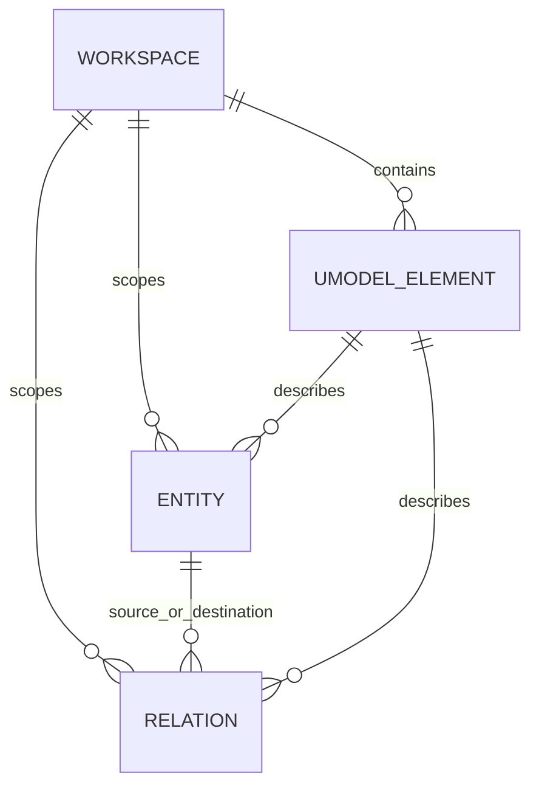
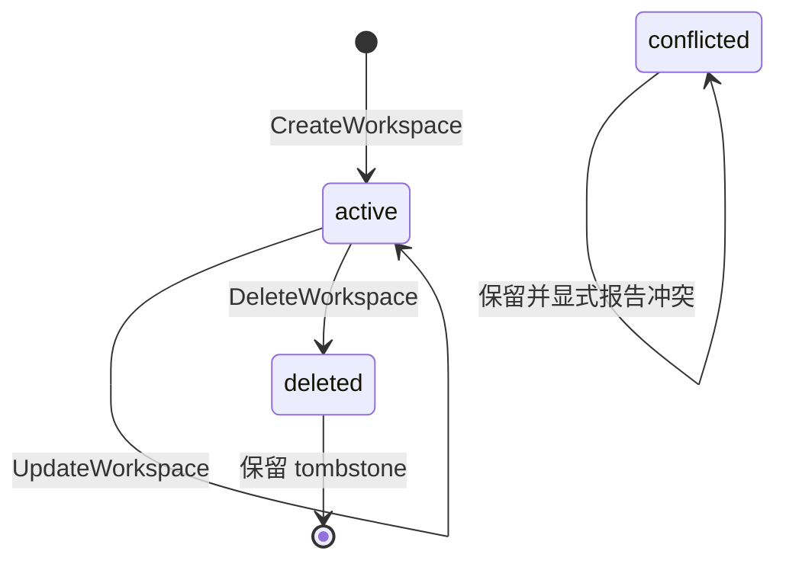
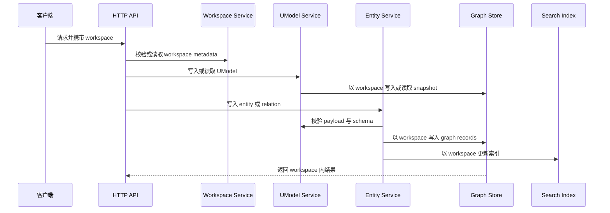

# 工作区与对象图模型

## 核心定义

`workspace` 是 UnifiedModel 中一组运行时数据的身份和隔离边界。请求、schema 解析、UModel snapshot、实体写入、关系写入、图查询和搜索索引都携带同一个 workspace；图存储内部也按 workspace 分别维护 UModel、实体和关系集合。因此，相同的稳定键在不同 workspace 中代表不同记录，不能把一个 workspace 的查询结果或幂等结果当作另一个 workspace 的数据。

工作区服务只负责 workspace 元数据生命周期，不负责直接创建或删除图中的对象。图 provider 通过 `OpenWorkspace`/`EnsureSchema` 准备自己的 workspace 容器；对象服务再把已验证的批次交给 graph store。这个边界使“工作区已删除”与“对象数据如何清理”成为两个不同的运维问题。

该 ER 图只表达代码支持的逻辑关系：workspace 是所有集合的作用域，relation 连接两个 entity，UModel element 通过 domain/name/type 为实体集或关系类型提供 schema 描述；代码没有为这些 schema 关系建立显式外键。

## Workspace 身份、元数据和路径

`WorkspaceMetadata` 包含以下稳定的管理信息：

- `ID` 是机器身份；`Name`、`Description` 和 `Labels` 是可管理的展示与筛选属性。
- `Config` 按 namespace 保存 provider 或其他组件的配置，并可由注入的 `WorkspaceConfigValidator` 逐 namespace 校验。
- `Paths.Root` 是 workspace 的实例根目录，`Paths.Tmp` 是其临时目录；使用 root `data` 时默认分别为 `data/instances/{id}` 和 `data/instances/{id}/tmp`。
- `Status`、`ResourceVersion`、`CreatedAt`、`UpdatedAt` 和可选的 `DeletedAt` 描述状态与变更版本。

<!-- openwiki: broken internal link [?:[a-z0-9_-]{0,62}[a-z0-9]] file "?:[a-z0-9_-]{0,62}[a-z0-9]" does not exist. Fix the href or restore the target, then delete this comment. -->
workspace ID 必须满足正则 `^[a-z0-9](?:[a-z0-9_-]{0,62}[a-z0-9])?$`：长度最多 64，首尾为小写字母或数字，中间可含 `_`、`-`。这既是 API 校验规则，也是从 provider 目录恢复元数据时的安全边界；例如 `../bad` 会被拒绝。file-memory provider 仍把 ID 转成单一、受 containment 保护的路径段，不能依赖调用者输入来构造任意路径。

HTTP 入口位于 `/api/v1/workspaces`：

- `POST /api/v1/workspaces` 创建 metadata；未给 `Name` 时回退为 ID。
- `GET /api/v1/workspaces` 按排序后的 ID 分页，默认最多 100 条，可用 `page_token`、`include_deleted`、`include_conflicts` 和 label selector 筛选。
- `GET`、`PUT`、`DELETE /api/v1/workspaces/{id}` 分别读取、更新和标记删除 metadata。

创建从 `ResourceVersion: 1`、`Status: active` 开始。更新支持 name、description、labels 和 config 的 merge 或 replace；只有实际发生变化才递增 resource version 并更新时间。提供非零 `IfMatchVersion` 时，必须与当前版本完全相等，否则返回 `CodeVersionConflict`。这使调用方可以在并发更新时避免无条件覆盖。

## 生命周期：active、deleted 与 conflicted

模型明确定义三个状态：`active`、`deleted` 和 `conflicted`。它们不是同一个“不可用”状态的不同文案：

该状态图展示 metadata 服务实现的状态边界；代码没有提供从 `conflicted` 自动修复为 `active` 的转换。

- `active` workspace 可被 `GetWorkspace` 读取和更新。
- `deleted` 是 metadata tombstone，而不是物理删除。删除记录 `DeletedAt`、递增 `ResourceVersion`，重复删除返回原 metadata；`GetWorkspace` 返回 `CodeWorkspaceTombstoned`，默认 list 隐藏它，`include_deleted=true` 才显示。相同 ID 不能重新创建，会继续得到 tombstone 错误。
- `conflicted` 表示 workspace identity 冲突，与 deleted 分开处理。`GetWorkspace` 返回 `CodeWorkspaceConflicted`；默认 list 隐藏它，`include_conflicts=true` 才显示；更新和删除也拒绝对 conflicted metadata 操作。持久化加载会保留该状态，不应把它当成已删除。

持久化 workspace metadata 时使用版本为 1 的 `workspaces.json`，采用临时文件写入后 rename 的方式替换目标文件。重启会恢复 metadata；如果 metadata 不存在，persistent service 可以从 file-memory 或 Ladybug 的 provider-specific workspace 目录恢复一个 active 记录，但已有 deleted metadata 优先，因此不会因为数据目录仍存在而复活已删除 workspace。

## UModel 元素与 schema snapshot

UModel 元素的最小身份由 `Kind`、`Domain`、`Name` 构成，可选 `Version` 和任意 `Spec`。`UModelElementKey` 固定生成 `domain/name/kind`，写入 memory、file-memory 和 Ladybug 时都以此作为稳定主键；更新同一 key 会覆盖元素，删除按该 key 操作。UModel service 在写入前执行 schema 校验，失败时不会把无效元素交给 graph store；成功后更新 workspace 内的索引和搜索文档。

`entity_set` 元素可被解析为 `EntitySetSchema`，`relation` 类型元素可被解析为 `RelationSchema`。解析引用分别使用 `EntityTypeRef{Domain, Name}` 和 `RelationTypeRef{Domain, Type}`；找不到对应元素时返回引用但字段为空，而不是凭空生成 schema。`UModelSnapshot` 总是带 `Workspace`、`Version` 和元素列表：memory 使用 `memory`，file-memory 使用 `file.memory`，Ladybug 使用 `local.ladybug`（除非调用方显式请求版本）。`SnapshotVersion` 把该 provider snapshot 版本暴露为 `SchemaVersion`，所以这里的 version 是 snapshot/provider 版本标识，不应误解为每个元素的 `UModelElement.Version`。

通过 import 载入模型时，`Import` 先把用户提供的路径限制在配置的 import root，并对发现的每个文件再次检查解析后的路径；解析出的元素随后以指定 workspace 写入。`ImportTrusted` 只用于已受信任的 bundled sample 路径，不能接收用户输入。

## Entity 与 Relation 记录

### Entity

`EntityRecord` 的结构化表示包含：

- 稳定 `Key`；
- `Domain`、`Type`、`ID`；
- `Method`；
- `Deleted` 生命周期标记；
- `Properties` 业务字段。

写入 API 实际接收 `EntityPayload`。CMS 2.0 必需字段是 `__domain__`、`__entity_type__`、`__entity_id__`、`__method__`、`__first_observed_time__`、`__last_observed_time__`；entity ID 必须是 128-bit 的小写十六进制字符串，method 必须为 `Create`、`Update`、`Expire` 或 `Delete`。`EntityStableKey` 将前三个身份字段连接为 `domain/entity_type/entity_id`。该 key 也作为 batch 结果 ID、memory map key、Ladybug 主键和搜索文档 ID 的基础。

memory store 对 method 有明确语义：重复 Create（已有且未删除）失败；Update 覆盖属性但保留原来的 `__first_observed_time__`；Expire 和 Delete 更新生命周期字段并把 `__deleted__` 设为 true；普通 upsert 保留已有的首次观测时间。当前查询隐藏 Delete 记录和已删除记录，带时间范围的查询仍可按观测时间看到 Expire 的历史记录。

### Relation

`RelationRecord` 包含稳定 `Key`、`Source`、`Dest` 两个 `EntityRecord`、`Type`、`Method`、`Deleted` 和 `Properties`。写入 payload 的身份字段是 source 的 domain/type/id、`__relation_type__` 以及 destination 的 domain/type/id。`RelationStableKey` 固定连接七段：

`src_domain/src_entity_type/src_entity_id/relation_type/dest_domain/dest_entity_type/dest_entity_id`

因此 relation 的身份包括方向和两端实体；仅改变属性或生命周期字段不应产生另一个关系 key。relation 写入前的校验要求两端 entity ID 合法并要求上述关系类型、method、观测时间字段齐全。

memory store 对 relation 使用与 entity 相同的 Create、Update、Expire、Delete 规则。Ladybug provider 将实体存入 `entity` node table，将关系存入 `topo` relation table；写关系时会先确保 source 和 destination entity node 存在，因此仅由关系导入也能建立端点占位记录。Ladybug 的 schema 使用 `entity_key` 和 `relation_key` 等稳定字段，并以 `deleted`、观测时间和 keep-alive 字段支持生命周期查询。

## 时间可见性、tombstone 与 expiry

`__deleted__` 是存储记录上的 tombstone 标志，不等于从存储 map 或数据库中物理移除。`ExpireEntities` 和 `ExpireRelations` 要求调用方提供稳定 key，服务将 key 解析成带当前时间的 `Expire` payload，再写回 graph store；非法 key 只产生该 item 的校验失败。Expire 还会删除对应 entity 的搜索文档。`Delete`/`Expire` 记录仍可为历史数据提供依据，但普通 current query 隐藏它们。

带 `TimeRange` 查询时，若记录具备 `__first_observed_time__` 和 `__last_observed_time__`：

- `first >= to` 的记录不可见；
- 已删除记录在 `last > from` 时仍可见；
- 未删除记录在 `last + __keep_alive_seconds__ > from` 时可见。

缺少完整时间字段时，store 采取可见的兼容行为而不强行推断时间。`RunTTL` 当前只校验 workspace 非空并返回空结果；因此不要把它描述成已经实现的后台过期扫描器。当前已实现的是写入时的 lifecycle/tombstone 保存、时间范围过滤，以及显式 Expire 操作。

## 按 workspace 的控制流与隔离

该序列图概括 workspace 如何贯穿 API、校验、图存储和搜索边界；实际请求可只经过其中一部分组件。

`entitystore.Service` 会覆盖 batch 中的 workspace 为入口参数，并以 `workspace + NUL + idempotency-key` 作为幂等缓存键，所以相同幂等键在不同 workspace 之间不会冲突。实体写入顺序是：逐条 schema validation → 将有效 payload 交给 graph store → 更新搜索索引；relation 写入同样先校验再写图。默认批次失败策略是遇到无效项即返回错误，`PartialSuccess` 才允许把失败项与成功项合并返回。

memory store 使用三层 map：`umodels[workspace]`、`entities[workspace]`、`relations[workspace]`，所有读写在 mutex 下进行，查询计划也按 `plan.Workspace` 只扫描对应 map。file-memory store 将同一结构持久化到 `graphstore/file-memory/workspaces/{safeWorkspaceSegment}/umodels.json`、`entities.json` 和 `relations.json`；每次 workspace 写操作成功后持久化该 workspace 的三个集合，并以临时文件 rename 替换。Ladybug 则为每个 workspace 打开独立数据库路径，默认在 `data/instances/{id}/storage/graph/local/ladybug`（若 metadata 提供 `Paths.Root`，优先从该根目录拼接）。

## 配置、provider 与运维注意事项

- 内存 provider 适用于 quickstart、MCP 和测试，不跨进程保存数据。
- `file.memory` 由 `DataRoot` 或 provider option `path` 配置；若 `path` 以 `.json` 结尾，系统把它视为 legacy 单文件路径，否则把它作为目录并追加 `.json` 作为兼容 legacy 路径。启动时优先读取 workspace 分目录格式，若只有旧单文件则迁移为分 workspace 文件。
- `local.ladybug` 使用 workspace metadata 的路径打开独立图数据库；provider startup 可从现有目录按 workspace 恢复连接和对象数据。
- workspace metadata 与 graph provider 数据是两个持久化层：删除 workspace metadata 不会在 `DeleteWorkspace` 中自动删除 graphstore 的 entity、relation 或 UModel 文件。执行清理时必须明确区分保留 tombstone、清理对象数据和清理搜索索引的操作顺序。
- 观察或排障时优先核对 workspace ID、metadata 状态、provider 路径、snapshot version 和对象稳定 key；不要只按展示名称定位数据。

## 关键不变量与测试锚点

1. **身份与路径安全**：ID 格式、`safeWorkspaceSegment` containment 和 metadata key/ID 一致性共同防止跨目录或错 workspace 恢复。对应测试包括 `TestInvalidWorkspaceID`、`TestSafeWorkspaceSegmentStaysContained` 和持久化加载校验。
2. **状态不可混淆**：`TestWorkspaceCRUDIsMetadataOnly`、`TestWorkspaceDuplicateDeleteAndTombstoneVisibility` 验证 deleted tombstone、不可重建和默认隐藏；metadata service 的 conflicted 分支验证冲突状态独立于删除状态。
3. **并发更新保护**：workspace CRUD 测试使用 `IfMatchVersion` 并断言成功更新递增 `ResourceVersion`；冲突时应让调用方重新读取再合并，而不是重试同一个旧版本。
4. **稳定对象身份**：`TestMemoryStoreEntityMethodSemantics` 和 relation 对应测试验证 entity/relation key、重复 Create、Update 保留首次观测时间，以及 Delete/Expire 的可见性。
5. **跨重启一致性**：`TestFileMemoryStorePersistsAcrossReopen` 验证同一 workspace 的 UModel、entity、relation 可恢复，删除的 UModel 不会重新出现；legacy migration 测试验证旧格式按 workspace 拆分后仍能读取。
6. **workspace 恢复不复活删除状态**：`TestPersistentWorkspaceMetadataDoesNotReviveDeletedLadybugWorkspace` 验证 provider 目录存在不能覆盖已持久化的 deleted metadata。

相关主题：

- [运行时边界](/openwiki/architecture/runtime-boundaries.md)
- [UModel schema 与校验](/openwiki/concepts/umodel-schema-validation.md)
- [Provider 与持久化](/openwiki/operations/providers-and-persistence.md)
- [导入与数据变更](/openwiki/workflows/import-and-mutate-data.md)
