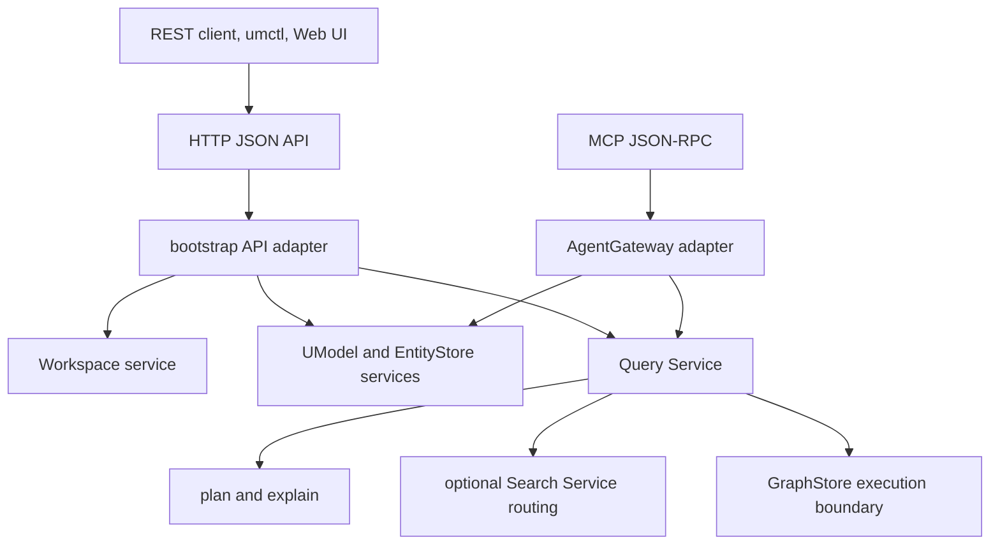
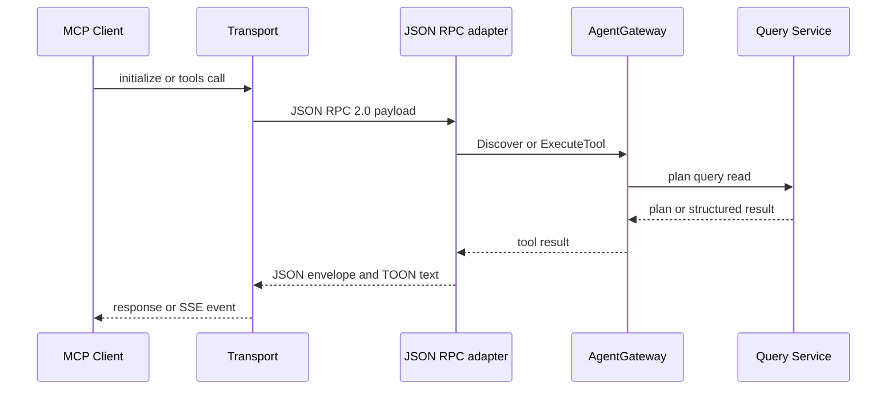

# Public REST, CLI, Web, SDK, and MCP Surfaces

本页只把声明为公共契约的文件当作集成边界：`api/openapi/openapi.yaml`、`api/mcp/tools.schema.json`、`pkg/contract`、`umctl`、Web API client 和 SDK。`internal` 中的 handler、planner 或 provider 是这些契约的实现者，不是客户端应直接依赖的 API；修改实现时，应先检查契约与适配器是否仍然一致。

## 总体边界与请求流

服务进程由 `cmd/umodel-server` 启动，构造 `bootstrap.App`，再将 HTTP 请求交给 API mux；`App` 把 `Workspace`、`UModel`、`EntityStore`、`Query`、`Search` 和 `AgentGateway` 组合起来。这样 REST、Web 和 CLI 共享同一个服务契约，而查询读取不会因为某个客户端而绕过 Query Service。



该图展示公共客户端、HTTP/MCP 适配器与服务契约之间的调用边界。

### 查询是 plan-only 公共能力

`unified-model` 的查询模式只有 `plan`：省略 `mode` 会归一化为 `plan`，其他模式会以可机器读取的迁移详情拒绝；服务不会把计划连接到真实外部存储执行。`GET /api/v1/capabilities` 也明确返回 `modes_supported: ["plan"]`、`default_mode: "plan"`，并公布 `formats_supported: ["", "agent"]`。因此调用方应把结果理解为查询结果或存储原生计划，而不是把此服务当作数据执行器；需要执行真实存储查询时，错误详情指向 `umodel-assistant`，不要在本页推导未声明的认证或多租户保证。

查询入口是：

- `POST /api/v1/query/{workspace}/execute`：统一 SPL 查询，查询体至少包含 `query`，可带 `limit`、`timeout_ms`、`time_range`、`format` 和 `parameters`。
- `POST /api/v1/query/{workspace}/explain`：返回 `source`、活动 `provider`、`pushdown`、`fallback`、算子、深度、限制和超时等解释信息。
- SPL 公共读取源以 `.umodel`、`.entity`、`.topo` 为核心，并扩展到 `.entity_set`、`.runbook_set` 及受支持的 `entity-call`/`graph-call`；不要新增实体、关系、邻居或 graph 的专用读 REST 路由。

默认 `format`（空字符串）是 assistant envelope，`format="agent"` 是 agent-native envelope；未知格式被拒绝。OpenAPI 的 `QueryExecuteResponse` 是兼容的 `code/message/success/data` 包装，其中 `data.header` 与二维 `data.data` 表示列和值。Web client 的 `normalizeQueryResult` 会把该包装转换成统一的 `{columns, rows, page}`，因此 Web 调用方不必感知两种结果形状。

## REST API：稳定 HTTP 合约

OpenAPI 3.1 文件是 REST 的规范入口，当前 server 为 `http://localhost:8080`。公共路由按职责分组：

| 能力 | HTTP surface | 说明 |
|---|---|---|
| 服务发现与健康 | `GET /`、`GET /healthz`、`GET /api/v1/capabilities` | 服务索引包含 graphstore 健康状态和常用 endpoint 提示；capabilities 专门描述查询模式/格式。 |
| Workspace | `POST/GET /api/v1/workspaces`、`GET/PUT/DELETE /api/v1/workspaces/{workspace}` | 列表支持 `page_size`、`page_token`、`include_deleted`、`include_conflicts`；metadata 暴露状态、路径和 `resource_version`。workspace path 参数受小写字母、数字、`_`、`-` 的长度模式约束。 |
| UModel | `POST .../validate`、`POST .../import`、`POST/DELETE .../elements` | 校验、从本地 YAML/JSON 文件或目录导入、批量写入和删除。 |
| EntityStore | `POST .../entities:write`、`.../entities:expire`、`.../relations:write`、`.../relations:expire` | 写入/过期使用稳定 `WriteResult`；依赖检查或批次项目失败应由 error envelope 或项目结果表达。 |
| 示例 | `POST /api/v1/samples/{workspace}/multi-domain-quickstart:import` | 一次导入 UModel、实体、关系和 topology 的 bundled quickstart。 |
| Agent | `GET .../discover`、`POST .../tools:execute`、`POST .../resources:read` | discovery 给出工具、资源和下一步 Query action；资源读取面向安全的元数据/模板。 |

所有 JSON 错误的公共形状是 `ErrorEnvelope`，其 `error` 包含 `code`、`message`、`retryable`，可选 `details`；客户端应按 code/retryable 处理，不应依赖内部 handler 的错误文本。`pkg/contract` 定义了更靠内侧但仍公开的服务抽象：`WorkspaceManager`、`UModelService`、`EntityWriteService`、`QueryService`、`SearchService` 和 `AgentGateway`，它们把 HTTP/MCP 适配器和可替换实现隔开。

## CLI：`umctl` 的适配器

`umctl` 是服务的命令行适配器，不是另一套领域读 API。根命令注册以下稳定命令族：

- `workspace create|get|list|update|delete`
- `umodel import|validate|put|delete|export`
- `entity write|expire|delete`
- `topo write|expire|delete`
- `query run|explain|examples`
- `agent discover|tool|resource`
- `sample import`、`health`、`meta export`、`configure list|show`、`version`

其中 domain reads 统一走 `query run/explain`；例如：

```bash
go run ./cmd/umctl --addr http://localhost:8080 workspace create demo '{"name":"Demo"}'
go run ./cmd/umctl --addr http://localhost:8080 query run demo ".umodel | limit 5"
go run ./cmd/umctl --addr http://localhost:8080 query explain demo ".topo | limit 10"
```

根级选项为 `--addr`、`--output/-o` 和 `--profile`。输出支持 `json`（默认）或 `text`。配置从 `~/.umctl/config.yaml` 读取；文件不存在时使用 `default` profile、地址 `http://localhost:8080` 和 JSON 输出。地址优先级是 `--addr`，其次环境变量 `UMCTL_ADDR`，最后当前 profile；`configure` 写配置目录时使用 0700，配置文件使用 0600。CLI client 只负责 JSON 编码、拼接地址、发 HTTP 并返回状态字节；路径和服务语义仍由 OpenAPI 决定。

## Web UI：同源 SPA 与 API 的边界

`web/src/api/client.ts` 是 Web 对 REST 的唯一 API client：它以 JSON 调用 workspace、UModel、EntityStore、query、sample 和 agent endpoints，并对 workspace/path 参数做 URL 编码。每次请求有 60 秒 `AbortSignal` 超时；超时转换为 `ApiError`（`code=TIMEOUT`、`retryable=true`），非 2xx 响应按 `ErrorEnvelope` 转换为 `ApiError`。UI 的 query 方法还会将 assistant envelope 归一化为表格行。

server 的 `HandlerWithUI(uiDir)` 将 `/healthz` 和 `/api/v1/` 前缀交给 API mux，其余路径交给 SPA 文件 handler；命中文件直接服务，不带扩展名的未知路径回退到 `index.html`，带扩展名的未知文件返回 404，并拒绝逃逸 `uiDir` 的本地路径。未配置 `--ui-dir` 时只提供 API。CORS 由外层 middleware 统一处理：预检 `OPTIONS` 返回 204，允许 `GET,POST,PUT,DELETE,OPTIONS`，并回显通过检查的 Origin；`UMODEL_CORS_ORIGINS` 可配置逗号分隔的精确 Origin 或 `*`，此外默认允许 `localhost` 和 loopback IP。该 CORS 规则不等同于认证策略。

## SDK：模型类型与服务 client 分层

SDK 分成两类，避免把 schema 类型和运行时服务调用混在一起：

1. **生成的模型 SDK**：`sdk/go/umodel`、`sdk/python/umodel` 和 `generated/java` 表示 `schemas/` 中的 UModel schema，提供解析、构造、元数据和类型校验能力；它们不应依赖 server 的 `internal` packages。
2. **手写的最小 Go service client**：`sdk/go/service` 封装公共 REST 调用，例如 `CreateWorkspace`、`ImportUModel`、`WriteEntities`、`Query`、`Explain` 和 `Discover`。它使用 `context.Context`、JSON body 和 HTTP status 检查，服务端错误以 client error 返回。

生成源是 `schemas/**/*.yaml` 以及新增 kind/version 时的 `schemas/manifest.yaml`。从仓库根目录执行以下流程，不要手改生成文件：

```bash
make expand
make verify
```

`make expand` 依次扩展并校验 schema，生成 Go、Python、Java model SDK，并嵌入扩展后的 schema；生成目录分别是 `sdk/go/umodel`、`sdk/python/umodel`、`generated/java`。服务 client 不由该 schema generator 生成。改变 schema 时应同时更新 examples、generated assets 和 focused tests。

## MCP：stdio、Streamable HTTP 与 legacy SSE

`cmd/umodel-mcp` 在启动时构造同一 `bootstrap.App`，检查 GraphStore health，然后把 MCP 方法映射到 `AgentGateway`。默认是 stdio：每行读取一个 JSON-RPC 请求，通知类请求不产生响应；带 id 的请求返回 JSON-RPC 2.0 response。`--workspace` 提供默认 workspace，单次请求也可在 params 中覆盖。

支持的入口参数包括 `--data`、`--graphstore`（`local.ladybug`、`memory`、`file.memory`）、`--import-root`、`--manifest`、`--transport stdio|http`、`--addr` 和 `--mcp-path`。`--transport http` 同时提供：

- **Streamable HTTP**：在 `--mcp-path`（默认 `/mcp`）上用 `POST` 传 JSON-RPC，用 `GET` 建立 `text/event-stream` 流，用 `DELETE` 接受会话终止。
- **legacy SSE**：`GET /sse` 建立 broker session，服务端以 `endpoint` 事件返回 `/messages?session=...`；客户端向 `/messages` POST，响应通过该 SSE session 推送。无有效 session 时返回 404。
- `/healthz` 是 MCP HTTP server 自己的轻量健康 endpoint，不是 REST server 的完整 service index。

HTTP MCP 校验 Origin：无 Origin 可接受，同 host 或 `localhost`/`127.0.0.1`/`::1` 可接受；不符合时返回 403。可选 `MCP-Protocol-Version` header 只接受 `2025-06-18`、`2025-03-26`、`2024-11-05`，未提供时兼容处理；`initialize` 会选择请求版本或当前版本 `2025-06-18`。MCP envelope 始终是 `application/json` JSON-RPC，tool/resource 文本是 `text/toon`；tool call 另外提供 `structuredContent`，资源内容的 `_meta` 标出原始 MIME 与 `toon` 格式。

公共 MCP schema 声明三种 transport 名称 `stdio`、`streamable-http`、`http+sse`，方法集合覆盖 `initialize`、`tools/list`、`tools/call`、resources、prompts、completion、`discovery` 等。工具集合包括 `query_spl_execute`、`query_spl_explain`、`query_spl_examples`、`umodel_validate`、`umodel_import`、`entity_write`、`entity_expire`；写工具可用 `requires_explicit_write_enable` 表达显式启用要求。资源是只读的 `overview`、`schema-index`、`query-templates`、`tool-capability-metadata`，URI 形如 `umodel://workspace/{workspace}/...`。



该时序图展示 MCP transport 如何把 JSON-RPC 调用转换为 AgentGateway，再进入 Query Service 并返回兼容文本与结构化结果。

## 修改与验证清单

当公共行为变化时，保持 `api/openapi/openapi.yaml`、`api/mcp/tools.schema.json`、`pkg/model`、`pkg/errors`、CLI、Web client 和相关 SDK/文档同步。优先运行：

```bash
make guard
make test-service
go test ./tests/contract/...
cd sdk/go && go test ./service
```

重点契约测试会检查 OpenAPI 必须暴露的 routes/schema，并禁止 domain-specific read routes；MCP schema 测试会检查 transports、JSON/TOON 格式、方法、工具默认字段和只读资源。查询侧的 format、mode、plan envelope、renderer 与搜索路由测试则验证“只规划”及响应兼容性。跨边界改动还应补 `internal/` focused test、contract/integration/e2e 或 golden coverage，而不是只测试某个内部 handler。
