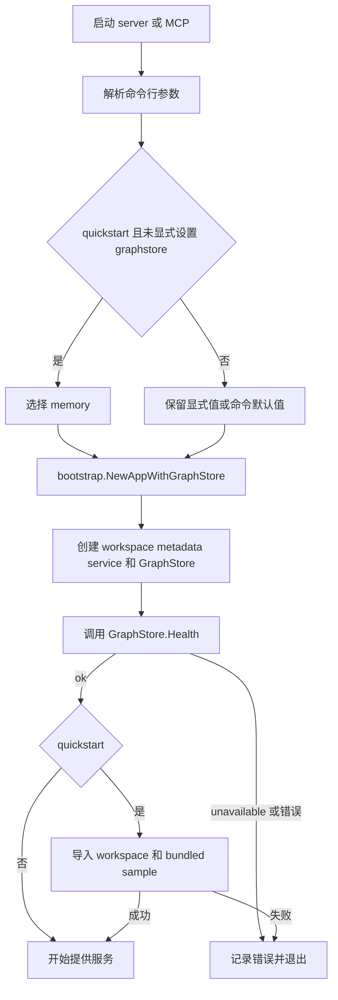

# Operations：配置、Provider、持久化与本地服务生命周期

本页描述本地运行时的实际行为。服务由 `cmd/umodel-server` 提供 HTTP API，可选地同时提供构建后的 Web UI；`cmd/umodel-mcp` 提供 stdio 或 Streamable HTTP MCP。两者都会先创建 `bootstrap.App`、检查 GraphStore 健康状态，再执行可选的 quickstart 导入，最后开始对外服务。

## 配置入口与优先级

### `Makefile` 的默认配置

根目录 `Makefile` 使用 `?=` 设置可被环境变量或命令行变量覆盖的 Make 变量；目标随后把这些变量显式传给脚本或 Go 命令。常用默认值如下：

| 变量 | 默认值 | 用途 |
|---|---|---|
| `API_ADDR` | `:8080` | server 监听地址 |
| `API_URL` | `http://localhost:8080` | 脚本访问 API 的地址及 Web dev proxy 目标 |
| `WEB_PORT` | `5173` | Vite dev server 端口 |
| `DATA_ROOT` | `data` | workspace 与 provider 数据根目录 |
| `GRAPHSTORE` | `file.memory` | `make dev` 的默认 GraphStore |
| `GO_TAGS` | 当 `GRAPHSTORE=local.ladybug` 时为 `ladybug`，否则为空 | Go build/run tags |
| `QUICKSTART` | `0` | 是否启动时导入样例 |
| `QUICKSTART_WORKSPACE` | `demo` | quickstart workspace ID |
| `QUICKSTART_SAMPLE` | `multi-domain-quickstart` | quickstart sample 包 |
| `PID_DIR` | `.run` | PID 文件及默认日志目录的根 |
| `LOG_DIR` | `$(PID_DIR)/logs` | 后台进程日志目录 |

因此，正常的 Make 覆盖方式是把变量放在命令行或环境中，例如：

```bash
GRAPHSTORE=file.memory DATA_ROOT=./data-local API_ADDR=:18080 make dev
```

`make dev` 将 Make 变量传给 `scripts/dev.sh`，再由脚本构造 `umodel-server --addr ... --data ... --graphstore ...`。如果直接调用脚本而不经过 Make，脚本还支持对应的 `UMODEL_API_ADDR`、`UMODEL_API_URL`、`UMODEL_WEB_PORT`、`UMODEL_DATA` 和 `UMODEL_GRAPHSTORE` 作为回退；同名的 `DATA_ROOT` 等直接环境变量优先于这些 `UMODEL_*` 回退值。Make 目标显式传值时，Make 的默认值也会覆盖脚本内部的 `UMODEL_*` 回退，因此要优先使用 Make 变量完成配置。

`make quickstart` 是特殊目标：它把 `GRAPHSTORE` 设为 `memory`，把 `QUICKSTART` 设为 `1`，并继承 `QUICKSTART_WORKSPACE` 与 `QUICKSTART_SAMPLE`。显式提供的 Make 命令行变量仍应视为最高优先级，例如 `GRAPHSTORE=file.memory make quickstart` 会保留显式 provider。`make deploy` 则把 provider 默认设为 `file.memory`，先执行 `build-ui`，再以 `--ui-dir web/dist` 启动生产风格 server。

### server 参数

`umodel-server` 的默认参数为：

```text
--addr :8080
--data data
--graphstore local.ladybug
--ui-dir ""
--quickstart false
--quickstart-workspace demo
--quickstart-sample multi-domain-quickstart
--import-root ""
```

这里的命令行默认 provider 来自 `graphstore.DefaultProviderType`，它是 `local.ladybug`，与 Make 的 `GRAPHSTORE=file.memory`、Docker 的 `file.memory` 默认值不同。也就是说，直接运行：

```bash
go run ./cmd/umodel-server
```

并不会采用 `make dev` 的 provider；无 Ladybug build 时会在健康检查阶段失败。对于本地开发，应明确使用：

```bash
go run ./cmd/umodel-server --addr :8080 --data data --graphstore file.memory
```

`--ui-dir` 非空时将静态 UI 与 API 合并到同一个 HTTP handler；不传则只提供 API。`--import-root` 限制 API 发起的 UModel 文件导入，空值默认限制在当前工作目录，传 `/` 才允许任意路径；内置 bundled sample 不受此限制。

### MCP 参数与 quickstart 覆盖规则

`umodel-mcp` 默认值为 `--workspace demo`、`--data .umodel-data`、`--graphstore local.ladybug`、`--transport stdio`、`--addr 127.0.0.1:8090` 和 `--mcp-path /mcp`，另有与 server 相同的 quickstart、sample 与 `--import-root` 参数。`--manifest` 只输出工具/资源 manifest 后退出。

quickstart 有一条专门的自动选择规则：**仅当 `--quickstart` 开启且用户没有显式写 `--graphstore` 时，server 和 MCP 都把 provider 改为 `memory`**。因此默认的 quickstart 不会因本机没有 Ladybug 而失败；但以下命令显式指定了 provider，规则不会覆盖它：

```bash
go run ./cmd/umodel-server --quickstart --graphstore file.memory --data data
# MCP 示例
 go run ./cmd/umodel-mcp --quickstart --graphstore memory --transport stdio
```

MCP 的 quickstart 在未显式指定 `--workspace` 时还会把默认请求 workspace 改为 `--quickstart-workspace`；显式 `--workspace` 则优先。quickstart 导入发生在 manifest 输出或 MCP transport 启动之前，导入失败会终止进程。

## Provider 选择、构建与就绪状态

GraphStore 通过 `ProviderConfig{Type, DataRoot, Options}` 进入注册表；目前内置 `memory`、`file.memory` 和 `local.ladybug`。空 provider 回退到 `DefaultProviderType`。provider 工厂是在包初始化时注册的，因此新增 provider 的扩展点是实现 `contract.GraphStore` 并调用 `graphstore.RegisterProvider`，而不是让业务服务依赖具体实现。



该图展示两个入口在开始 HTTP/MCP 服务前共同遵循的 provider readiness 与 quickstart 顺序。

- `memory` 只存在于进程内，健康状态为 `ok`，适合 quickstart、MCP 和演示。
- `file.memory` 是带 JSON 快照的内存实现，健康状态为 `ok`，适合无需 Ladybug runtime 的本地开发和 Docker/Compose。
- `local.ladybug` 在 `//go:build ladybug` 版本中使用 Ladybug 数据库；其真实 `Health` 返回 `ok`。无 `ladybug` build tag 时仍注册一个 stub，但健康状态是 `unavailable`，所有实际操作返回 provider unavailable。启动入口检查到这一状态后会退出，并提示使用 `-tags ladybug` 或 `--graphstore file.memory`。

Make 会在 `GRAPHSTORE=local.ladybug` 且未另行指定 `GO_TAGS` 时自动设 `GO_TAGS=ladybug`，开发脚本也有同样的回退；`GO_TAGS` 非空时脚本按其原值构建。Ladybug 版本依赖 CGO 的 `go-ladybug` binding，并且运行时必须能找到 `liblbug`（通常需要同时满足链接时 `LIBRARY_PATH` 与运行时 `LD_LIBRARY_PATH`）。可选测试只有在 `UMODEL_TEST_LADYBUG=1` 且提供 `liblbug` 时才运行：

```bash
UMODEL_TEST_LADYBUG=1 make test-ladybug
```

开源 Dockerfile 和 Compose 明确构建/运行 `file.memory`，不带 Ladybug build tag，也不需要 `liblbug`。只有确实准备好 Ladybug-enabled build 和 runtime 时，才应在本地选择 `local.ladybug`。

## 持久化边界与恢复

### workspace metadata 与 graph state 是两条边界

`workspace.Service` 管理 workspace 的身份和 metadata（名称、描述、labels、config、状态、版本、时间戳和 `Paths`），不是模型、entity、relation 或 topology 数据库。选择 `file.memory` 或 `local.ladybug` 时，bootstrap 使用持久化 workspace service；`memory` 则使用进程内 metadata service。持久化 metadata 位于：

```text
DATA_ROOT/workspaces.json
```

写入使用 `*.tmp` 后 rename 的方式替换目标文件。读取时要求 state version 为 `1`；文件损坏或不支持的版本会使应用创建失败。创建、更新、删除 metadata 在持久化失败时回滚内存中的变更。删除 workspace 是 tombstone，不会被目录恢复逻辑重新变成 active。

`file.memory` 的 graph state 与 metadata 分开保存，默认布局为：

```text
DATA_ROOT/
├── workspaces.json
└── graphstore/
    └── file-memory/
        ├── workspaces/
        │   └── WORKSPACE_ID/
        │       ├── umodels.json
        │       ├── entities.json
        │       └── relations.json
        └── file-memory.json          # legacy 单文件位置
```

每个 collection 是 version `1` 的 JSON 对象，写入同样先写 `.tmp` 再 rename。打开 workspace、建 schema、写入或删除 UModel、写入 entities 和 relations 后，`FileMemoryStore` 都在持久化锁内把该 workspace 的完整快照写回；因此进程重启后可以恢复这些 graph state。也可通过 `ProviderConfig.Options["path"]` 指定自定义路径：带 `.json` 时它是 legacy 文件名并以去掉后缀的路径作为目录，否则该值是目录且 legacy 文件名为其加 `.json`。

### 目录优先、legacy 迁移

启动 file.memory 时先扫描 `graphstore/file-memory/workspaces/` 下的 workspace 子目录，再尝试旧的 `graphstore/file-memory.json`。只要目录中加载到至少一个 workspace，就不会用 legacy 文件覆盖它；目录中的 `umodels.json`、`entities.json`、`relations.json` 缺失项按空集合处理。若目录没有可加载状态而 legacy 文件存在且 version 为 `0` 或 `1`，服务会读取它，并立即把内容迁移写成按 workspace 分目录的三个 JSON 文件。JSON 解码错误或不支持的版本会阻止启动，而不是静默丢弃数据。

持久化 workspace service 也会从 provider 的物理目录恢复缺失 metadata：file.memory 扫描 `DATA_ROOT/graphstore/file-memory/workspaces/WORKSPACE_ID`，Ladybug 扫描 `DATA_ROOT/instances/WORKSPACE_ID/storage/graph/local/ladybug`。仅当 `workspaces.json` 中没有该 ID 时才创建默认 active metadata（名称为 ID、resource version 为 `1`），随后补写 metadata 文件；已有 deleted 或 conflicted 记录不会被目录“复活”。workspace ID 仍必须满足小写字母/数字开头和结尾、长度限制以及中间仅允许小写字母、数字、`_`、`-` 的规则。

Ladybug 的默认数据库路径是：

```text
DATA_ROOT/instances/WORKSPACE_ID/storage/graph/local/ladybug
```

打开 workspace 时 provider 创建目录、打开 Ladybug database/connection，并确保 `umodel_node`、`entity` 和 `topo` schema 存在。Ladybug 的数据库句柄和连接在 provider 的 workspace handle 中维护；应用退出时应让进程结束释放它们。不要把 Ladybug 的目录当作 file.memory JSON 目录，也不要在 provider 之间直接复制其内部文件。

### 易混淆的持久化预期

- `memory` 的 GraphStore 和 workspace metadata 都随进程消失；`DATA_ROOT` 不会把它变成持久化 provider。
- `file.memory` 持久化 graph state 以及 metadata，但 search provider 仍由 bootstrap 固定为 memory，因此重启后搜索索引需要由相应导入/写入流程重新建立，不能把 search 内存索引当作持久化事实来源。
- Docker/Compose 的数据是否保留取决于 `/data` volume。Compose 使用 `umodel-data:/data`；`docker compose ... down -v` 会删除 volume，从而删除 `/data/workspaces.json` 和 file.memory graph state。

## HTTP、UI、健康检查与 CORS

### API 和 UI

`HandlerWithUI(uiDir)` 把 `/healthz` 与 `/api/v1/` 路径交给 API mux，其余路径交给 SPA handler。根路径 `/` 返回服务状态与 graphstore 信息（只在没有 UI 时由 API mux处理）；配置 UI 后，实际文件直接服务，无扩展名的未知路径回退到 `index.html`，带扩展名的未知文件返回 404，并拒绝逃逸 `uiDir` 的路径。`--ui-dir` 为空时只提供 API。

开发模式由 Vite 在 `0.0.0.0:${WEB_PORT}` 提供 UI，并将 `UMODEL_API_TARGET=${API_URL}` 作为 API target；生产/部署模式则把 `web/dist` 传给 server，由 server 在 API 同端口服务 UI。开发脚本要求 Node.js 22+；优先使用配置的 `PNPM`，找不到默认 `pnpm` 时依次尝试 Corepack 或 `npm exec` 获取 package 中声明的 pnpm 版本。依赖安装和 Vite/API 启动日志分别写入 `dev-web.log` 与 `dev-api.log`。

### 健康检查

启动脚本最多轮询 60 次、每次间隔 0.5 秒访问 `${API_URL}/healthz`。server/MCP 在监听前已经直接调用 GraphStore.Health；所以 `/healthz` 的成功不仅表示 HTTP handler 可达，也包含 provider health payload。provider 返回错误或 `status=unavailable` 时入口直接退出，脚本会报告 API 在成为 healthy 前退出，并打印日志尾部。

常用检查：

```bash
curl -fsS http://localhost:8080/healthz
make status
```

`make status` 展示当前 `GRAPHSTORE`、`DATA_ROOT`、PID/log 目录、三个受 Make 管理的 PID 文件、端口监听者、API `/healthz` 响应以及 `http://localhost:${WEB_PORT}` 的可达性。没有 `lsof` 时端口 PID 显示为 `unknown`，不会替代 API health 检查。

### CORS

外层 middleware 对 API 和 UI 统一处理 CORS。只有 `Origin` 是允许值时才回显 `Access-Control-Allow-Origin`；允许的方法为 `GET,POST,PUT,DELETE,OPTIONS`，预检 `OPTIONS` 返回 `204`，并回显请求 headers（无请求值时为 `Content-Type, Authorization`）。`UMODEL_CORS_ORIGINS` 是逗号分隔的精确 Origin 列表，也可写 `*`；即使未配置，它仍默认允许 `localhost` 和 loopback IP 的 `http`/`https` Origin。该规则只是跨域响应策略，不是认证或授权策略。

## 启停、日志与失败处理

### 开发模式

```bash
make dev
# 或：GRAPHSTORE=file.memory DATA_ROOT=data-local API_ADDR=:18080 make dev
```

`scripts/dev.sh` 先检查 Node、解析 API/Web 端口、拒绝已占用端口和仍在运行的 PID 文件，然后安装 Web 依赖，构建 `umodel-server` 到 `.run/bin/umodel-server`，后台启动 API，等待 `/healthz` 成功后再启动 Vite，并等待 Web 可达。默认后台文件为：

```text
.run/openumodel-dev-api.pid
.run/openumodel-dev-web.pid
.run/logs/dev-api.log
.run/logs/dev-web.log
```

API 未健康或 Web 未可达时脚本清理已启动的进程、端口监听者和 PID 文件；排查时先查看相应日志尾部。

### 生产风格本地部署与容器

```bash
make build-ui
make deploy
# Docker Compose
 docker compose -f deployments/compose/docker-compose.yaml up --build
```

`make deploy` 要求 `web/dist` 已存在，检查 API 端口后以 `go run` 启动带 `--ui-dir web/dist` 的 server，日志为 `.run/logs/deploy.log`，PID 为 `.run/openumodel-deploy.pid`，并等待 `/healthz`。Compose/Docker 默认映射 `8080:8080`、把 `/data` 挂到持久化 volume，并显式使用 `--graphstore file.memory`。

### 停止

```bash
make stop-dev
make stop-deploy
make stop-all
# 只预览动作
DRY_RUN=1 make stop-all
# 确需处理配置端口上的非本仓库进程时
FORCE=1 make stop-all
```

`stop-dev` 停开发 API 和 Web，`stop-deploy` 停部署 server，`stop-all` 处理三者。脚本先读取 PID 文件，再检查配置端口上的监听者；默认只停止工作目录在本仓库且命令看起来像本仓库进程的 listener，避免误杀其他服务。普通停止先发送 `SIGTERM`，等待端口释放，仍未释放时对匹配进程使用 `SIGKILL`；`FORCE=1` 才跳过进程身份检查。`DRY_RUN=1` 只打印而不删除 PID 或发送信号。

## 相关测试与变更验证

涉及本页行为的重点验证不是单纯编译，而是端到端边界：

- `internal/graphstore/file_memory_test.go` 验证 file.memory 关闭/重开后 UModel、entity、relation 可恢复，删除也会持久化，并验证 legacy 单文件迁移。
- `internal/bootstrap/workspace_persistence_test.go` 与 `internal/workspace/service_test.go` 验证 metadata 持久化、从 file.memory/Ladybug provider 目录恢复，以及 deleted workspace 不被复活。
- `cmd/umodel-server/main_test.go`、`cmd/umodel-mcp/main_test.go` 验证 quickstart 默认使用 memory、导入后可查询；`*_no_ladybug_test.go` 验证无 tag 时默认 Ladybug 的 unavailable 指引。
- `internal/graphstore/provider/ladybug/provider_ladybug_test.go`、`tests/contract/graphstore_contract_test.go` 和可选 E2E 验证真实 provider；需要 `liblbug` 时运行 `UMODEL_TEST_LADYBUG=1 make test-ladybug`。
- 服务与脚本整体改动可用 `make test-service`、`make test-quickstart-health`、`make test-ui` 和 `make ci` 检查；部署后至少用 `curl http://localhost:8080/healthz` 验证实际 provider readiness。
