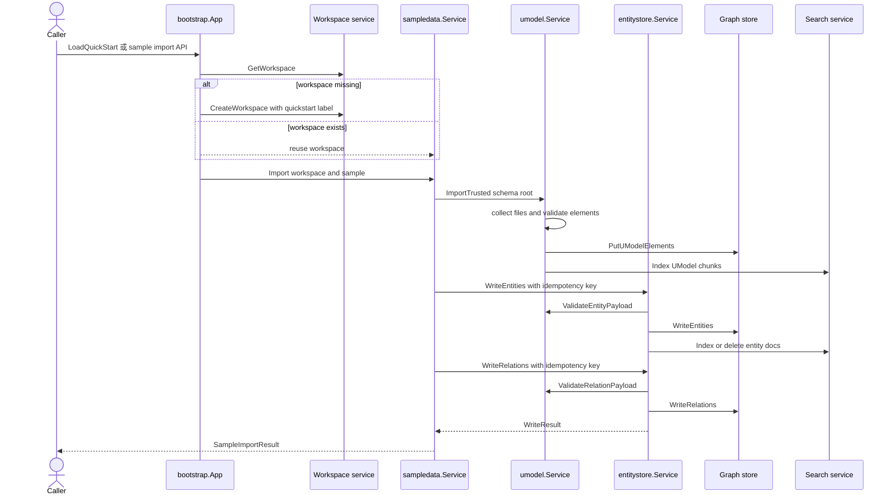

# 工作流：导入模型并写入运行时数据

本页描述两条经常一起发生的写入路径：一条是 `LoadQuickStart` 或 `/api/v1/samples/{workspace}/{sample}:import` 把仓库内示例 schema、entities、relations 装入某个 workspace；另一条是公开 API 直接对 `/api/v1/umodel/{workspace}/import`、`/api/v1/umodel/{workspace}/elements`、`/api/v1/entitystore/{workspace}/entities:write` 和 `/api/v1/entitystore/{workspace}/relations:write` 做模型或运行时数据变更。它们最终都会落到同一个 UModel service、entitystore service、graph store 和 search service 组合上。

## 入口与组件边界

`bootstrap.NewAppWithGraphStore` 组装运行时依赖：workspace service 管理 workspace 元数据，graph provider 持有 UModel、entity、relation 数据，memory search provider 作为搜索索引，`umodel.Service` 连接 graph 和 search，`entitystore.Service` 连接 graph、UModel schema resolver 和 search，`sampledata.Service` 复用 UModel 与 entitystore，query 与 agent gateway 再复用这些服务。也就是说，样例导入和 API 写入不是两套独立实现，而是共享同一个校验、持久化和索引路径。

HTTP 层只做路径解析、JSON 解码和动作分发：`handleUModel` 将 `import`、`validate`、`elements` 和 `DELETE elements` 分别转给 UModel service；`handleEntityStore` 将 `entities:write`、`entities:expire`、`relations:write`、`relations:expire` 转给 entitystore service；`handleSamples` 把 `sample:import` 转给 sampledata service。workspace 的创建、更新、列表和删除在 `/api/v1/workspaces` 与 `/api/v1/workspaces/{id}` 处理。

## 代表性 quickstart 导入流程

`LoadQuickStart` 是最完整的代表路径。它先把空参数归一为默认 workspace `demo`、名称 `Demo`、描述和样例 `multi-domain-quickstart`。然后它读取 workspace；如果 workspace 不存在就创建带 `umodel.io/quickstart=true` label 的 workspace；如果读取失败不是 not found，或者创建失败不是 conflict，则立即返回错误。最后它调用 `Samples.Import` 导入样例。

上图展示 quickstart 或 sample import 如何复用同一套 UModel、entitystore、graph store 和 search side effects。

`sampledata.Service` 维护内置样例目录表，`multi-domain-quickstart` 指向 `examples/quickstart-multidomain`，并支持别名 `quickstart-multidomain`、`quickstart`。导入时它先把 schema root、entity JSON 和 relation JSON 解析为仓库路径；内置包通过 `ImportTrusted` 绕过 API import root 约束，因为路径来自受信任的仓库定义而不是用户输入。schema 成功后，它读取 `sample-data/entities.json` 并用 `def.Name + ":entities:v1"` 作为幂等键写实体；再读取 `sample-data/relations.json` 并用 `def.Name + ":relations:v1"` 写关系。如果实体或关系写入返回失败 item，即使 service 调用本身没有 error，sampledata 也会把结果包装成 `CodeValidationFailed`，避免“样例导入成功但数据不完整”的假象。

## API UModel 导入与元素写入

公开 `/api/v1/umodel/{workspace}/import` 使用 `UModel.Import`，它把调用者给出的 `path` 限制在 `WithImportRoot` 配置的根目录内；默认根是服务当前工作目录，传入 `/` 等同允许任意路径。实现会先解析并校验顶层路径，然后在目录遍历之后对每个匹配文件再次做 symlink-resolved containment 检查，防止目录内部 symlink 指向 import root 外部。相反，内置样例只通过 `ImportTrusted` 进入，它跳过 confinement，代码注释明确要求它不能接收用户输入。

导入器接受单个 `.yaml`、`.yml`、`.json` 文件或目录。目录导入会跳过隐藏目录以及 `node_modules`、`vendor`、`target`、`dist`、`build`、`sample-data`、`deploy` 等目录，只收集扩展名匹配的文件并统计其他文件为 `Skipped`。每个文件解析成 `UModelElement`：`kind` 来自顶层，`name`/`domain` 优先来自 `metadata`，`version` 来自 `schema.version`；如果 `domain` 为空，会从包含点号的 `name` 前缀推断。缺少 kind、domain 或 name 会使该文件以 `CodeValidationFailed` 结束。

`PutElements` 是 UModel 持久化的不变量门：它要求 workspace 非空，先运行 `Validate`，再调用 graph store `PutUModelElements`。`Validate` 至少要求每个元素有 kind、domain、name，并把 `schemaspec.DefaultValidator()` 的 errors 和 warnings 映射为 `ValidationResult`；任何 validation error 都会阻止写入并返回 `CodeValidationFailed`。graph 写入成功后，service 更新自己的 schema index，把 validator warnings 附加到 `WriteResult.Warnings`，并在配置了 search indexer 时写入 UModel search chunks；search 写入失败不会回滚 graph 写入，而是作为 `Field: "search_index"` warning 返回。

memory graph store 对 UModel 使用 workspace 内 `UModelElementKey` 作为 map key。重复导入同一元素会覆盖同一个 key，并仍返回 accepted item；集成测试也断言重复 import 后 snapshot 中只保留一个元素。这使 UModel 包导入对重复执行天然接近幂等，但它不是依赖显式 idempotency cache。

## 实体与关系写入路径

实体和关系 API 写入都先在 HTTP 层解码 batch，然后调用 entitystore service。service 会把路径中的 workspace 写回 batch，并在存在 `IdempotencyKey` 时先查缓存：缓存 key 是 `workspace + "\x00" + idempotencyKey`，实体和关系分别维护独立 map，命中时返回 clone 后的旧 `WriteResult`，不再重新校验、写 graph 或更新 search。

未命中缓存时，entitystore 逐 item 调用 UModel service 暴露的 resolver：实体必须包含 `__domain__`、`__entity_type__`、`__entity_id__`、`__method__`、`__first_observed_time__`、`__last_observed_time__`，且 entity id 必须是 128-bit lowercase hex，method 只能是 `Create`、`Update`、`Expire`、`Delete`；关系额外要求 source、dest、`__relation_type__` 等 CMS 2.0 字段，并校验两端 entity id 和 method。校验失败时，`PartialSuccess=false` 直接返回 `CodeValidationFailed`，不会写入任何已收集的 valid item；`PartialSuccess=true` 则把该 item 放入 failed 列表，并继续写入其他 valid item。

valid item 会被批量送入 graph store。graph store 返回 error 是硬失败：entitystore 立即返回 error，不合并 partial item，也不会记录幂等缓存。graph store 返回的是 item-level failure 时，例如 duplicate `Create` 或 missing target 的 `Delete`/`Expire`，这些 failures 会进入 `WriteResult`；如果调用者没有允许 partial success，service 会以 `CodePartialFailed` 返回 result 和 error。只有完成这些步骤后，service 才把最终 `WriteResult` 记录到幂等缓存。

memory graph store 的生命周期规则定义了查询可见性：`Create` 在未删除记录已存在时返回 `CodeAlreadyExists`，否则写入并设置 `__deleted__=false`；`Update` 或其他默认方法会覆盖 payload，但如果旧记录有 `__first_observed_time__` 就保留首次观测时间；`Expire` 和 `Delete` 都要求已有记录，随后把旧记录克隆并通过 `applyLifecycle` 写入新 method、`__deleted__=true`、last observed time 和 keep alive。查询层对当前视图隐藏 `__deleted__` 记录；带 `TimeRange` 的历史查询可以看到 `Expire` 后的记录，但 `Delete` 方法始终被过滤掉。

## 搜索索引副作用与非致命 warning

UModel 与 entity 写入都在 graph 写入成功之后再处理 search。UModel 元素写入调用 `search.Index`；删除 UModel 元素时只对 accepted item 删除 `umodel/{id}` 文档，并对 `runbook_set` 的分 section 文档也构造 delete doc id。实体写入会把非删除 payload 转成 `DocID: "entity/" + stableKey` 的 chunk，chunk text 包含 domain、entity type、entity id、method 和完整 payload；如果 payload method 是 `Expire` 或 `Delete`，则改为删除对应实体文档。实体 expire API 也会在 graph 写入 accepted 后删除 `entity/{stableKey}` 文档。

这些 search 操作都遵循“非致命索引失败”语义：`Index` 或 `DeleteByDocID` 报错时，已经完成的 graph mutation 不会回滚，`WriteResult.Warnings` 增加 `Field: "search_index"` 和错误原因。调用方必须区分这种 warning 与 validation failure、graph-store error 或 item-level partial failure。

## 过期、删除和 TTL

`entities:expire` 和 `relations:expire` 接受 stable key 列表，而不是完整 payload。实体 stable key 必须是 `domain/entity_type/entity_id` 三段，关系 stable key 必须是 `src_domain/src_entity_type/src_entity_id/relation_type/dest_domain/dest_entity_type/dest_entity_id` 七段，并且两端 id 仍需满足 128-bit lowercase hex。无法解析的 id 会产生 `CodeValidationFailed` item；可解析 id 被转换为 `__method__="Expire"`、`__first_observed_time__=0`、`__last_observed_time__=now` 的 payload，并用 `PartialSuccess=true` 写入 graph。实体 expire 还会删除 search 文档；关系没有对应 search 删除副作用。

`RunTTL` 目前只是保留入口：workspace 为空返回 `CodeInvalidArgument`，否则返回空 `WriteResult` 且不扫描或改变数据。测试明确覆盖“没有过期数据时不变更”，因此不要把它当作已经实现的后台 TTL sweep。

## 失败语义速查

| 场景 | 返回形态 | 是否持久化 | 是否更新 search |
| --- | --- | --- | --- |
| UModel schema validation error | `CodeValidationFailed` error | 否 | 否 |
| entity 或 relation payload validation，`PartialSuccess=false` | `CodeValidationFailed` error | 否 | 否 |
| entity 或 relation payload validation，`PartialSuccess=true` | `WriteResult.Failed` item | 其他 valid item 会继续 | valid entity item 成功后才处理 |
| graph store 方法返回 error | error | 取决于 graph store 实现，但 service 不缓存结果 | 否 |
| graph store item-level failure 且 `PartialSuccess=false` | result 加 `CodePartialFailed` error | accepted item 已由 graph store 写入 | entity accepted payload 已触发 search 处理 |
| 幂等缓存命中 | clone 后的旧 `WriteResult` | 不重复写入 | 不重复处理 |
| search index 或 delete 失败 | `WriteResult.Warnings` 中 `search_index` | graph 写入保留 | 失败的 search 操作不回滚 |
| sample import 的 entity 或 relation item failure | `CodeValidationFailed` error，包含 accepted 和 failed 详情 | 已完成的前序阶段保留 | 已成功阶段的 search 副作用保留 |

## 关键测试覆盖

- `tests/e2e/business_flow_test.go` 通过 REST 创建 workspace、校验和写入 UModel、导入 quickstart schemas、写实体和关系、验证 update 保留 first observed time、验证 expire 与 delete 的当前和历史查询可见性，并覆盖 agent 资源不泄露运行时行数据。
- `internal/bootstrap/quickstart_test.go` 验证 `LoadQuickStart` 会创建默认 workspace、导入模型和拓扑数据，并且导入后的 entity 与 UModel 可以通过关键字或向量搜索查询；它还验证已有 file-memory workspace 上再次运行 quickstart 不会失败。
- `internal/umodel/import_test.go` 覆盖 UModel validation、单文件导入后 schema index 重建、重复导入覆盖同一元素、目录导入的 JSON/YAML 与 skipped 计数、无效 source 的稳定错误，以及 common schema pack loader hook 未接线时返回 `CodeNotImplemented`。
- `internal/entitystore/service_test.go` 覆盖 CMS 2.0 必填字段与 id 校验、partial success 与 idempotency cache、duplicate create 的 item failure、entity/relation 的 CRUD 查询可见性、stable key expire 的解析失败，以及当前 TTL 入口不变更数据。
- `tests/integration/umodel_import_query_test.go` 用真实 quickstart example 目录验证导入数量、按 kind/domain/name 查询 UModel，以及按 spec 文本查询导入内容。
